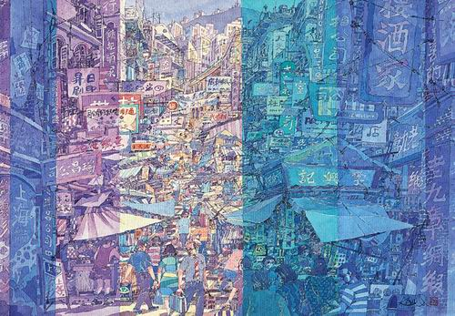

# 香港片段（四）

耳畔萦绕着梁朝伟的《最后一支舞》，刚看了《2046》的缘故，又翻出他的CD来听。在我的概念里梁朝伟的歌声具有香港这个地方的气质，悠悠然荡漾着历史沉淀的味道。如行走在香港拥挤狭窄的人行道上，霓虹摇曳影射着每个人内心的情绪...深邃或散漫...

在香港期间，喜欢上乘双层巴士乘地铁的感觉。很多人都说现在的上海和香港差不多，甚至有些地方超过香港。然而，上海的地铁和巴士却让我缺乏热情，许是大陆大城市千篇一律的风景，许是周围那些毫不顾忌距离感的人？许是那些积极、你争我抢的面孔？总之，香港的竞争状态都很好地隐藏于表象良好的秩序中，在这样的秩序里能安然的观察香港人感受这个城市，这亦是旅行的过程吧？

香港人是守规矩的。

香港有一个半山自动电梯在兰桂房附近。几乎所有的行人都站在人行电梯的右边，左边空着让赶路的人行走。地铁、商场的人行电梯上也是这种状况，欧洲一些城市也有这种现象，那么入乡随俗我也自觉地去遵守这不成文的规矩。途中经过石板街，石皮铺砌，人们习惯叫它做“石板街”。1858年，港府将这条街道取名为“砵甸乍街”，以表彰砵甸乍爵士为英国所建立的公勋。在港时杜琪峰导演的[《**龙凤斗**》](http://ent.qq.com/zt/2004/xinpian/lfd.htm)正在电影院热播，大街小巷常能看见这部电影的宣传画报，因剧情需要，刘德华在片中成了郑秀文的摄影师，为郑秀文在中环石板街拍照留念。这段剧情讲述两人尝试寻回昔日情时，途经中环石板街一个贩卖古灵精怪饰物的摊子......

另外一个细节是在双层巴士上，有些客人会先上车，等大家各就各位后再走到门口去把零钱丢进司机身边的箱子。换做在南京，司机早就吆喝起来了，吆喝的原因嘛自然是不信任。不信任是怎么产生的呢？应该与彼此的素质有关吧？在香港我倒没看见司机吆喝，也没见客人不付钱不刷卡溜掉的情形。那些巴士和出租车的玻璃，请观察一下......非常干净，再看看我们身边的巴士和出租车的玻璃...这是人的素质问题？还是管理问题？

不得不提到的是行人过马路。去了欧洲东南亚的一些城市，观察那里的行人基本上都能遵守红灯停绿灯行的交通规则。我们中国也有同样的交通法规，然而真正规则的履行与遵守则体现在我们每个人的社会公德和素质中。当你有了车之后，口粗现象在开车的初始阶段表现由为很激烈。瞅着空子窜过马路的行人，瞅着机会在汽车间穿插的自行车，只要有那么点缝隙，总能见着我行我素的牛人横在车前面。曾经和一个出租车司机讨论过闯红灯的话题，那个司机说：“红灯的时候人家都走了，你一个人等在那里，后面的车要催，还会被人笑骂‘傻瓜呆子’......”难道我们的那份自觉自率行为是为了表现给别人看的吗？很多人谈论到这个问题总会自嘲的说：“我们中国人多啊，不抢就没机会......”正因为人多，大家就更该守秩序，难道不是吗？

这里列举一些我平时不得不让你无法忽略场景：  
1、早晨等出租车的路边，一男骑自行车带着一女，那女孩还是坐车前的大杠上，那是一副多么浪漫的图画啊。突然那个女孩把装早餐用的纸袋很优美的抛在路上。我当时浑身直起鸡皮疙瘩；

2、车在红灯前停下来，望见前面桑塔娜里的司机正把车上烟灰缸里的杂物往窗外倒；

3、乘火车回到南京，出火车站扑面而来满头满脸的灰尘、满空气里充斥着一股混杂的老油味，据说南京火车站建造四年了，难道我们的生命和精力都消耗在缓慢的效率里了？这个效率当然也时常体现在与官方打交道的过程中，一个小时可以完成的事情，有时需要一个月六个月甚至更多，部门间你推我搡，让我们这些急着办事的人等到头发都白了却仍然困惑彷徨。我们公司的客人“笑”谈国庆节的南京火车站和汽车站好象逃难的场景，大家无语。效率、效率、缓慢的效率......

4、某农村一些妇女和孩子在往牛的胃里灌水，记者问：“你知道你们在做什么吗？”天真的和孩子和纤弱的妇女们洋溢着笑脸回答到：“我们在灌金子...”这些妇孺的话让我不寒而栗。据说一些西方国家不倾向进口中国的牛羊猪肉，他们认为我们这里屠宰的方式太不人道，会使那些牲畜在临死前产生一种有毒素，吃了后对人体健康不利；

5、我友从深圳回香港等轮渡，等了两个小时也没上了船票上那班时间的渡船，好不容易船到了，工作人员根本无视排队的散客，要旅行团先上。我友挡在前面问到：“为什么要他们先上？”工作人员回答：“他们是旅行团啊。”我友答：“那不是理由，我排队在前必须让我们先行。”工作人员见状只好按照秩序放行。到了香港只5分钟船上客员顺利通过。我又开始浑身发凉，往下坠的感觉。这些制订规则的人，却自己首先打乱规则的执行。  
...... ......

因为难过我不想再继续写这个话题，那些抛垃圾、倒烟灰、不守交通规则、无视社会公德、缓慢工作效率和笑嘻嘻“灌金子”的妇孺有何区别？我一个同学大学时，国外的亲戚让其好好学习英语将来出国。其坚定得回答：“因为爱国，所以我不学英语。”此时其正在海外努力学习......

   
    
**—石板街/半山人行电梯**

    
**—等候红灯的行人/夜晚石板街附近**

 —巴士司机。图左边的小盒子是八达通刷卡机，中间是投币箱。

   
   
   
 —陈球安 香港中环石板街

  —放松点，小贝/站在姚明面前岂不是自取其辱？

 —香港也是一个很重要的海港码头

   

---

## 评论（10）

**[murj](http://nic-nac-project.de/~murj/blog/)** · 2004-10-12

有同感。我们不守秩序，有人还加以利用来赚钱。比如某车站那些可以让你提前进站上车的服务，这可是官方服务.

**carine** · 2004-10-13

呵呵，现在已经有感觉了。国内时候，总埋怨身边的种种现象，可一但出去，每当别人说到中国什么的情况下，又会非常生气地而为祖国争辩

**lezhi** · 2004-10-13

的确，如carine所说，在国外才能更深刻的体会什么叫做爱国。  
祖国的确有诸多的缺点，污垢。但有时想想，也是有他无可奈何的原因的。当然我们不能因为这样那样的原因就无视他，就不去进步。我们要给时间让他慢慢进步，对吗？俗话说“子不嫌母丑，儿不嫌家贫”。  
前两天我也和老公说起来，国内的制度根本不执行，是虚的。这的确是个影响发展的问题。  
  
还有，国外其实也有一些不守公德的人，不一定都是中国人。有些什么越南，缅甸人的坏行为，都被加诸到中国人的身上（因为仅从外貌外国人分不出）。也有他们本国人。  
  
也许是基数小，所以同样比例算下来，坏习惯，坏行为的中国人的数字就很大，很显眼

**christina** · 2004-10-13

我们需要的是有效率的管理和每个人的素质、道德教育。

**lezhi** · 2004-10-13

是的， 我们需要的是有效率的管理和每个人的素质、道德教育。  
  
可是要怎么去实现呢？很多时候，知道问题是什么，却很难找到解决的办法。  
  
其实，说起素质和道德，我想起日本人。我在日本碰到的日本人看起来都很有教养，彬彬有礼，整个社会也井井有序，我也许该承认他们的素质高；可是他们的内心是否变态，卑鄙我就无从知道了，只是当我看到那么多淫秽色情书刊漫画（playboy是好看的不是淫秽，但是日本的那些明显没有欣赏性，没有美感）堂而皇之的摆在7-Eleven和其他的便利店，书店时，我想呕吐。对于女人在那里的卑下地位，我无语。也许是我不懂，也许是他们的文化，可是我很疑惑：到底什么是所谓的”素质，道德“？这简直比“鸡生蛋蛋生鸡”还要难。so confused!  
  
sorry 在这里说了这么多闲话。如果不合适，christina, 请删除。

**christina** · 2004-10-13

日本人身上存在着极致的两极：天使和魔鬼、唯美和极其龌龊的...

**lezhi** · 2004-10-13

christina 说得有道理. 我有点懂了。 :P   
  
christina 经常说很短的话，有很深的道理。这样很好。简洁有力。pf一下

**[onair](http://www.chinaeiga.com)** · 2004-10-15

我不想为日本人辩护。只是我想说的是，当别人指出我们的缺点或者不足，批判我们缺乏社会公德意识，如果我们的第一反应便是回人家一句，“别看你衣冠楚楚彬彬有礼，说不定你背地里比我更肮脏更龌龊呢”的话，那么我们也许对自己的境遇会永远心安理得，尽管国内的7-Eleven不允许摆放淫秽色情书刊漫画，但在灯红酒绿的背后呢？如今的中国在某种程度上已经相当地人欲横流，世风日下，很难在道德和精神世界的领域里，笑傲江湖，鄙视匪夷了。怀念往日时光，但已经一去而不复返了。。。

**红叶** · 2004-10-21

闲逛到此，随便说说，我曾经看过一篇文章好象标题是眯起眼睛看日本人其中一句是卑躬屈膝的后面是一副狰狞的面孔，同为东方人，日本这个民族是与我们不同．希望生活在日本这个国度的中国人别要被同化！

**anmu** · 2005-07-21

hehe, 偶去年去香港的時候也在鏞記吃的飛天燒鵝，好讚啊！  
大家去過的很多地方一樣的呢！

