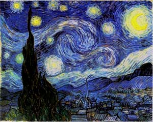

# starry night

vincent – don mclain

starry, [**starry night**](http://www.okqq.net/riji/rijiben/bg/vincent.mp3)  
paint your palette blue and gray  
look out on a summer’s day  
with eyes that know the darkness in my soul  
shadows on the hills  
sketch the trees and the daffodils  
catch the breeze and the winter chills  
in colors on the snowy linen land  
now i understand  
what you tried to say to me  
how you suffered for your sanity  
how you tried to set them free  
they would not listen they did not know how  
perhaps they’ll listen now  
starry, starry night  
flaming flowers that brightly blaze  
swirling clouds in violet haze  
reflect in vincent’s eyes of china blue  
colors changing hue  
morning fields of amber grain  
weathered faces lined in pain  
are soothed beneath the artist’s loving hand  
now i understand  
what you tried to say to me  
how you suffered for your sanity  
how you tried to set them free  
they would not listen they did not know how  
perhaps they’ll listen now  
for they could not love you  
but still your love was true  
and when no hope was left inside  
on that starry, starry night  
you took your life as lovers often do  
but i could have told you vincent  
this world was never meant for one as  
beautiful as you  
starry, starry night  
portraits hung in empty halls  
frameless heads on nameless walls  
with eyes that watch the world and can’t forget  
like the strangers that you’ve met  
the ragged men in ragged clothes  
the silver thorn of bloody rose  
lie crushed and broken on the virgin snow  
now i think i know  
what you tried to say to me  
how you suffered for your sanity  
how you tried to set them free  
they will not listen they’re not listening still
