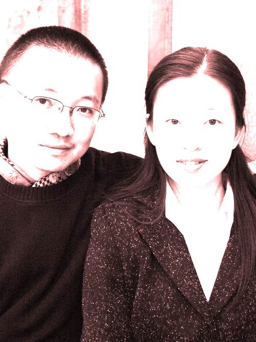

# 悲喜交加...

> 耳畔那首恋爱时的歌“想问天问大地，还是迷信问问宿命...”
>
> Grace回大陆开会，晚上和他们夫妇二人在王府大街一起吃饭，居然遇见了茶的技术支持[**Goghs**](http://www.eqiao.com/)和他的朋友。谈兴越来越浓，酒也越喝越多，基本上6瓶啤酒都是Grace的先生和我灌下肚了。开心啊...再没有人嫌我想法多，再没有人嫌我有病......那是些毫无答案的问题，那是些我无数个日夜为之困惑的问题，那是人生道路上一直找寻缺口突围的问题...“碰碰车”与“自我感受”，城市与自我、人生信仰及宗教信仰的矛盾......
>
> 悲喜交加的向他们挥手告别...下次我们Tibet见......你可以选择离开，而我只能选择盲目，即使内心是清晰的，我仍然要回到那个不知道属于谁的现实中，坐上那辆有轨道的车继续痛并快乐着...微晕的酒性在橘色夜灯下灿烂如花，这晚和明天无关。
>
> 看到这样一则留言:生命中，你可以选择的是自己，你不可以选择的也是自己。
>
> 我们一直生活在这个城市里，什么是我们生存的目的？

---

## 评论（2）

**sissi** · 2004-11-08

grace 的气质好的没法说，我喜欢那种类型。:razz:

**[埯姬](http://angie.tecinese.com)** · 2004-11-09

生命中有着太多的事情你无法解释，无奈后也会得到惊喜，以最自然的方式生存着不挺好吗？

