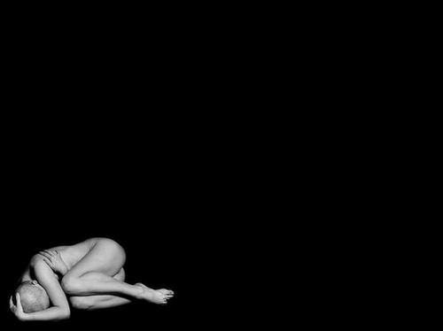

# 芦苇的留言

> 曾经有一个很爱我的男人说：我们可以试一下情人的关系...
>
> 我说:  
> 如果你真正喜欢我，你不会让我做你的情人；  
> 如果我真正喜欢你，也不会做你的情人。
>
> 我明白生命中有种种不能承受之轻之重之痛，所以我拒绝了某种混乱的生活方式，至今仍过着白粥般清淡的生活，我不知道是否最后也会得到心理医生~~~~

---

## 评论（3）

**atbyin** · 2004-11-11

不会吧 她已经成为一座丰碑？

**[芦苇](http://mypaper.pchome.com.tw/news/casablanca)** · 2004-11-13

林子大了,啥bird都有.这也是Christina'home的精彩所在:)  
一楼的客官,你误会了.  
我想每个人都在选择适合自己的生活方式,只要你喜欢,你大可以走自己的路.我自知心理承受能力差,很多东西我都无法承受.我无法承受他想爱我的时候可以尽情地受,他说想我的时候可以尽情的说,而我的喜怒哀乐却不能与他分享甚至连一个电话都不敢接只因他的爱人在旁,我无法承受别人可以在阳光下牵手而我只能暗中相见,我无法承受的事情很多很多,所以我选择了不选择.  
  
但是,这并不意味着我抗拒其他人,也不意味着我把爱情看得有多高尚世事有多美好,如欧阳应霁所说,花花的世界就正如墙纸那么表面,就是那么七色五彩,一手狠狠撕下来却叫你看得见背后生活的龌龊和时日的斑驳.  
  
你可以笑我放不开,我只是在选择我的方式;  
我选择白粥,是因为我喜欢白粥--我喝白粥从来不加咸菜:)  
红尘里,我看别人的故事,过自己的生活.

**christina** · 2004-11-13

芦苇，我写的夸张指的是有个“我爱漂亮女人”的家伙留言说“他所有的努力就是为了挣钱买张火车票来见我”，所以我写了“夸张”两个字。一楼的留言也是征对这个人的留言写的，不要误会。  
  
我很赞同你写的，所以才转载，没有想断章取什么义，只因为我同意和理解这种观点！

