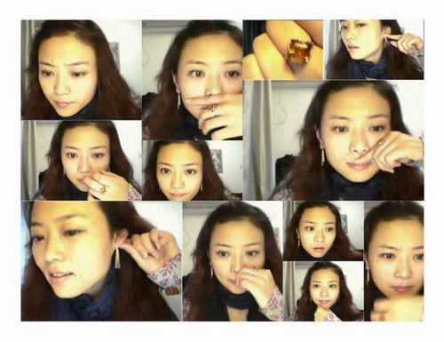
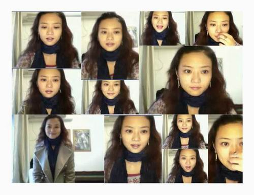

# 鱼眼镜头里的我

> 我又胖了，98斤了！
>
> 需要解决的问题不是胖的问题，而是抵抗地球引力问题，近期继续去健身会馆，器械比较枯燥但有健美操和瑜珈来调剂。其实到现在还没体会过瑜珈，由于节奏太慢太慢......不适合偶的性格。
>
> 偶大哥说他在学游泳，呵呵~~为了他那落枕的脖子？！偶脑海里恶作剧的念头突然窜出来，不好不好...Angie说偶这是欺负老实人~~

  

---

## 评论（14）

**[埯姬](http://angie.tecinese.com)** · 2004-11-12

绝对自恋！自恋有罪？

**christina** · 2004-11-12

这个是别人拍摄下来制作的，呵呵~~  
没觉得新鲜吗？好玩儿~~

**[asiapan](http://www.cathome01.com/asiapan)** · 2004-11-12

感觉有点诡异：）

**薇安** · 2004-11-13

自恋没有错。有童心未必不是好事。哈哈，顺便提一下，我也喜欢搞这些玩意。

**don** · 2004-11-13

看起来像 《十分钟年华老去》 Ten minutes older 的一个故事的摄影手法。 用四个监视器 同时放一间屋子里的事情。 时空错位， 让你不知道哪里是开始那里是结束。

**[jerain](http://www.jerain.com)** · 2004-11-13

hehe,美女显得很黄。第一次让我跌了一小下眼镜。

**tony** · 2004-11-13

自恋狂，这么喜欢暴光自己，有病的说。

**christina** · 2004-11-13

这也是一种能力，不然你也暴露一下呢？

**YD** · 2004-11-13

黄黄的灯光好温暖...  
  
一如既往的光彩照人。

**tony** · 2004-11-14

大姐，比你漂亮的人多了。  
在这里见到你的人越多，你的路就越窄。  
不过倒也是追忆青春的一种表现，以暴光为本，如果你愿意，当然可也。

**christina** · 2004-11-14

又如何？  
我就没和你考虑一样的问题！

**IPneer** · 2004-11-14

看样子tony喜欢“万人如海一身藏”的感觉哦，不过与世界60亿的人比较起来，来过  
这个网站的人真的也可以忽略不计的。  
如果人人都像tony一样自私刻薄的话，那这个世界恐怕也成了人间炼狱了。

**janet** · 2004-12-03

鱼眼的效果就是有些怪。这些不明显，拍对称建筑很有架势。  
有些角度象小C，有些不像。呵呵～好玩

**高山** · 2005-07-30

你很有魅力，同时很有勇气

