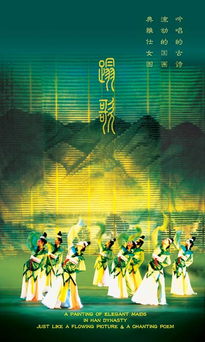

# 舞蹈《踏歌》

走出房子时天已经黑了，习惯这种视觉上的黑暗一如习惯在黑暗中放松的自己。

> 这两日公司排练舞蹈[《踏歌》](http://www.cctv.com/entertainment/xzwt/no40/6.html)，很美的唐代舞。我以身体欠佳为由逃避活动，但前线歌舞团的老师是我的朋友，又不得不陪着她们一起排练。
>
> 《踏歌》动作虽然顺手顺脚，但是从“顺”的动作中寻找韵味，中国艺术十分讲究气韵、精神，抓不住‘神’，仅是猎取到几个‘形’，也仍有可能是风马牛……为什么偏远山森里的苗族妇女走起路来摇摇晃晃？为什么从原始社会一下子跳到社会主义社会的边陲兄弟民族的舞蹈，都是跳的节奏而动作上看不到旋律性？为什么还每每顺拐？还残留着动物形态？总之，难以捕捉的是气韵、精神。当然我的同事们能做到形似就算是成功一大半了。常有人说舞蹈演员四肢发达头脑简单，事实上我认为舞蹈演员反应灵敏，是聪明、坚强懂得配合的群体。
>
> 在旁边也跟着学习那些动作，这是我喜欢的舞蹈类型，很美很有韵味。其实，跳舞的时候我们每个人都要认为自己是最美的，所以爱跳舞的我多少有些自恋。
>
> **下载欣赏**—[**舞蹈：《踏歌**》](http://www.2890.cn/list.asp?softid=157&action=download&list=1)  
> 君若天上云 侬似云中鸟   
> 相随相依御日浴风  
> 君若湖中水 侬似水心花   
> 相亲相恋与月弄影  
> 人间缘何聚散   
> 人间何有悲欢  
> 但愿与君长相守  
> 莫作那昙花一现…

---

## 评论（6）

**atbyin** · 2004-11-15

每次心浮气躁后，都来这里看看，读你。

**tell** · 2004-11-16

战士军前半死生，美人帐下犹歌舞。

**carine** · 2004-11-16

chris,it seems like that you start to love the"cameraunion.net",what i recommended is ok? Happy

**Eric Zhang** · 2004-11-18

The picture says the dance expresses a style of not Tang Dynasty but Han.  
your website is really clean ,elegant and clear.....hmmmm and makes me calm.........in a word,im loving it...hehe...

**christina** · 2004-11-18

汉唐时期的风格，不过老师介绍的是唐代舞。  
喜欢，就多看看，不喜欢就不看，呵呵~~

**weiwei** · 2006-02-25

:oops:

