# 我们喜欢的东郊

> 我爱南京的东郊。
> 除此之外这儿还有什么能让我喜欢？
> 妈妈出生的如意里？还是她小时侯生活玩耍的总统府一带？
> 这种没有归属感的状况在东郊总能解决的很好。
> 上个周末和姐姐、外甥女又去了......
> 这天，微冷的天，有成群的鸟儿在林间飞翔。

*Shot by Sony F717*  
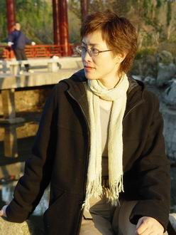 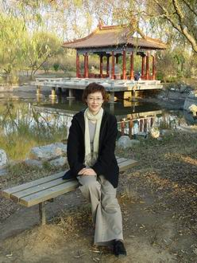   
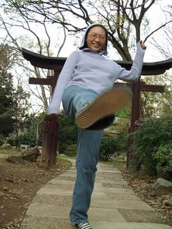 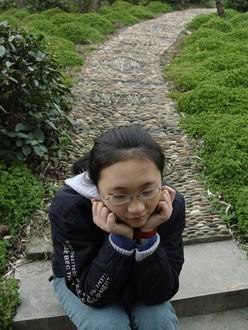   
   
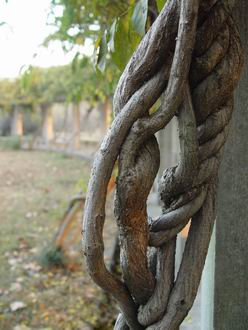 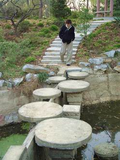   
盘根错节......  
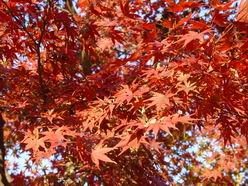 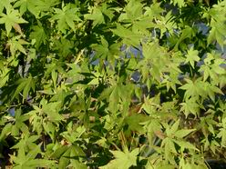   
两种秋色  
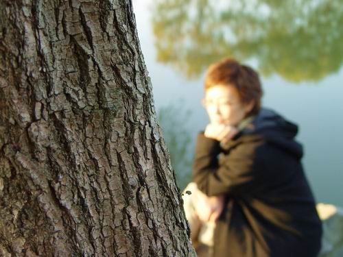   
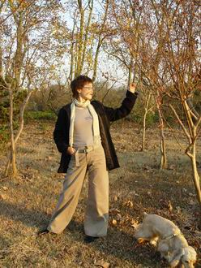    
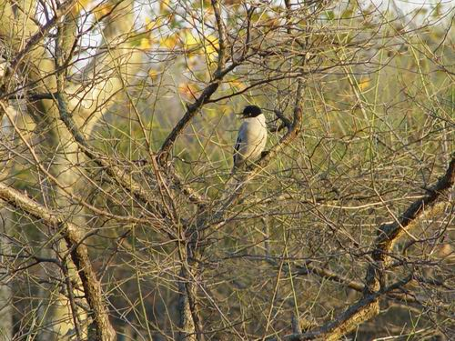   
 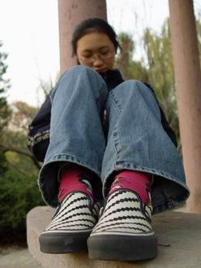   
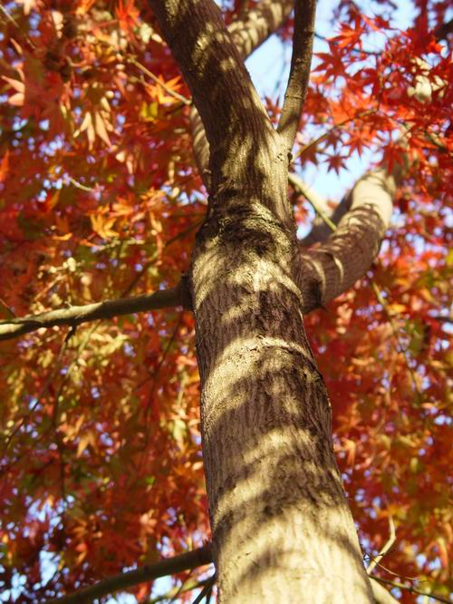

---

## 评论（15）

**atbyin** · 2004-11-30

你外甥女有男朋友么，kidding.

**细菌** · 2004-11-30

姐姐到底是见过世面的，穿着看起来很舒服。

**细菌** · 2004-11-30

也喜欢东郊。有段时间几乎天天骑车在那里转悠。

**[woods](http://www.20six.co.uk/woods)** · 2004-12-01

你若剪短头发，跟你姐姐就是twins.另外你用的相机是什么牌子，CANON 20D吗？

**Michael** · 2004-12-01

NICE PHOTOES!   
AWESOME

**gongxigongxi** · 2004-12-01

权相佑获颁人气明星奖  
　　被誉为韩国影坛盛事的第25届青龙奖颁奖典礼，昨晚已于汉城顺利举行，今年共有21部作品竞逐16个奖项，康佑硕及郑在泳分别凭《实尾岛》赢得最佳导演及男配角，《实尾岛》更获颁最佳电影大奖；赛前获最多9项提名的《太极旗飘扬：生死有情》，结果由张东健大热赢得影帝，加上最佳摄影及技术等奖项，成了今届青龙奖的大赢家。《缘份的天梯》（又译《神父教育》——新浪娱乐注）男星权相佑（又译权相宇——新浪娱乐注）获颁人气明星奖。《汉城大劫案》(The Big Swindle)则为廉晶雅赢得最佳女配角，更取得最佳新晋导演及剧本奖；《球爱咖啡屋》(Someone Special)李奈英顺利封后。

**gongxigongxi** · 2004-12-01

ask for more fotos !!!!!!!!!!

**don** · 2004-12-01

才发现， 你们家全是近视眼。 //grin...  
  
快喜欢上南京了，有机会一定要去看看。 建议christina做南京的旅游形象大使..

**christina** · 2004-12-01

我姐姐家才有趣呢，一家三口人出来都戴着眼镜。  
她比我大7岁哦！

**citycorner** · 2004-12-01

呵呵，真是幸福而从容的生活．

**carine** · 2004-12-01

the elder sister is so beautiful.that is not the same as the young,maybe there is some years

**[SUMNNY](http://www.cn-long.net/wp/)** · 2004-12-01

JJ像个男孩子呀，MM愈发显的有女人味哦，哈哈

**grace** · 2004-12-02

刚去南京度周末回来。去了总统府，还有明孝陵。黄昏的时候，站在明孝陵的方城上，斜阳照在深秋的树叶上，竟然是光亮的红色，终于体会到易安居士所说的“落日熔金”是怎么样的景象了。

**[jessica](http://www.blogcn.com/User7/jessica_liu/index.html)** · 2004-12-03

姐妹俩长得很像啊！

**Michael** · 2004-12-05

just enjoy the harmony between nature and human beings...

