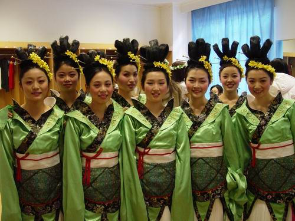

# 演出花絮

   
 

[**更多图片**>](http://www.imagestation.com/album/?id=2134371431)

---

## 评论（13）

**[r@in](http://www.jerain.com)** · 2004-12-10

ask for more fotos.

**jiajialing** · 2004-12-10

你没打电话给我嘛，我还在家等着呢。

**hank** · 2004-12-11

80年代的？怎么看起来像是60年代的？  
呵呵

**niu** · 2004-12-11

南京的姑娘就是美。

**Christina** · 2004-12-11

jiajia你那个什么破电话？不是不在服务区就是已关机，晕！！！快点重新给我一个电话。

**Michael** · 2004-12-11

有一天，我拨打你的电话，语音提示为：“对不起，你拨打的用户正在裸奔，请稍后再拨。”过了一会我又尝试地拨打了你的电话，语音提示更改为：“对不起，你拨打的用户已奔出服务区或已归西，请留言。”......

**[Nio](http://www.infor96.com/~nio/)** · 2004-12-11

头上那个看起来好怪异……

**[sumnny](http://weblog.cn-long.net/index.php)** · 2004-12-12

还是christina 最没PP；）

**Future** · 2004-12-13

过来看了一下，熟悉、亲切的感觉就好像从金鹰的大玻璃里边看雨中的南京。谢谢你的Blog。 -boston

**wildcild** · 2005-05-16

You are buteaful.

**Monique** · 2005-06-03

Oi Adorei seu blog,sou do Brasil,Rio de JAneiro,o Japão parece ser lindo,sonho em um dia conhecer.  
Um grande abraço!Tchau!!!!!!

**jonas** · 2005-07-03

you is beatiful  
i love you  
  
from brazil  
jonas  
kisses

**kiek** · 2005-07-09

muy bonitas las fotos... especialmente bella Cristina... y de perturbadora sonrisa, bello por lo mistico, bello por ser bello...

