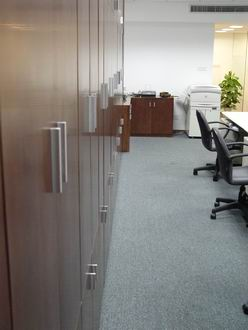

# 墨色想象

华灯初上，不露声色地望着人来人往，近了又远远了又近...  
人生诸多无奈，泪盈满眶无力而无助。

   
   
 

---

## 评论（9）

**jiajialing** · 2004-12-14

想到什么了。。。。？

**cappuccinoscn@msn.com** · 2004-12-14

你们公司真现代，一个电脑，一个电话就搞定了。

**christina** · 2004-12-14

俺们公司的办公室就跟仓库和垃圾场。  
照片上的没看出来是没使用的新办公室吗？当然不是我们公司的。  
观察力真逊！！！

**hank** · 2004-12-14

怎么搞的像网吧一样？

**Michael** · 2004-12-15

办公设备不错。简洁，实用！

**Conch** · 2004-12-15

没有了隐私。。。。

**don** · 2004-12-15

我看象 Call Center. 只是没有隔断。 “你好，这里是A公司客户服务中心，5555号服务员为您服务。” 椅子不好， 应该是皮的。

**Christina** · 2004-12-15

hahahah~~超想象力~~

**mauricio rubio** · 2005-09-07

hola sabes ojala puedas traducir esto pero quiero decirte que eres preciosa y que si estuvieras aqui en este momento te lo diria hasta cansar mis labios bueno me gustaria que me escribieras aunque sea en ingles esta bien un beso adios   
mauricio de chile

