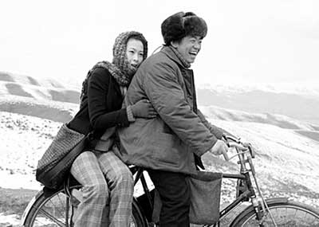

# 傻根，原来那个啥如此重要...

 在电影院看完冯小刚贺岁片《天下无贼》。冯小刚：“如果说《手机》是一杆子插到生活里的话，《天下无贼》可以说是打一巴掌揉三揉，对人性和生活都充满了善意，甚至有些乌托邦式的理想主义。”好人或是坏人并不是靠长相来决定的，这是刘德华的“贼人观”，乍一听颇有哲理。“其实在生活里很多偷盗之人不是因为钱财，而是因为灵魂，《天下无贼》就是这样一个深入到贼人灵魂的故事。”

电影从开始女贼王丽对神祖的跪拜，而男贼王薄的嗤之以鼻就预示了影片的悲剧结尾。演傻根的[**王宝强**](http://ent.sina.com.cn/m/c/2004-11-19/0825570488.html)是冯小刚新挖掘的新演员，傻根语言纯朴、倔强、可爱而真实，没有这个角色的存在相信盗贼们也不会演得那么出彩。整部影片里我最不喜欢的演员是李冰冰，有段在火车的酒吧里李冰冰穿着吊带裙的形象实在令人大跌眼镜，衣服根本撑不起来，不够饱满骨感太重。与《手机》里的范冰冰相比较而言，范冰冰的眼睛聚集着智慧和情感，眨眼的瞬间从睫毛上洒落出漫天星光。范伟和冯远征那出打劫的戏狂逗：“抢.....抢...劫...今天......我就要......劫......劫个色......IQ…...是什么......？　拿......拿出来......”冯远征严肃的形象来演这幕喜剧真是无人能比，他翘着兰花指说的那句：“不许笑，这是打劫......”最最印象深刻。

我和许多人一样面对世俗险恶也是傻根式的思维和心智，但那只是开始的时候，如我女友所说。我们不仅学习如何防贼还学会如何辗转于现实社会的染缸中。在女人眼中率真朴实的傻根式男人还是很有吸引力的，女友则认为傻根不会调情，所以傻根除了要学习如何防人还要学会如何调情？傻根正是用他那种质朴感动了王丽，而王薄还活着话，他一定还会是个贼。

---

## 评论（9）

**nick** · 2004-12-17

已阅!

**don** · 2004-12-17

不想看冯小刚的电影了，可能是“手机”太“真实”了， 以至于把“我把青春都献给了你”里面说的冯小刚和他们这个小圈子里的人的事情都演完了，没声什么东西了， 再演就只能说说，冯小刚个人结婚后的幸福生活。 “天下无贼”？ ............前一段时间看了 搞笑巨星金凯瑞的演艺历程。 可能和冯小刚会是一样的， 先用无哩头的夸张搞笑，在商业领域站住一定的席位，然后，继续无聊的搞笑，突然有一天，开始觉得累了，就开始“卡夫的世界”，“月亮上的人”探讨生活的真谛，娱乐圈的黑暗。 但是娱乐归娱乐，他的生活感悟，可能和我的没什么关系，所以自己很少会跟着他去想什么贼的内心世界。 有时觉得，搞艺术这帮人也挺惨的。要去演艺所谓的艺术，其实只是自己生活的一个缩影而已。 有一天，把生活的经验都演完了， 就开始胡编乱造，按商业的方式操作，看似有序，内容深刻， 其实，他已经不能再超越自己了。手机之后，已经没有我值得期待的作品了，因为那都不是他的生活，只是一种幻像罢了。

**Christina** · 2004-12-17

那我们都出家当和尚尼姑吧。

**don** · 2004-12-17

“如果说《手机》是一杆子插到生活里的话，《天下无贼》可以说是打一巴掌揉三揉，对人性和生活都充满了善意，甚至有些乌托邦式的理想主义。”  
我觉得冯小刚的本性和金凯瑞还是不同的。 金凯瑞后期的作品是悲观的去描述一个小角色的形象，是喜极而悲。而冯小刚的是由现实到到乌托邦式的理想主义。   
其实都想探讨，只是个人的角度，个性生活阅历不同。金凯瑞的拿手好戏是做搞怪的表情，而冯小刚的看家本领是现实的“冯式幽默”。 我一直觉得“手机”是冯小刚的一个转折点。 个人观点。

**[CATHOME01.COM](http://www.cathome01.com/archives/2004/12/post_261.html)** · 2004-12-17

**摄影师镜头下的中国百姓真实生活**  
有些照片需要永远的保存,留给我们自己,留给我们的后辈们来看,来反思。 2003—...

**sss** · 2004-12-17

知道21世纪什么最值钱？人才  
原来都是人才

**Michael** · 2004-12-18

前几天去看了“天下无贼”。感觉是部不错的片子。好几年没有看到这样诙谐的电影作品了。在当今，能有电影作品能让电影院里所有的人捧腹大笑的片子是越来越少了。电影的选材上就具有喜剧因素，整个火车上只有傻根这一个人相信天下无贼。而围绕在他周围的贼们各显神通,在有限的空间内为我们展示了他们的绝世“偷“技！而影片中周而复始的明星客串也为影片增色不少。特别值得一提的就是范伟的经典台词...爆笑...”天下无贼“不同于冯小刚上一部作品－”手机“。”手机“太真实，真实的有点让人害怕，就像张毅某的”一个也不能少”看过后你会感觉到农村教育确实需要援助。看完了会有一点伤感。而“天下无贼”在带给我们欢笑的同时，在结尾时刘德华的死去也会给我们带去一点遐想的空间：刘若英以后怎么办？她的孩子呢？如果刘德华还活着会怎么样？......据说过两天有周星施的电影，我在观注ing...

**nick** · 2004-12-18

再阅!!!

**bruce** · 2005-01-03

傻根不是冯小刚的发现，是《盲井》的导演李扬第一次用王宝强。有了那此的表演，这次用它就很自然。两个电影里面，他的表演都是很本色的。

