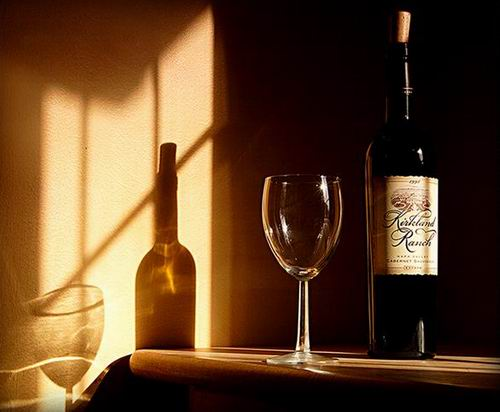

# 周六，晨，雾

没有闹钟的铃声，习惯性的在早晨7：30醒来，打开台灯继续看昨晚那本书，一边听他用英语说着梦话，就这么磨蹭到快9点起床。往常睡醒后和姐姐妹妹们一样都在为穿什么衣服烦恼，有时穿得赏心悦目有时又会是惨不忍睹，或满意或不满意的走出家门。只有周末的早晨是轻松的，可以不刷牙不洗脸的就坐到书桌前敲打电脑键盘了。书房里还弥漫着昨晚他抽的烟味儿，点上小蜡烛改善一下空气。说到蜡烛我想起女友昨日送我的烛台，她说你喜欢点蜡烛，我逛街看着好看就买了三个，一个给你，一个给老牛，一个自己留着用。那是一个吹萧的女天使穿着粉红色衣裙，玻璃材质越发显得烛台晶莹剔透。还不能确认究竟是放在家里还是放在办公桌上装饰用好？于是周末，它被刻意地忘在了公司。

昨晚和他跑了几家酒吧，人爆满。难怪南京的小酒吧越开越多，去年国贸楼上100平米不到的天堂隔壁酒吧，在阳光大厦那边新开了分店。去了两次，也许是因为周末的原因客人非常多，第一次和他还有一个法国帅哥去的，当我们介绍这个酒吧是以一夜情著名时，法国帅哥歪着嘴笑着问道：“one night love or one night sex?”他说他们那里十五、六岁的青少年抽烟吸毒的人比过去要多很多。中国人酷爱仿造，这种嗜好不仅体现在商品上还体现在生活方式里。下面我们又将进入怎样一个模仿时代？在酒吧见过形形色色的女孩，其中一些人只要不开口说话，就是非常美丽的动物！然而，这些美丽的动物不是被欣赏着，她们的周围总是闪烁着猎人的眼睛，随时随地都有可能被射杀，充满着刺激和诱惑。酒吧是一本人类心理学的书，那些眼神表情和行为......从小我就喜欢观察人，现在这种喜欢已经延伸到人物摄影上。前两周去摄影器材店看过实物的Canon Eos 20D，太大了。用过F717之后，我怎么还可以对相机没有要求？我现在特需要一个旅游携带方便、体积小，性能好的单反数码相机。F717携带还是不够方便，有时想悄无动静地拍一下陌生人，那个大家伙一掏出来就把对方给吓跑了。

我现在无所依赖无所欲念，就那么点小小的爱好，这是否喻示着一种衰老？当我收到礼物的时候才发现一年过去了，人们又要投身到各种沸腾的场所欢度西方人的节日，这和结婚男女盛行为无名指戴上戒指是同一种模仿。这之中有多少人信奉天主教和基督教？我和他没有互赠戒指，首先我们不是宗教徒，其次我们不相信那些繁文缛节，于是我们给自己各买了一块手表，这既实用又有纪念意义！常有人询问我们的生活计划，其实我和他什么计划都没有，和他生活在一起之后受他影响我渐渐也开始随意了，人们往往给他们注重的事物套上各种各样的形式，越想望得到越是得不到，这是一个不变的规律！“象草木一样均匀地呼吸，不去思索（刻意的），平静的生活。”这是女作家陈染在一篇文章里的话。

***\*他送我三本不同主题的相册，很有意思的设计。是圣诞礼物吗？***  

*\*书房里的晨烛*  

***\*暖色调的光影***  

*\*瑞典柠檬味的伏特加酒*  
 

---

## 评论（5）

**[埯姬](http://angie.tecinese.com)** · 2004-12-19

照片不错，水平见长了。

**沉草** · 2004-12-19

那个谁总是用伏特加掺着红牛喝

**Michael** · 2004-12-21

连做梦的时候也说英语!高手!  
我也时常和自己说英语，但还没有到睡觉的时候也说的地步......  
那些常去泡吧的人也只是想为自己找点乐子的吧？......

**vincent** · 2004-12-21

生活方式不错，照片更是不错

**elaine** · 2004-12-21

one night stand

