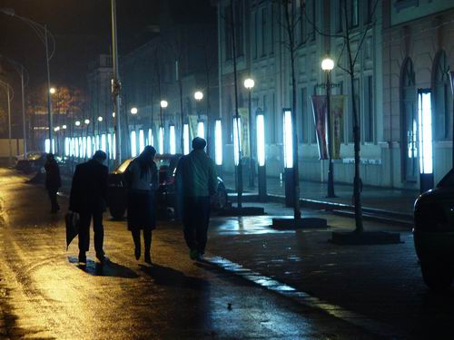

# 无序

> 一个人坐在肯德基餐厅里解决午餐，那些嘈杂声仿佛在另一个时空里飘荡，我静静地躺在自己的思绪里荡漾，窗外的街景并不好看，但因为是流动的，所以总令人期待，好似人生。

  
*周日凌晨于南京1912  
Shot by Christina  
Sony F717*

---

## 评论（5）

**annie** · 2004-12-21

呵呵,这是我常有的感觉.

**Michael** · 2004-12-21

如果吃饭的时候太吵了我常会走神。发觉自己的灵魂仿佛跳出身体。人在那里，可是心却不知道飘向哪里去了。。。

**[kk](http://www.blogcn.com/user23/oms_infix_neveralone/index.html)** · 2004-12-21

我喜欢你的博客,我链接中国茶可以吗?

**[kk](http://www.blogcn.com/user23/oms_infix_neveralone/index.html)** · 2004-12-21

不好意思,我先加了,因为刚玩博客没多久,有些雀跃了.到时候不行再改好么.

**cappuccinoscn@msn.com** · 2004-12-21

我偶尔也喜欢一个人在麦当劳座着，喜欢那儿漂亮的MM像风景一样美，喜欢那儿的青春气息和生命力。

