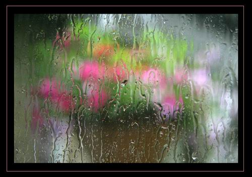

# 无语

> 又要降温的时候想写点什么，然而无从下笔，好比喉咙那儿堵着什么酸涩得说不出话。
>
> 打哈欠打得泪流满面，正在等什么？哦...在等热水器的水热到72度然后洗澡睡觉。搬到另一个办公室工作3天了，最初感觉还行，因为增加了工作量比过去要忙碌，只是目前还没完全进入状态。下午公司给我换了新电脑，工作情绪活跃了许多。我是个需要鼓励的女人，不管做什么，他们找我谈了之后，对我也是个促动。
>
> 中午快一点钟独自去肯德基吃午饭，坐下来抬头朝窗外望去又见到流动的景物，马上触动到内心的某根神经，[想不起来距离上次午餐有多少天？](http://www.tecinese.com/index.php?p=285#comments)也许我看问题不能用惯常思维，事物不总是我看到的那样，真的......我都开始怀疑自己的判断力了。那么给我一副面具...泛着低调而华丽的金黄色，象过去那样把自己傻瓜的面孔隐藏在面具后面吧！

---

## 评论（13）

**cappuccinoscn@msn.com.** · 2005-01-07

这个照片和你的心情很相衬

**why31** · 2005-01-08

尽管你有朋友、有丈夫、有家，但是你并不真正快乐，你孤独，心灵寂寞。这是一种痛苦，为什么？

**christina** · 2005-01-08

因为我喜欢多愁善感，自寻烦恼，呵呵~~或许也是神经过于脆弱。

**薇安** · 2005-01-08

我也常常这样，有点庸人自扰的感觉。唉...

**why31** · 2005-01-08

不满足，在心灵的最深处。

**christina** · 2005-01-08

又有谁真正满足呢？好象我也不是例外吧？

**why31** · 2005-01-08

应该会有这样的时候的,你也会有。

**nick** · 2005-01-08

呵呵呵呵,还有什么不满足的啊?!欲望的无限过大就是罪恶了啊!

**[Nio](http://www.infor96.com/~nio/)** · 2005-01-08

有时候一个人静静的呆着挺好的，我也喜欢这样，不用做什么，不用想什么，就这么看着，甚至不用去思考看到的是什么……

**atbyin** · 2005-01-08

电脑 问题 终于解决了 。

**atbyin** · 2005-01-08

想法 多 的 人总是比较痛苦 。 傻瓜总是很快乐 。

**[onair](http://hwww.chinaeiga.com/mtblog/)** · 2005-01-13

>呵呵~~或许也是神经过于脆弱。  
  
啊，可惜！四舍五入的话，就,就差一个字啊...（谜  
  
by onair@神经衰弱

**[KanJing](http://blog.csdn.net/kanjing)** · 2005-04-17

因为有思想和热情的人都不会安于现状，希望突破，改变！   
这样麻烦事也会伴随而来，但是不必想太多，追求想要的就行了~

