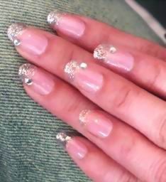

# 美甲体验

韩国MM的手指甲呈椭圆型，指尖部分为不透明的宝蓝色，根部为透明的白色。之所以两次在麦当劳认出她皆因为她漂亮的指甲。于是，一个有关美甲的梦想油然而生。

昨晚找到一家美甲店，当我十指生辉的从店里乐滋滋的离开，麻烦才开始。

 麻烦一：拉车门时，完全还是过去概念里的指甲长度，如果车把手得用手抠着开的话，必须小心；  
麻烦二：脱衣服穿衣服，尤其是穿长统袜，长长的指甲很容易拉伤袜面；  
麻烦三：擦护肤品时，无论用哪根手指去霜状器皿里取护肤品，都会把指甲内侧塞得满满的；  
麻烦四：摘取隐型眼镜极其困难，基本上是揉出来的，浪费了一副月抛隐型眼镜，第二天直接戴有框眼镜；  
麻烦五：穿长筒靴，尤其是比较紧的鞋子，那个困难和痛苦；  
麻烦六：敲打电脑键盘手指显得很做作，微微翘起，俨然无法尽情享受打字的乐趣；  
麻烦七：做家务很不方便，洗洗浆浆的，容易弄坏指甲...... ......

> 美甲之后，我得到了什么？
> 短暂快乐了一把.....且了解了美丽背后的辛苦，增强对事物的判断力。

---

## 评论（15）

**HM** · 2005-01-15

best solution: cut them off.

**[埯姬](http://angie.tecinese.com)** · 2005-01-15

美丽后的残缺会让你更无法接受。

**nick** · 2005-01-15

娇情!

**christina** · 2005-01-15

臭美一下，不行吗？

**nick** · 2005-01-15

资产阶级奢糜的生活方式!呵呵呵!

**christina** · 2005-01-15

干吗？看着不顺眼啊？那就受着呗~~呵呵~~

**nick** · 2005-01-15

艰苦朴素是我党一贯的优良传统!

**don** · 2005-01-15

对christina的奢侈腐化生活，已经习惯了。下面等着看她，美脚指甲。~~

**christina** · 2005-01-15

是不是有点大惊小怪啊，不过是臭美一下啦~~

**atbyin** · 2005-01-15

christina，我支持你，每天做一件自我感觉幸福的事。

**[tell](http://www.tecinese.com/index.php?p=306#comments)** · 2005-01-16

哇！我的无名指......  
哇！我的无名指......  
哇！我的无名指......  
可怜的 christina .................

**annie** · 2005-01-17

好细心的臭美,呵呵  
有时间,可以什么都体验一下:)

**why31** · 2005-01-18

说句最不中听的大实话：  
愿意折腾没什么不好，这就是自由，爱谁谁！  
可惜从图片上看并不美倒是让人遗憾。——不过只要自己不觉得也就行了。

**montecarlo** · 2005-01-18

世上本无事...干一件自己喜欢的小事,增添一下生活的情趣,却引来那么多的言论

**Michael** · 2005-01-19

好几年前就有了

