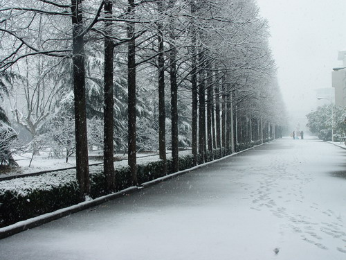
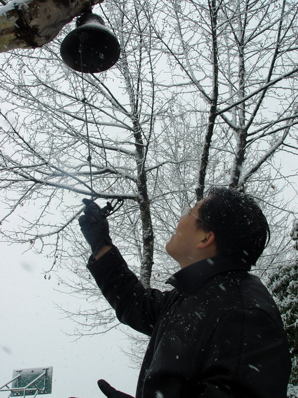
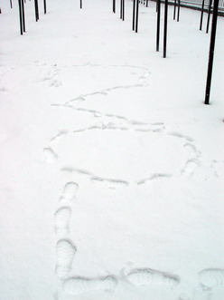
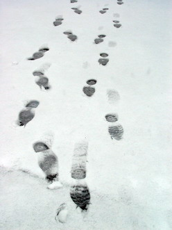
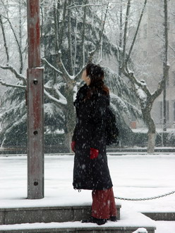
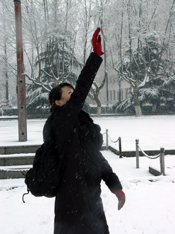
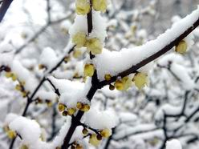

# 春天在漫天大雪中来临

   
   
   
    
    
    
 

---

## 评论（3）

**[Nio](http://www.infor96.com/~nio)** · 2005-02-16

雪花真漂亮，我会到南方了，热得要死，有几天都是穿短袖，春节还是有雪好

**[埯姬](http://angie.tecinese.com)** · 2005-02-17

我们那里的雪半天不到就化了，不知何时又能象儿时那样在厚厚的积雪上打场雪仗。

**citycorner** · 2005-02-23

喜欢一大一小的两对脚印，简直是脚脚相印，呵呵

