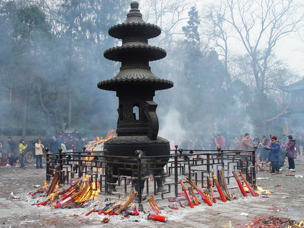
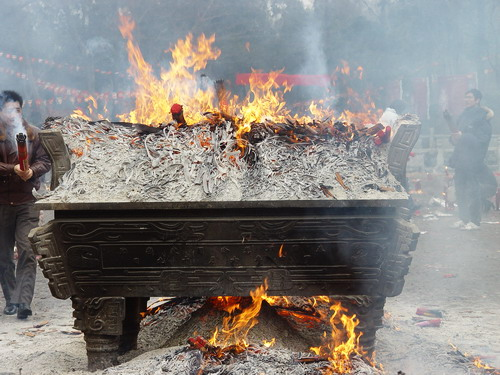
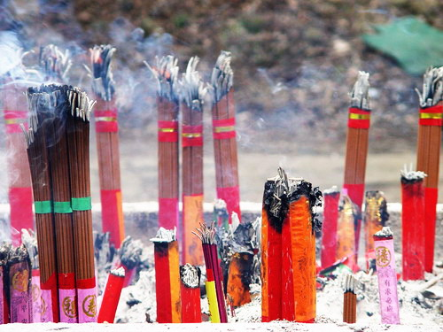
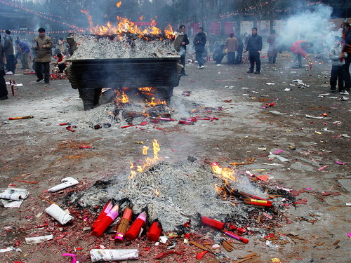
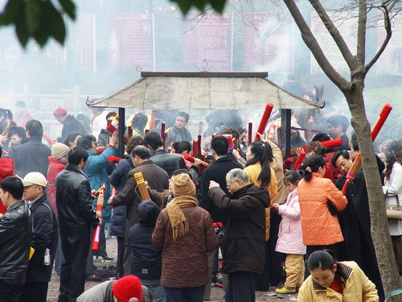

# 迎财神

> 中国民众的过年时有一项[接财神](http://www.gb.taoism.org.hk/religious-activities&rituals/taoist-folk-customs/pg5-6-3.htm)的习俗。一般在正月初二清晨或者在初五清晨燃放鞭炮，以示迎接财神。
>
> 江南地方，又有年初五接路头神的习俗，他们也被称为财神，其来源则不易考证清楚，大抵是民间信仰，难以查究。不过初五接路头的习俗於敬财神的方式、 时间却大有影响。一般商店除夕做完生意便放年假，至初五接过财神，才开门营业，称为开头盘。这样，接财神的时间便有正月初二和初五两个时间，至於某 地固定在哪一次，则各地各行其俗。

大年初五凌晨1点前往百家湖放烟花爆竹迎财神  
   
 

初五早晨栖霞古寺迎财神  
   
   
   
   

04年8月与05年正月的对比  
 

---

## 评论（1）

**光膀子乱跑** · 2005-02-14

一直以为你在国外呢，不过发现你真是一个比我还爱拍照的孩子啊！网站很不错，加油！新年快乐！

