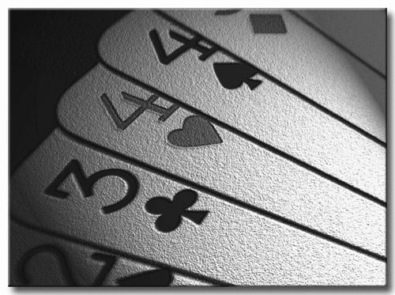

# 上班心思

> 上班两日一直都在忙碌，这边事情刚做完回到座位上，桌上又有一些文件需要处理。以前时忙时闲的时候想着要是自己能忙碌些会更充实，现在忙起来又想是不是在忙有意义的事儿？我问他你最喜欢南京哪些地方？他说第一喜欢的地方是办公室，其次是网球场、日本料理店、酒吧、驾驶的车子里。只有一个找到工作状态和乐趣的人才会把工作场所作为第一喜欢的地方，这让我既羡慕又妒忌。在这个城市中除了家，还有一些令我喜欢的地方和场所，但是和他喜欢的办公室相比一切都没有意义。
>
> 昨儿一整天没有妈妈的消息，忙着忙着也就忘记给她打电话。晚上和朋友吃饭谈话到11点钟左右才回家，睡了5个小时左右爬起来又急忙赶去上班。大概只有周末才能令人悠闲一些，是吗？今天才知道原来妈妈和我的姐姐从前天中午12点开始看《天国的阶梯》一直到昨天早晨六点才睡觉（18个小时），电话里感叹仍没从剧情中回过神来。如果可以沉浸在自己喜欢的事物中也是很享受的，无论是悲伤还是喜悦。
>
> 现在我有两个Blog站：Te Cinese和Chinese Tea。因为在Te Cinese上写得多了，Chinese Tea就越来越冷清了。还好我只建立了两个Blog，有两个email地址。我知道有些人有一大把email信箱，后来自己都忘记了信箱地址和密码，有时发信给对方，还要问问究竟哪个信箱是常用的。想关闭Chinese Tea，从2002年4月建立到现在已经如我的心情一样平淡到毫无欲望，没有欲望更新就是衰老，衰老之后便是死亡。可有人认为：“建立一个“品牌”不容易即使这品牌未必精彩了还是保留的好，好似同时爱两个人，总是一个人得到的多了另一个人就会少一些。”
>
> 昨天在hi5上收到一个信息，对方自称是英国专业律师，一个在尼日利亚出车祸死亡的中国家庭留下150万美圆的遗产，律师提出让与同姓的我签发一些文件提供一些个人信息，就可获得遗产的30%......这个骗局可笑得有点象愚人节的节目。欺骗的目的各不相同，有的基于良心，有的基于感情，有的基于物质钱财，也有的基于游戏！受骗大致因为两点：天真和贪婪。出于娱乐我回复对方说那30%留给你自己享用吧，骗子居然今天又写来长篇大论打算说服我。看来一个真正的骗子对自己设下的骗局如宗教信仰般沉浸其中，不仅自己相信还要别人也相信这是真的，当鱼儿吞下鱼钩时骗子就开始有享受的感觉了。当你看穿面具背后的嘴脸，看着一个认真的骗子尽情地表演，一切又是那么滑稽可笑。

---

## 评论（4）

**jerain** · 2005-02-18

放弃Chinese Tea是明智之举，所谓品牌与点击率终将化作浮云，没有激情就已经没有一切了。另外昨天wordpress.org已经开放1.5版本的下载了，建议升级。目前的theme能否继续使用不能确定......祝洗澡快乐。

**[wcoco](http://prettymom.blogspot.com)** · 2005-02-19

i prefer to read this blog. probably there are too many different authors at chinese tea that it's loosing it's 'style'.

**[mvm](http://home.wangjianshuo.com/mvm)** · 2005-02-20

来自hi5的邀请我从来都只直接删掉  
  
有点不喜欢hi5

**[mvm](http://home.wangjianshuo.com/mvm)** · 2005-02-20

btw，你的很多照片都unavailable了：  
  
http://www.imagestation.com/album/?id=4287300695

