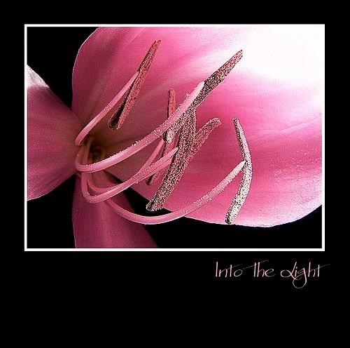

# Into The Light

   
*Into The Light  
by Albert Darmali*

> 自从我的Sony笔记本更换了保修期内的硬盘之后，一上网就死机。而他的IBM笔记本却一直没有出现过问题，所以适当的考虑品牌很有必要。晚上收拾出5、6年前买的一件黑色羊毛短大衣，人民币499元，放到现在应该更贵些，人民币越来越不值钱了。
>
> 洗澡前从书架的库存里找出7本《旅行家》，6本介绍日本1本介绍巴厘岛。把这些书端放在床头柜上，只等洗澡结束直接奔进被窝阅读直至进入睡眠。可洗澡之后还是忍不住来到书房打开最明亮的橘色灯光打开电脑写点什么。在[jianshou](http://home.wangjianshuo.com/)的网站里有个人写了段有趣的文字，大致意思是：jianshou要求其每月至少写15篇文章，其认为这是要求不得的，文思泉涌时可以一连写好几篇，有时却干涸得一个字没有，其比喻成每月的大姨妈要想多来几次也来不了，现在我就是这种状况哦。喜欢jianshou中文blog[屋顶上的木帷幕](http://home.wangjianshuo.com/mvm/archives.htm)标题下的那句“让你看到我心中细腻的那面”以及他太太blog上的“梦里的天空很大，我躺在你睫毛下； 梦里的天空很美，我躺在你睫毛下。 爱对了人，每天都过情人节。”爱对人，爱对人，爱对人，爱对人......相象的人会相互吸引，岁月在激情中真的燃烧起来，一定要节约能源小心安全，不然烧焦的是自己。若在一次爱情中释放了所有能源，下面的人生也将波澜不惊......相如以沫，不如相忘于江湖。

---

## 评论（5）

**dophingking** · 2005-02-19

very short ,simple but very interesting... I like it...

**dophingking** · 2005-02-19

好像是练舞功一样。。。慢慢释放自己的能量和激情。。。

**[jessica](http://www.blogcn.com/User7/jessica_liu/index.html#top)** · 2005-02-21

“爱对了人，每天都过情人节。”——Wonderful!

**[jessica](http://www.blogcn.com/User7/jessica_liu/index.html#top)** · 2005-02-21

爱情如煲汤，得文火。  
急火攻心挖~~~~

**montecarlo** · 2005-02-24

喜欢煲汤,因为喜欢那种不愠不火细水长流的感觉

