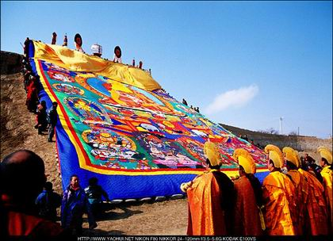
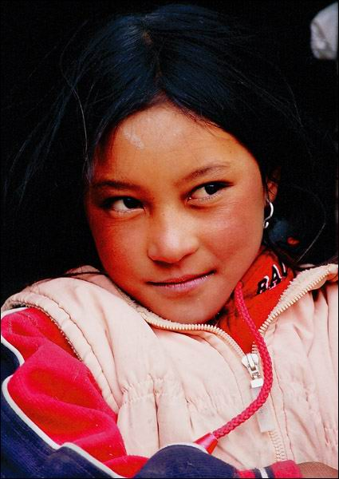

# yaohuier青海之行

是NIKON F80拍摄出来的图片让人心跳加速，还是面孔上的那抹高原红？亦或是都市浮躁心态下寻找不到的那种眼神中的宁静让人着迷？总之，[**yaohuier**](http://www.blogcn.com/User10/yaohuier/index.html)[青海走一遭带回来是这些生动的表情画面！](http://www01.fengniao.com/forum/showthread.php?threadid=259010)

相机/镜头/胶片  
NIKON F80 /NIKKOR 24-120mm f/ 3.5-5.6G KODAK E100VS  
   
   
   
   
   
   

