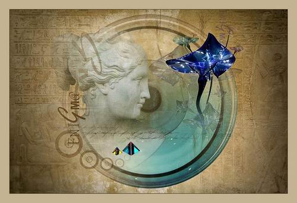

# 女人节和《星座》的前奏间奏

> 收到“节日快乐”诸如此类的短信若干，大部分都是妇女之间的祝贺，注重同性交往是我们这个年龄段的趋势？！下午公司包场看电影文艺片《一个陌生女人的来信》，中午从驾校回市区的班车上一个男人手捧的报纸上面有一行黑体字标题“老公另外一个手机号码”，似乎和这个电影名称有异曲同工之处？
>
> 在很忙的这段时间里，很偶然知道音乐发烧友对于声音和碟片的超级追求究竟怎么回事。如果你的车有不算赖的音响配置，请找一首[王力宏《星座》](http://mp3.baidu.com/u?u=http://down.baizhao.com/147338/AfkKLTU$.mp3)的歌曲来播放，歌曲本身一般，但请仔细听前奏和间奏部分很好地挖掘出汽车音响的那些功能，我感觉音乐从四面八方涌现，感受到低音在脚下振动，这首歌一定比其他音乐录制的要出色，才试出了音响的美妙，音符萦绕在身体周围，血液都流畅起来，音乐发烧友的身体一定很健康，无论从精神到肉体这些感受在我看来都可称得上是一种健身吧，当然前提是你必须有一对发烧级的耳朵和发烧级的兴趣。

---

## 评论（3）

**dophingking** · 2005-03-10

SIGHT MU NIUG GO JI ADF AI OA AN ARUE D,FIAE SDFASFQPL, IUQY , QIE ,  
IAYHE ,OOR ,OK?

**lezhi** · 2005-03-10

saw an interesting essay of 师太。it describes somebody vividly.  
  
人来疯  
  
幼儿们许多陋习中，有一种叫人来疯：平时好端端，一见生人，马上又哭又闹，刁钻起来，不受控制，使大人啼笑皆非，丢尽面子。  
  
成人也会患人来疯症。  
  
好好的一个人，学识不差，性格也尚算热情，同他做朋友，还可考虑，不知恁地，就是这个人来疯症叫人受不了。  
  
一有生人在场，特别是老板级人马，他立刻状若癫痫，半真半假，开始语无伦次，踩低别人，捧高自身，“老板老板，甲说你是啬吝鬼”、“乙的小说全是行货，不过几句对白尚算过得去”、“我的稿费非比丙还高”……要多呛就有多呛。  
  
换句话说，人来疯患者强烈地希望在人前突出自己，已达不可药救地步，每一个细微的机会都不放过，随时随地弄巧成拙，失礼死人。  
  
许多专栏，堪称人来疯专栏，天天、日日、无时不刻在读者面前标榜自己，无论写什么人，什么事，归根究底，不过是想告诉读者，他是多么美丽，多么强壮，何等聪明，何等高贵，孝悌忠信，礼义廉耻，全宇宙之美德，统统齐备，且希望读者照单全收。

**[猫头鹰](http://www.52sq.com)** · 2005-03-10

歌曲很好听，谢谢！

