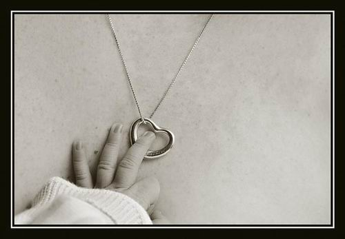

# 春天心情

3月21日驾照办下来，只要有机会就开着自家车在繁忙的交通时间段里练习，他一直认为我属于胆大的，拿到驾照的当天便自己开了车，拐进小巷子时出了一身汗。对于新手来讲左右方向感不是很强，需要特别注意。

今天体检，除了血液未出结果其他一切正常。体重比之前的92斤重了8斤。中午我们几个年轻人和经理一起去宁海路那边吃鸡丝汤面，据说是正宗的草鸡汤，面馆附近还有好吃的上海生煎包，一客2元四只，价廉物美。

除了工作之外若还要忙碌别的事情，一定觉得时间不够用，于是大脑也没有空间去想那些空闲时候莫名其妙的烦恼。很多次有人要我发喜糖给大家，这是我私人的事情吧，我愿意为谁花钱也是我个人的事情吧。现在是迎接春天的心情，如果真有那么多精力的话还是多关心自己一些比较好。

在上海时和朋友晚上去泡吧，那间酒吧有一个打斯诺克的台子，客人把自己的名字按照先来后到的顺序写在黑板上，输了就让给后面的人来打，这种方式既娱乐了客人又能结识新朋友，蛮有意思。

---

## 评论（8）

**[Simy HanX](http://spaces.msn.com/members/leftjust)** · 2005-03-29

那個老雞湯縂覺得太不值了，呵呵。生煎包絕對的美味

**ANJIE** · 2005-03-30

来这个陌生的博客好久了，喜欢这里的文字、图片，是无意在搜索中发现的，也感谢陌生朋友的给予的春天心情

**Michael** · 2005-03-30

你吃面怎么没有被罚? 我吃碗面被罚了５０，违停．次日，又是单行线１００．不过当时还没有带照．．．．．．真黑！！

**Christina** · 2005-03-30

哇，你们都知道那个吃面的店啊，呵呵~~  
没有罚款啊，中午是不是好点啊？

**Michael** · 2005-03-30

Hi Christina. I haven't received your emails yet. Not sure about the cause...

**细菌** · 2005-03-31

有人为什么要你发喜糖？...难怪贴大肚子女人照片？...

**Christina** · 2005-03-31

喜糖是指结婚,生孩子是发红蛋。

**KanJing** · 2005-04-17

上海生煎吃多会腻，不适合我的大食量！

