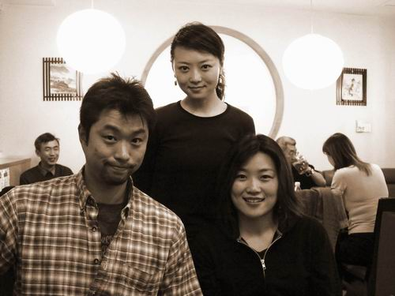

# 寥寥数语话周末

疯狂烦躁的下午，时常为上不了局域网而停下手上的工作，这是怎样一个让人心脏出位的网络？

匆匆结束所有琐碎的时间，未必来得及收拾好下班的东西，寥寥数语这就要离开。不得不说周末的感觉很棒，只是这天气一定要配合才好。

明天将披着我那青黄不接的头发前往上海。

*—上周末在上海拍摄的照片（冈本、Christina、Angie）*  

---

## 评论（7）

**Sea** · 2005-04-02

另外一位女士是您的姐姐 or 妹妹？  
如果是同事，也太像了吧，@\_@.

**[airylea](http://airylea.blogcn.com)** · 2005-04-02

那男的很可爱的样子。

**don** · 2005-04-03

这就是那个呼叫中心么？ :-)

**amasing** · 2005-04-03

第一次花了那么多时间看一个陌生人的博客  
谢谢你带给我的快乐和感动  
谢谢

**[Tian](http://tian.blogs.com)** · 2005-04-03

宝贝儿，太爱你了。你已经深刻地影响我判断女人的标准了。不要介意我的幼稚。^\_^

**[猫头鹰](http://vod.52sq.com)** · 2005-04-08

韩剧《最后的舞请与我一起》不知道看过没有。  
也挺好看的，我在看。

**KanJing** · 2005-04-17

期待的周末，狂热的激情。

