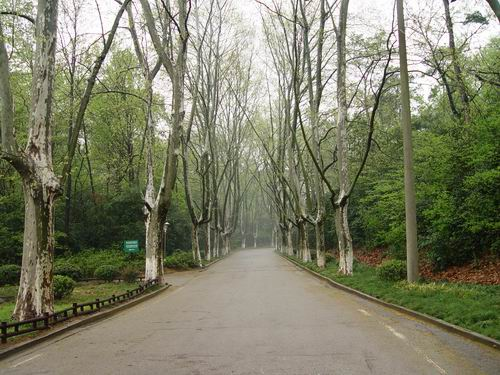

# 淡绿色郊外

下午和Sherry开车去中山陵，为了看雨中的水榭。景色没有阳光下的明媚热情，但别有一番味道......

Sherry下个周末去韩国旅行，她和这个时代的女孩子们一样从喜欢韩剧开始喜欢上韩国的服装和饰品，可见文化传播的作用是多么迅速有效。常常在南师大附近遇见许多韩国留学生，有些年龄还很小就来到中国学汉语。听说韩国人大多崇尚中国文化，谁的家中要是有汉字的木匾或摆设，便算是品味的象征。如今越来越多的韩国人来中国学习又是受了什么影响呢？

这次她为我拍摄的照片几乎没有对准过焦距，本来她打算这次旅行前买部数码相机的，可是大致数落一遍下来，好的数码品牌都是日本的，原来全世界人民使用质量好的数码相机都是日本的？！这是不是多少有些无奈？看看我们衣橱里的衣服，有多少是使用YKK拉链的？

   
 

---

## 评论（17）

**[Jianrtian](http://www.donews.net/jianrtian)** · 2005-04-10

春色绿影,相得益彰！

**细菌** · 2005-04-10

如果不见外的话，就买Kodak或者HP数码机了，又便宜，业余水平足够用了。  
  
话说回来，中国虽有十几亿人口，有能力购买日本高档产品的人还是有限的。群众抵制日货究竟能对日本经济从而政治有多大实质上的冲击？再说，这也是有百多年历史的老掉牙肢俩了，中国人不应该还停留在那个低效能低技术水平。  
  
上面提到韩国文化对中国的影响，中国人应由此得到启发。犹太人一直在有效地使用这种战术，他们搜集史料证据，出书拍电影，坚持不懈地向世界宣传纳粹德国的罪行，通过文化形式广为传播，深得人心，从而得到了全世界人民的同情和深刻理解。在这种世界性的觉悟下，新纳粹主义即使有三头六臂，也无法成气候。  
  
那些认真要呼唤世人警惕日本新军国主义势力的中国人，也应该潜心研究一种借用文化媒介建造世界反日本军国主义的联盟的长期战略，而不是心血来潮一阵风，在自家里砸几个日本锅碗瓢盆。

**[mvm](http://home.wangjianshuo.com/mvm)** · 2005-04-10

Kodak 素美国的

**[Nio](http://www.infor96.com/~nio/)** · 2005-04-10

很向往中山陵，有机会到南京的话，一定去看看

**jiajialing** · 2005-04-10

漂亮的姑娘...美丽的中山陵....

**随风** · 2005-04-11

漂亮

**何晓** · 2005-04-11

无论头型还是衣饰，韩国味儿浓得很。。。

**oakland** · 2005-04-11

Some Broken Hearts Never Mend   
Some Memories Never End  
Some Tears Never Dry

**[Dingpin](http://www.dingpin.com)** · 2005-04-11

水灵灵的中山陵，美丽的大眼睛...

**galahad** · 2005-04-11

这个姑娘好靓啊,我认识的,呵呵,不要对她要求太高,她会按快门已经很不错了.

**Sherry** · 2005-04-12

Galahad, 我拍的照片不错的呢，jiajialing可以作证。^\_^

**Christina** · 2005-04-12

那为什么90%我的人物照都没对准焦距?哈哈~~

**Sea** · 2005-04-12

Sherry长的也蛮像韩国人的，单眼皮，  
加上发型和服饰，更像韩国人了，呵呵。

**Sea** · 2005-04-12

看错，...,近看双眼皮，远看像单眼皮。.....

**pidan** · 2005-04-12

嘿黑，最看不惯的就是女孩拍照做胜利状

**Christina** · 2005-04-13

好象喜欢一样东西必然要抛弃另外一样东西？不是黑就是白？

**Sherry** · 2005-10-27

楼上有毛病嘛，你仇日跟我有啥关系，变态

