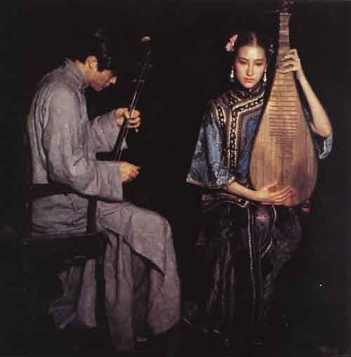

# 无题

又到了春季室内冷室外暖的时候，有人说双手冰凉是女人独有的温度。

为了贵州“天无三日晴”的天气，昨晚在金鹰买了件泰国制造的Colombia淡蓝色防水外套，还送了把Colombia的钓鱼折叠椅，很喜欢。之前打算在附近外贸小店淘的，发现现在小店里很难寻到质量好的正品了，想着一件好的户外防水服可以使用很多年，不能亏待自己这么喜爱四处奔走的女人。有时以为花了很少的钱买了件品牌货，捡了便宜似的开心，但很快就会感觉到这里或那里不对劲，出现许多瑕疵，事实上这是一种更大的浪费。[山猫俱乐部网上商城](http://bbs.tufei.com/shanmao/sc/sort.asp?sort_id=24&page=9)有许多户外用品出售，价格便宜，不知道质量怎么样？

本想往返贵阳，现改成从桂林返回，这样不用走回头路。听Grace说香港大学也有组团去贵州，叫“贵州思苗行”，以访问少数民族为主，应该挺有意思的。有人说要把国内旅游放到60岁之后，60岁前尽量安排国外旅行。

[陈逸飞](http://www.dlgallery.com.cn/shanghai/chenyifei.htm)去世了，上周日在一家小店里听画画的老板娘讲的。仅仅过去几天但已是旧闻，明年这时候人们才会想起他。

陈逸飞作品《恋歌》  

---

## 评论（2）

**[ben](http://blog.bcchinese.net/casawood/)** · 2005-04-17

是要去贵州旅行吗？我也一直向往黔东南的徒步游。上次去了接近桂黔交界的三江，那里有侗寨的风雨楼和鼓楼，也是个安静的好地方：）

**KanJing** · 2005-04-17

中国本来就不多大师，现在又走了一个，真是流年不利！  
  
晕死~` 这Blog居然没有分页功能，看起来超级痛苦！ WordPress是不是傻了！

