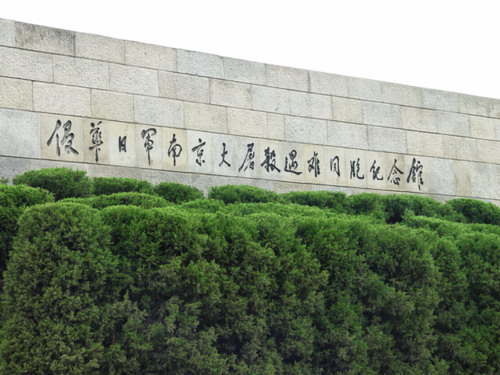
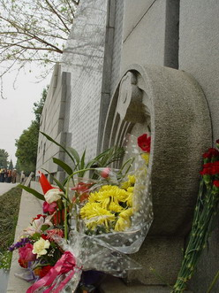
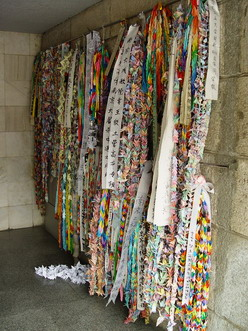
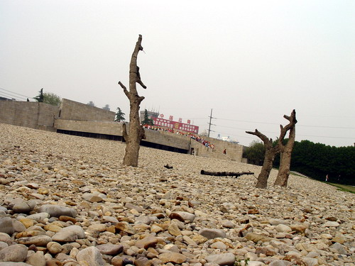
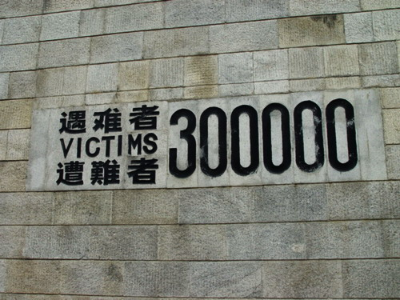
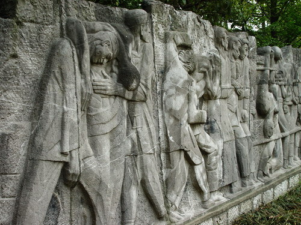
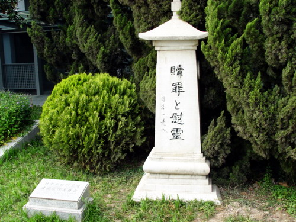
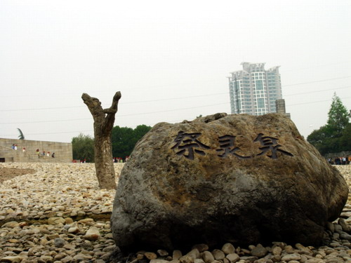

# 换个方式......

周六我们带朋友认识的日本朋友一起参观了南京大屠杀纪念馆。

参观完全免费，去的人很多，还有很多外国人。入口处写着两个黑色的大字：肃静。一群红色帽子上写着“江海小记者”的孩子在馆内吵吵闹闹好象在春游似的，我扯着几个叫嚷的孩子一顿训斥........

老师都是怎么拿教育工资的？和大屠杀纪念馆的气氛很不合适，这些孩子真让人感到悲哀！爱国教育不仅仅是形式！

   
    
   
   
   
   
   

---

## 评论（4）

**[KanJing](http://blog.csdn.net/kanjing)** · 2005-04-18

呵，意义不是很大，但是做了总比没做好！ 支持

**青青子衿** · 2005-04-19

很喜欢你的叶子，可以做个链接吗？÷  
http://society.mblogger.cn/maggieforever/

**michaelhan** · 2005-04-19

训的好!

**[singlewinghx](http://www.donews.net/singlewinghx/archive/2005/04/20/343740.aspx)** · 2005-04-21

**[日讀]近日網摘-戛納開始**  
Ping Back来自：www.donews.net

