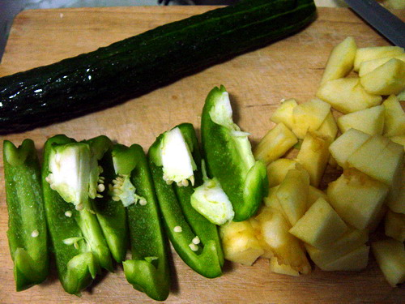
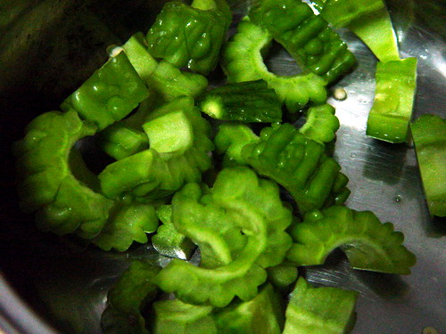
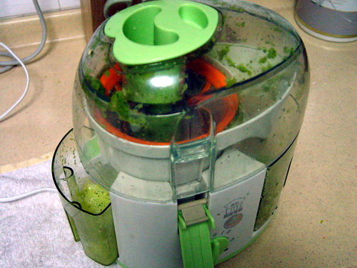

# 中医美容疗法

下午在办公室里突然无法继续容忍皮肤上的雀斑和眼角的鱼尾纹，晚上老妈居然买了黄瓜、青椒（个大不辣的）、苦瓜、苹果准备榨汁喝，只是在她喝的果蔬汁里多加了苦瓜。这是怎样一个让人振奋的晚上啊，我雀跃而积极主动地要求劳动，老妈在一边指导。记得以前老妈用红豆、绿豆、黄豆泡一夜，第二天早晨用家里的豆浆机做新鲜的豆浆给我们喝，豆浆比牛奶更适合女性饮用。

到了我这个年纪好些女人经常光顾美容院做面部保养，可是我到目前为止还是因为好奇在27、8岁的时候去过几次，这种治表不治里的美容方式一点也没有获得我的好感。倒是很青睐榨汁的方式，既保健又可以美容，如果您在皮肤上和我遇到了同样的烦恼可以尝试一下我妈妈提供的方法。平时我爱吃肉不喜欢吃蔬菜，所以这个饮食习惯我准备培养起来坚持到老。

多谢老妈了，呵呵~~~  
   
   
   
**食疗方：**  
１、去斑美肤汁   
取红萝卜、芹菜各５０克，苹果半个，雪梨１个，柠檬１／４个，放入搅果汁机中搅汁，１次饮完，每周２－３次。   
２、油菜柠檬雪梨汁   
取油菜５０克，柠檬１个，雪梨２个，共放搅果汁机中搅汁，１次饮完，每周３－５次。   
３、胡萝卜汁   
将鲜胡萝卜研碎挤汁，取１０毫升－３０毫升，每日早晚洗完脸后，用鲜汁拍脸，待干后用涂有植物油的手轻拍面部。此外，每日喝１杯胡萝卜汁也有去斑作用。因为胡萝卜中含有丰富的维生素Ａ原。维生素Ａ原在体内可转化为维生素Ａ。维生素Ａ具有滑润、强健皮肤的作用，并可防治皮肤粗糙及雀斑。   
４、柠檬冰糖汁   
将柠檬搅汁，加冰糖适量饮用。材供中含有丰富的维生素Ｃ，每１００克柠檬汁中含维生素Ｃ可高达５０毫克。此外还含有钙、磷、铁和Ｂ族维生素等。常饮柠檬汁，不仅可白嫩皮肤，防止皮肤血管老化，消除面部色素斑，而且还具有防动脉硬化作用。   
５、西红柿汁   
每日喝１杯西红柿汁或经常吃西红柿，对防治雀斑有较好的作用。因为西红柿中含有丰富的谷胱甘肽。谷胱甘肽可抑制酪氨酸酶的活性，从而使沉着的色素减退或消失。   
６、果菜美肤汁   
香菜、芹菜、黄瓜、草莓、柠檬各适量。将前４种果菜洗净，搅汁，滴入柠檬汁饮用，每日１次。有笑颜增白功效。

---

## 评论（8）

**niu** · 2005-04-19

还不如就直接吃。榨了吃多浪费。

**[thyamy](http://www.blogcn.com/User6/thyamy/index.html)** · 2005-04-20

苦瓜加黄瓜这该有多难喝啊。。。

**Christina** · 2005-04-20

加上苹果很不错的口味哦，不信试一下。

**Maggie** · 2005-04-20

我决定依你的方法试试.看上去很不错的样子

**tell** · 2005-04-20

老外脸上为什么那么多雀斑？是不是跟老外接触多了，就近墨者黑？

**aluha** · 2005-04-20

男士适用吗?^\_^

**ttea** · 2005-04-25

呵呵,真滴有用吗?哦收起这些个方子,等哦比较勤快时试试吧.就怕难喝呀:(

**jing** · 2005-05-15

你用的相机是什么牌子的？效果很好。

