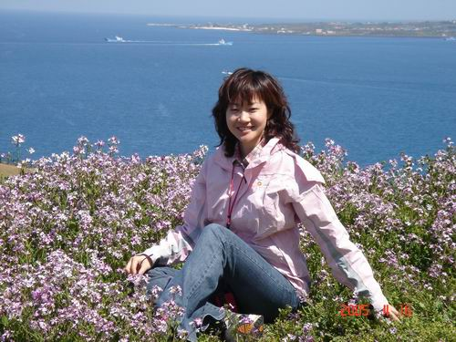

# Sherry韩国行

Sherry从韩国旅行回来一周，给我看她在韩国拍的照片，风景倒没什么特别的，只是这照片里的人儿笑起来甜蜜蜜的。

她送给我一双据说是韩国女孩现在很流行的那种发白的长统丝袜，没来得及穿呢，不知道是什么效果。她说韩国女孩大学四年，一年整容一个地方。好的容貌在韩国找工作比较容易些，一个女孩家庭条件好学历高如果没有好的容貌也很难找到一份满意的工作。韩国街上不管男女的皮肤看上去几乎都是清爽白皙，年轻人大多喜欢穿着康威牌帆布球鞋，深色宽大的牛仔裤，浓浓的眼影。别看韩国泡菜可是用20多种原料泡制出来的，[韩国人皮肤](http://sh.21cn.com/lady/beauty/facial/2005/04/19/2087139.shtml)那么好除了用化妆品之外是不是也和吃泡菜有关系呢？泡菜能防止皮肤老化。有研究人员进行实验后发现，在140天的时间段里，吃泡菜老鼠的皮肤细胞角质层明显变雹皮肤紫外线酸化作用明显减少。据悉，在美、韩等国刮起一阵能留住青春的[毒针美容法](http://www.clue.com.cn/NEWS/SWCZ/lbghdmmw.html)旋风：在韩国，越来越多的人愿意花上半个月薪水进行”毒针美容”；在美国，接受毒针美容的手术者达160万，占到全国整容总人数的19%，远远超过隆胸。为了美丽越来越多的人不惜代价。

据说亚洲金融危机的时候韩国平民会主动把家里储藏的黄金拿出来交到国库。曾与藤原纪香担任世界杯亲善大使的《密爱》女星金允珍自爆不用试镜便获好莱坞名导演斯蒂芬·斯皮尔伯格（Steven Spielberg）的垂青，邀请她参演他监制的新片[《艺妓回忆录》](http://yule.sohu.com/s2004/yjhyl.shtml)，但遭她以维护国家尊严为由而拒绝。也曾听说韩国人大多购买自己的汽车，有人开着日本品牌的汽车去公共停车场停车，会时常被告之没有车位......

韩国民族不容忽视！  

---

## 评论（11）

**Sea** · 2005-04-29

Sherry也太像韩国的女孩了。呵呵。

**[Simy HanX](http://spaces.msn.com/members/leftjust)** · 2005-04-29

像麽？不太像啊，一眼就能看出來！

**montecarlo** · 2005-04-30

Sherry挺耐看:)

**Sherry** · 2005-04-30

Simy Hanx?这名字都看不出哪国人了。你哪国人啊？中国人？洋鬼子？

**Sea** · 2005-04-30

Sherry确实比较耐看。  
印象中韩国人不管男的女的，单眼皮较多，我一般看韩国人主要是根据眼睛，眼眉和嘴去判断。另外韩国人做事有一种特别的"气质".平时看的韩剧也比较多。所以现在我就想，是不是韩国双眼皮的漂亮女孩祖上都有中国血统，因为在古代也有很多中原的人去那里啊。呵呵。  
Sherry脸形，眼睛，发型和衣着，以及气质，和韩国女孩子都比较接近，或者说难以分辨。甚至会给人先入为主的认为是韩国人。

**Sherry** · 2005-04-30

呵呵，我自己没觉着我五官象韩国人呢！:)  
不过韩国年轻人看上去明朗阳光的感觉，倒是和我有些象，嘻嘻

**Christina** · 2005-04-30

Sherry平时好可爱的,尤其是笑起来的样子!

**carine** · 2005-04-30

非也啊~~~法国这边的韩国女孩简直是传统的翻版，当然是平日外表看上去，骨子里倒是挺现代的：P周围最早成为法国男人女友的，多数是韩国MM哦

**Sea** · 2005-05-01

如果大多数中国大陆女孩子身上再多一些韩国女孩子身上的那种“气质”，就更无敌了。呵呵。不过这种气质是可以“修炼”出来的。相比较而言，目前新世代台湾的有些年轻人比大陆的年轻人更不如，太日化了。反感ing......

**lusfe** · 2005-05-02

sherry好像比几年前漂亮很多哦

**shrink** · 2005-05-03

泡菜难吃死了。

