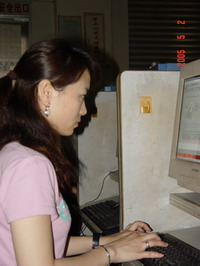

# 到达榕江

昨天下午14点35分的飞机，17：55分到达贵阳，5分钟走到机场大门外花10元上了机场巴士，20多分钟后到了贵阳体育馆汽车站，等待30分钟左右乘19：05分的大巴前往凯里与上海的表妹会合，大约21：30左右在北京东路一个公共汽车站上接到她，在鸿祺宾馆住下，双标288元/晚，讨价还价到170元，里面的设施比我们想象的要好也舒适的多。凯里比较繁华，但是凯里不在我们旅行计划当中。第二天（5月2日）即前往郎德上寨的苗族村寨，很幸运一早到达那里既没有买门票又遇上了村寨的表演活动，不枉此行了！

 中午在郎德路口招手拦到榕江的大巴，4-5小时后我现在坐在榕江县城闷热的网吧里写下行程的流水帐。很想告诉关心我的朋友和家人，到目前为止感觉贵州的人比较淳朴善良，旅游未充分开发，郎德上寨给我的印象是古朴的，以苗族人自然的生活状态呈现在我们面前。有人称现在的贵州黔东南线是5、6年前的丽江，可是仅仅一天的时间我就开始为这里的一切担忧，他们越来越被汉族同化，多么希望这些民族仍然保留他们自己的传统和民俗，一百年二百年......希望一百年二百年之后那些见到人便微笑的苗族女子仍然盘着高高的发髻，发髻上插着鲜艳色彩的花朵和短木梳；苗家男人还穿着藏青色长袍，气质独特的吹着长笙；苗家村寨仍然饮用山上接下来清凉的山泉水。我的这些愿望也许不要50年就烟飞灰灭了，但是让我们为这些民族祈祷吧！在郎德的青石子路上清晰可见汉人随处丢弃的烟壳、废纸和塑料食品袋，为这些人的行为感到可耻，就好象在别人干净的画布上不轻不重的抹了N个黑点。

明天会在榕江四周游玩一圈，打算当天赶到从江，我们旅行计划的重点在从江一带。先写到这里，88。

---

## 评论（11）

**jiajialing** · 2005-05-03

祝玩的开心....等你的pp

**[不倒翁](http://always_can.blogcn.com)** · 2005-05-03

您的博客是不是群体博客  
如果是，能不能成为麾下的一名博客  
我的博客是always\_can.blogcn.com  
请看看不知道是否符合您的要求。

**[googoz](http://spaces.msn.com/members/googoz/)** · 2005-05-03

发点图片上来多好啊

**[angie](http://angie.tecinese.com)** · 2005-05-03

ENJOY IT!

**[lemonhall](http://lemondog.51.net/wordpress)** · 2005-05-04

不错呢，我就是贵州的呢。贵州旅游的魅力就在于它的未开发。

**yaohui** · 2005-05-04

都可以闻到你的贵州之旅了。

**[elton](http://zhiyu.blogone.net)** · 2005-05-04

admire中

**po** · 2005-05-05

这版面是你作的，真漂亮!  
职业水准!  
  
seen i been  
  
My home  
----------------------------  
http://xiangtool.nease.net

**[信海光](http://www.donews.net/xinhaiguang/)** · 2005-05-07

所谓希望人家一两百年都保持老土的样子，纯粹是都市人的自私之想，少数民族并不是为了游客们观赏而活着啊。

**Sea** · 2005-05-09

信海光说的虽然有些难听，但是不无道理呢。哈哈。  
不过我个人揣测Christina的意思应该是：在经济繁荣和融合的同时，一些好的文化传统和风俗不能因此而消失，每个民族都应保持自己的特色。这个世界就是因为多样性才更美丽。如果这么大的个国家每个地方的风俗和传统都一样，还真是没意思，而且这样的国家也很难发展好。呵呵。

**oakland** · 2005-05-09

苗族服饰改革。清雍正以后，在汉族文化的影响下，苗族地区的知识分子觉得本地区的服饰较汉族“欠雅”，有进行改革之必要。于是一场服饰改革运动在县内清水江、亮江沿岸地区展开。最著名的是道光年间娄江苗族举人杨学沛在娄江、偶里、稳江、铜坡等“二十一早半”地区倡导进行的改革。服饰改革主要针对妇女。规定头饰：未婚者蓄长发，加红绒线编成辫垂后或盘于脑侧，红线头垂下左肩。已婚者将发绾髻于脑后，不加红线，插以“弯弥”（银簪）。平时不包帕，干活时搭布巾顶于抵尘灰。戴小耳环。服饰：上装，衣作矮领，袖长及腕，腰宽大，衣长及臂，左衽大襟，两侧开叉，布扣，束蓝或绿色宽腰带。下装，改褶裙为筒裤。衣裤布料颜色不限。此项改革影响颇大，至今不但此地，且连大同、秀洞、铜鼓、小江、九寨乃至天柱县高酿及湖南省靖州县与锦屏毗接地多数仍袭其装制。  
民国后，除固本、新民、裕河外，多数地区男子均剪短发或剃光头，改包头帕为戴帽子。抗日战争后，在学生的影响下，多数青年穿学生装。民国29年（1940）和32年（1943），偶里、平略地区先后两次由乡政府和学校组织宣传“剪短发、穿短衣、不束带”，彻底改变为汉式，逢场期于津渡或路口设卡，对往来者强行剪发、截衣、去带。因宣传不够，手段粗暴，为人们普遍反感，致有一段时间无人赶场。解放后，服饰逐渐自然汉化。至今男子穿着与本地汉族已无区别，女子相当部分也已改着汉服。

