# 凯里-郎德上寨

> 凯里：是黔东南苗族侗族自治州的首府，距省会贵阳190公里左右，位于清水江畔，少数民族村寨散落在四周，其中苗人占了半数以上，也是我国并不多见的以苗族为主的城市。城区面积１８平方公里，人口２３万，在苗语中，凯里意即未开垦的土地。上世纪５０年代，凯里作为黔东南首府才开始城市化建设，现已成为黔东南地区１５个县市的中心城市。凯里设治已有500年历史，早在明清时期曾有“小京州”美称。山清水秀，景色迷人是一个多民族花园，被誉为“苗岭明珠”。
>
> 郎德上寨：在中国贵州黔东南地区的苗岭腹地，清水江的上游，有一座依山傍水的自然村寨，距凯里市区29公里，距县政府雷山7公里，属雷山县丹江区报德乡可供游客游览。郎德上寨系苗语“能兑昂纠”的意译，“能兑”即欧兑河下游之意，村以河名，“昂纠”即上寨，郎德上寨因属郎德地片上方，故名。世居为苗族，至今全寨有118户，500多人，以陈、吴二姓为主。郎德上寨依山傍水，背南面北，四面群山环抱，茂林修竹衬托。

[**进入“郎德上寨”相册**](http://www.imagestation.com/album/index.html?id=2127102925)

一路从[贵阳](http://www.ctrip.com/Destinations/DistrictTransportOverview.asp?District=33)赶到凯里天色已黑。凯里比我想象得要繁华许多，和大多数小型城市没什么区别。我们将行李放在鸿祺宾馆即外出解决晚饭。外地人都知道黔东南人“三天不吃酸，走路打偏踹”，酸一直是当地人饮食的主要特色。1986年，吴笃琴女士在凯里创办了后来闻名贵州省甚至省外的“快活林”酸汤鱼，外地人到凯里都要到那去吃上一锅酸汤鱼，否则就算枉走一遭。当天时间已经是晚上10点多钟，宾馆服务员告诉我们“快活林”可能已经关门了，于是我们走到离宾馆不远的夜排挡，看客人们吃得很香，也选择其中一家坐下来。这里的人偏爱豆制品，摊子上有臭豆腐和烤豆腐，还有煎的土豆饼，每块均是6角钱。这里的臭豆腐不象我们这里黑乎乎的，表面上和普通豆腐没什么两样，吃到嘴里才觉察出口感的异样。臭豆腐要在煎板上捣碎了拌着[鱼腥草](http://health.qianlong.com/29/2003/08/04/111@1517617.htm)和辣椒粉一起吃，鱼腥草好象我们这里葱姜蒜的效用，味道腥酸，有点不太适应。烤豆腐则不是捣碎吃的，而是中间辟开夹上鱼腥草。两个人吃了4块臭豆腐、一块烤豆腐、两块土豆饼，一共4.2元。买了两个苹果和半斤圣女果补充维生素用，也许是贵州还没到水果上市的季节，苹果很绵没水分，圣女果还凑合。这里基本上不用硬币，都是纸钞，据说是硬币携带不方便，渐渐大家就习惯使用纸币了。  
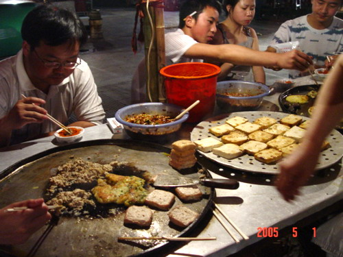

5月2日早晨凯里打雷下雨。本打算赶7：30的巴士去郎德，后还是包了辆出租车，50元单程前往，29公里路程不到一小时便到了村寨门口。郎德的早晨炊烟和着清晨的薄雾缭绕，石阶而上遇见一个阿姐站在青瓦黄木的吊脚楼下向村口张望，穿着蓝衫布衣，一朵黄花跳跃在黑色的发髻上，特别好看。寨口的几个阿伯见着我们并不陌生，依然自故自地做着手上的活。一对母女正聚精会神地忙碌在水潭边捞鱼。没有游人喧闹的郎德显得那么悠然而静谧，世外的一切好象都与这里无关。

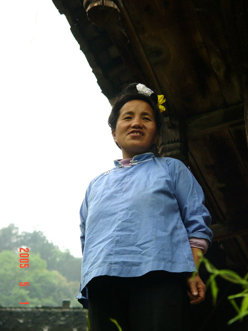   
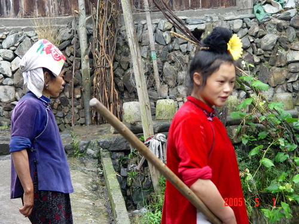

寨子里建筑与建筑挨得比较近，略有些拥挤的感觉。寨子里穿插着牛粪的气味，屋前的棚子上铺着杉木皮树皮，时间久远上面长着厚厚的青苔以及一些不知名的小植物。苗族大多居住在高寒山区，山高坡陡，平整、开挖地基极不容易，加上天气阴雨多变，潮湿多雾，砖屋底层地气很重，不宜起居。因而，苗族历来依山抱水，构筑一种通风性能好的干爽的木楼，后半边靠岩着地。屋顶大多盖青瓦，平顺严密，大方整齐。楼分三层，也有两层的。因其二三楼和前檐用挑梁伸出屋基外坎，形成悬空吊脚。“吊脚楼”有半吊脚和全吊脚两种形式。吊脚楼上装有“美人靠”，平时是姑娘们刺绣和梳洗打扮的地方，既可凭高远眺，又可休息聚会。

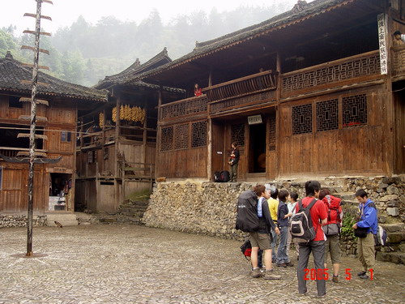

苗族婚姻恋爱的传统方式—“坐妹”。据说是每当劳作一天后傍晚来临，寨中的适龄未婚男女青年就聚集到某家的吊脚楼上，围着火塘嬉戏，喝酒对歌，如若某对男女青年互生感情，就在聚会过后自觉的私汇在一起，这就是“坐妹”。偏僻闭塞使生活很贫困，艰苦的劳作更坚定了多子多福的信念，苗族人很重视女人的健康和生育能力，只有怀上孩子的女人才有人迎娶，而第一个孩子的父亲是谁并不重要。如果感情不和，妻子也可以主动回娘家（等于离婚）继续“坐妹”，而孩子则要留在男方家里……

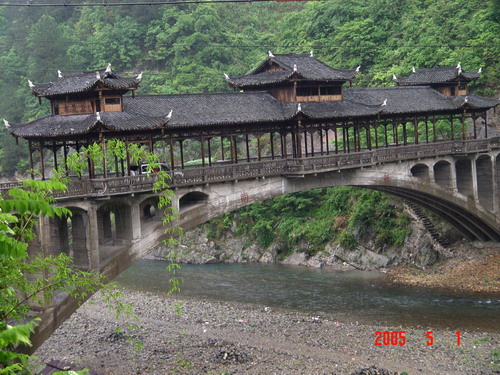   
凯里去郎德途中拍摄的“南花桥”。即风雨桥又称花桥。花桥也是侗族的典型建筑标志。

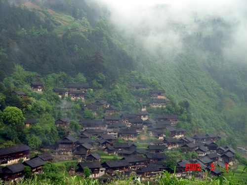   
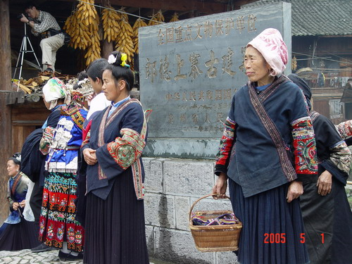   
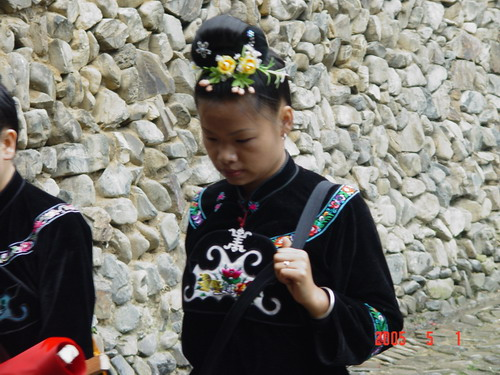   
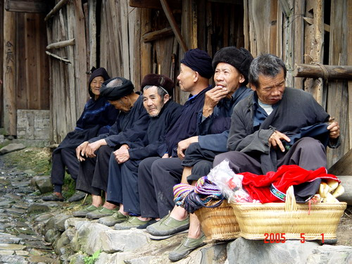   
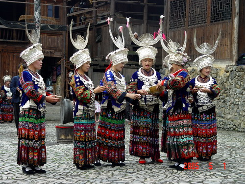   
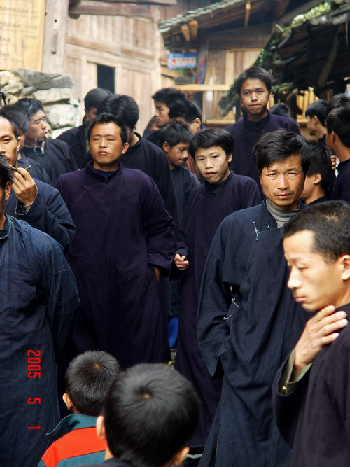   
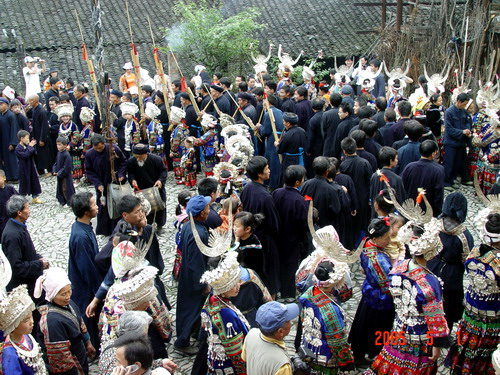   
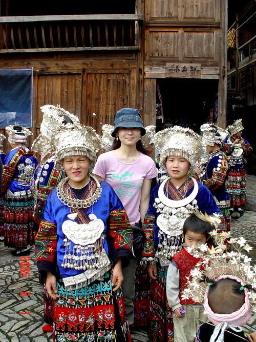   
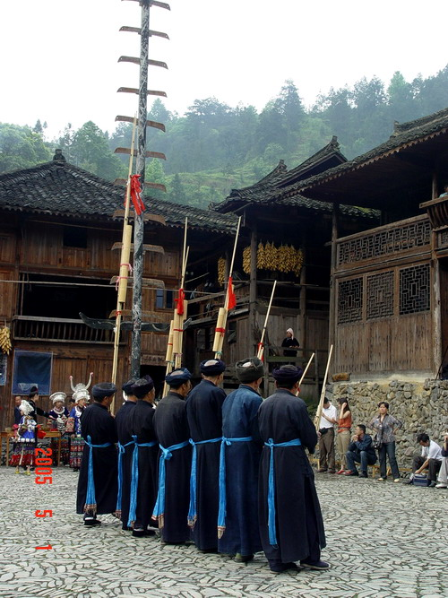   
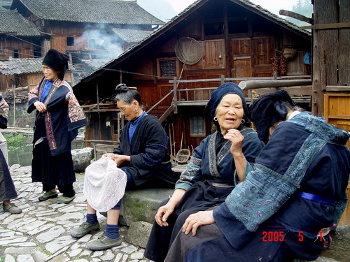   
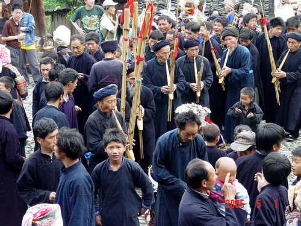   
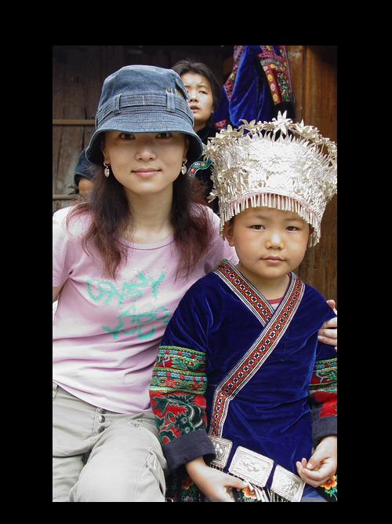   
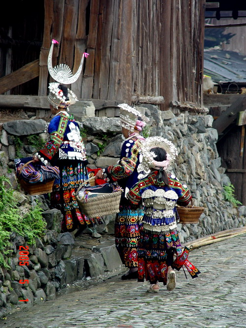

---

## 评论（11）

**[Dingpin](http://www.genaudioworld.com/music)** · 2005-05-08

很纯朴，有机会去欣赏下

**ned** · 2005-05-08

狗狗很可愛ㄛ

**googoz** · 2005-05-08

鱼腥草可是我的救命草哦

**nick** · 2005-05-08

呵呵呵,感觉不错吧!

**nick** · 2005-05-08

对了,丝娃娃吃了么?还有一种叫哲耳根的野菜?

**[lemonhall](http://lemondog.51.net/wordpress)** · 2005-05-08

呵呵，我建议你去屯堡看看。。。不是少数民族的镇子，却也很好玩。无法TrackBack，所以就给出我刚写的一些东西的地址啦，旅行愉快：）  
http://lemondog.51.net/wordpress/?p=350

**montecarlo** · 2005-05-09

折耳根就是鱼腥草.屯堡是汉人的地方,600年前从江淮迁徙过去的.屯堡人的故乡是南京

**oakland** · 2005-05-09

院中的立杆是做什么用的呢？晒东西？登高？

**[DAVID](http://sunsethouse.apro-g.com/archives/000877.html)** · 2005-05-14

遗憾啊...我们走到郎德就没再往下边走了...下次有机会再去

**[dikar](http://d)** · 2005-09-15

角度还不够独特

**loanganliang** · 2005-10-09

如果你兴趣到我们黎平县的肇兴侗寨去看看的话，那比这可说是小巫见大巫了，那可是全国最大的侗寨，有差不多上千户人家，好几千人哟，还有那里的侗寨的特有东东--鼓楼，是可以上吉尼斯记录的。还有黎平的另一个吉尼斯记录的东东--八舟河上的天生桥，那也是世界第一的。

