# 从江县-岜沙

经过两个多小时从榕江到达从江县城，从江没有榕江大，县城似乎被一条河分割成两块，城关的灰尘完全掩盖了清秀面目的山河景色。途中和座位边一个女孩攀谈起来，原来是高三女生，背着龙图的父母跑去黎平游玩。她在从江第一民族中学读书，在学校附近和另外两个女生合租了一间15平米的房子，每月70元，三个人睡同一张床，她睡中间，她的名字里有字叫“文”。上车时看见她在磕瓜子，瓜子皮随意丢在座位下面，当时对她印象特别不好。于是我说：“给你个建议，不要随便丢瓜子壳，好吗？”文说：“我们这里都是这样的。”我不知道该怎么回答了。后来我们住在从江的月亮山宾馆，店家主人一口东北腔，房间很紧张，好不容易挤出一个三人间，一晚90元。傍晚约了文乘三轮摩的一起过桥去吃晚饭，要了份啤酒鸭，口味不敢恭维，吃了几口便不想吃了。文倒是吃得津津有味的。她说他们好些同学一天只吃两顿，买不起饭票的就从家里带米过来顶饭票，从江一中大多是附近镇子村寨的学生。大部分同学都有男女朋友了，有的已经同居。文说他们学校的升学率不怎么好。第二天我们又约好一起去岜沙玩。

[**进入”岜沙”相册......**](http://www.imagestation.com/album/pictures.html?id=2127093727)

**岜沙**：据说是适合单身者旅游的十大胜地之一，从江包车往返岜沙的面包车，车主要80元，事实上只要50元就可以，正值旅游季节为了不耽误中午去桂林的班车时间，我们就接受了。离开从江大约半小时便到达岜沙，一行手拿长抢，腰挎砍刀，头上扎着发髻的男人拦住了去路。当时给我的感觉好象进了土匪寨子似的，有些恐惧。这些男人没有前面遇见的那些少数民族的羞涩，直接趴到车窗上瞅着我们问从哪里来，并上下打量着。电影里某些镜头迅速闪过脑海，我故作镇静地回答着他们的问题。进寨的门票30元，为了门票的工作要6、7个大汉持枪拿刀的把门吗？其中一个听说我是南京来的，很兴奋地说他曾经去过南京演出，在淮安一带。

岜沙人穿的衣服是自己织的布自己染色，用鸡蛋清糊上一层再加颜料再糊上蛋清再晒干，穿上是黑色的亮亮的，雨点淋上不吸水会象皮衣一样滚下。岜沙男人的服饰是一身无任何点缀的无领青布衣，大裤管的青布裤，腰间挂着腰刀、铁沙袋、火药袋，还有一个烟袋，这个烟袋绣有漂亮的图案，多是情人送的；女子身穿大襟的上衣，下穿百折短裙，扎绑腿。只有领口、袖口绣有彩锦。衣服的布料是自己染织出来的，因此家家都有织布机，过着标准的男耕女织的生活。而最古老的男装就是岜沙的苗族（黑苗）男子，儿时髡发，前额头发剃光。留脑部头发披于肩后，至成年时开始蓄发，渐渐绾髻于头顶，额头勒一条挑花布巾，此装束至今不变。岜沙寨老说，男人头上蓄留的发髻象征着生长在山上的树木，身上穿的青布衣象征着树皮。有人说岜沙人的这种发型，是苗族从狩猎时期向农耕时期转变时的遗风；有人说这种发型是清朝的遗风；也有人说是唐宋时期的遗风。男人剃头很简单，女子梳妆却很费时，铁锅里的汤是用糯米煮出来的，她们就是用这种纯天然无公害的绿色化妆品来梳理秀发的，糯米汤的营养把岜沙女子的秀发滋润得乌黑发亮。

史学家格迪斯在其《山地民族》一书中说：“世界上有两个灾难深重而又顽强不屈的民族，他们是中国的苗族和分散在世界各地的犹太族。”这两个民族的生存和发展总是伴随着战争和迁徒。黔东南一带的苗人与侗人争地，由于苗族打不过侗族，结果侗人占据了平地，苗人住在了山上，因此，古代的苗人有随身携带武器的习惯。岜沙部落是1700多年前从苗族内部分裂出来的一个支族，他们被打败后到处流浪，1000多年前最终定居于此。因为是战败后滚出来的，所以部落里的人大多姓滚。经久的抗争和征服使得岜沙苗人养成了粗犷的性格和尚武的精神，在岜沙，有无腰刀就是识别英雄和懦夫的标志。岜沙苗人流行着这样一句谚语：一枝猎枪一条狗，一枝扛子朝山走。

有人说，改变一个地方的民风民俗，最简单的方法就是修筑一条公路。此话不假，但也有例外。岜沙离从江县城不远，公路从寨子中间穿过，应该说与外界的交流是很多、很便利的，但岜沙人依然“坐怀不乱”，顽强地抵抗着近在咫尺的现代文明的侵蚀，保留着原始古朴的生活习惯和服饰，不得不说是一种奇迹，不知是何原因？岜沙，苗语的意思是草木繁多的地方。岜沙人认为，每一棵树都有一个灵魂，越是古老的树就越有神性，而山头的树木更被视为岜沙的神木。由于这种植物崇拜的观念，他们不愿意伐林垦地，而除了农业，他们又没有其它的经济收入，因此，常常陷入困窘之中。也许，恰恰是这种贫穷使得他们保持了传统。

上个世纪80年代初,一对法国老年夫妇发现了岜沙,从此,上万学者、专家和游客为探寻岜沙的神秘不远万里赶来。二十多年过去了，一批批的游人满心好奇而来，又带着未解的疑问离开，岜沙人心湖的水却不起一点涟漪，平静得让人觉得不解风情。

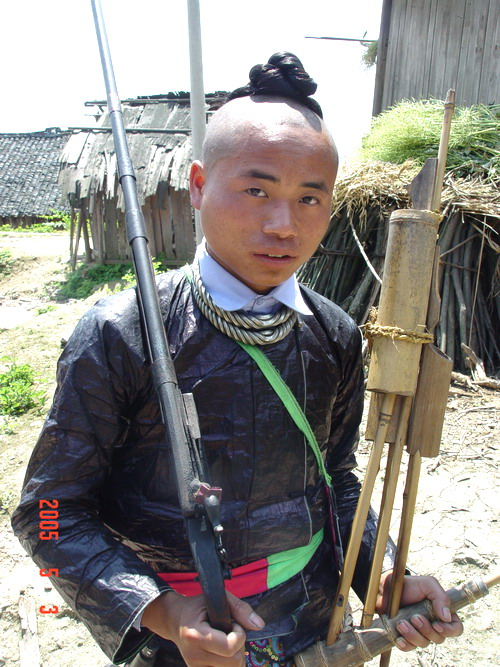   
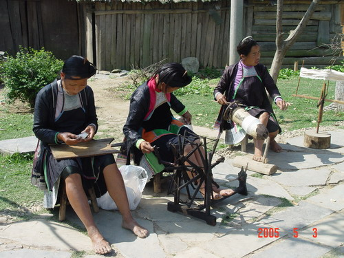   
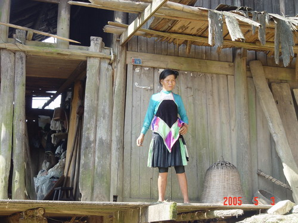   
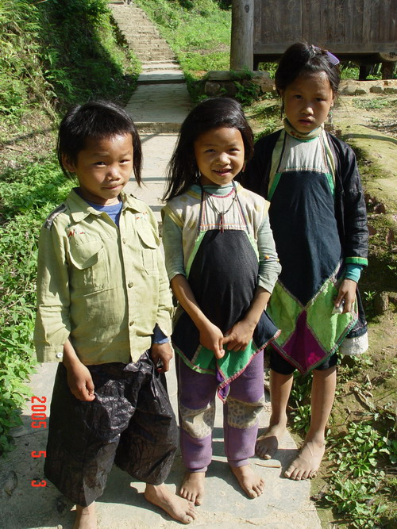   
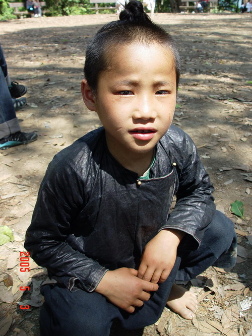   
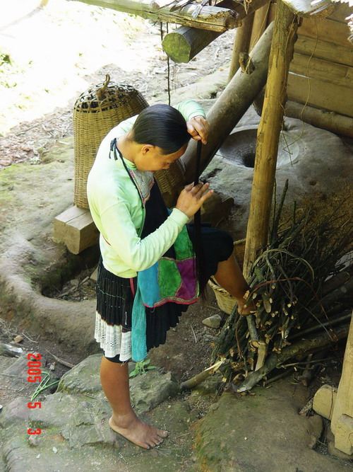   
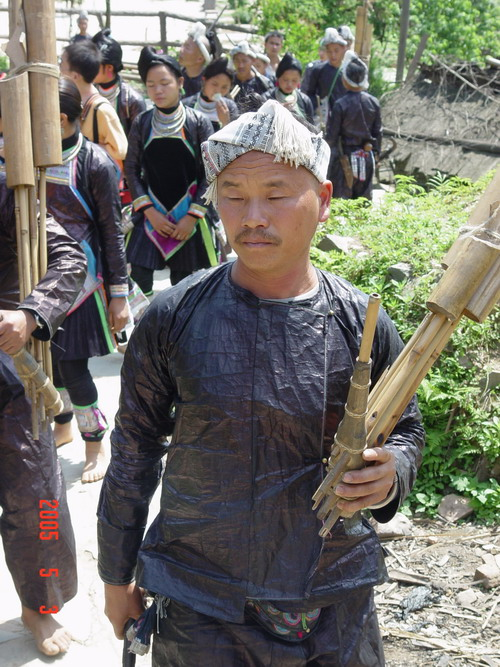   
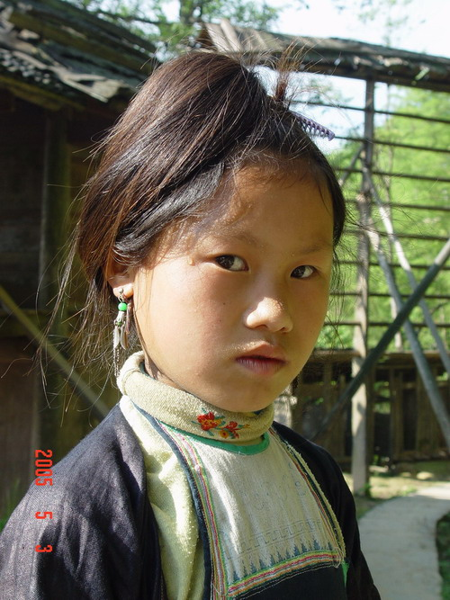   
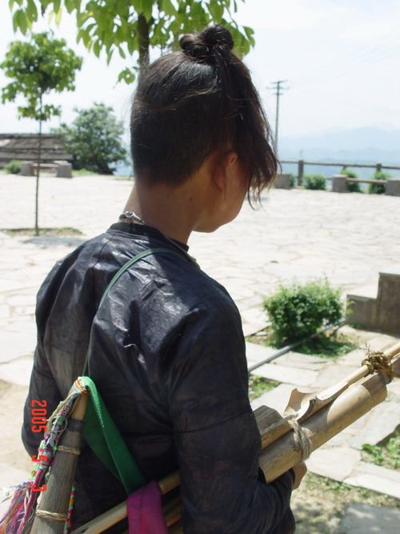

寨里古树参天，遮天蔽日，风景如画。每一棵大树都编了号，树上有草绳做的秋千，树很高很大，人在秋千上荡，树动也不动。岜沙苗家的男女青年都是在秋千上恋爱，[每年的农历6月初7](http://www.caacjournal.com/cj03/rp.php?id=351481)，是秋千节，男女青年就在大树上荡秋千，要荡3天3夜。有女青年一人荡秋千，如某男青年看上她，就跳上女的秋千上共同荡，并踩女的脚示爱，女的如果也中意男的，就踩男的脚，再共同荡秋千。女的如果没看上那男青年，她就不睬那男的脚，男青年就会下去，再觅另外的秋千，再找另外的女子。

在岜沙我认识了一个11岁男孩，上小学二年级。个头只有我们这里7、8岁孩子那么高。他叫易真强，有个三岁的妹妹，他在妹妹面前真有点男子汉的气质呢。易真强带我去村子里逛，摆出各种姿态让我给他拍照，一点不认生。然后邀我去荡秋千，那是一根拴在高树上的麻绳，荡的时候他能在空中做出一些姿势，胆量不小哦。我也上去荡秋千来着，那感觉好象在原始部落里似的，很有意思！后来他说他要去拣塑料瓶子，要我等他。他每月靠卖塑料瓶能获得2-3元钱，一个瓶一角钱。临走前我丢了些零钱给他，嘱咐他去买文具之类的学习用品。  
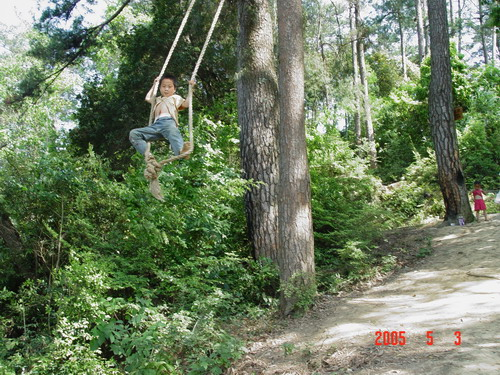   
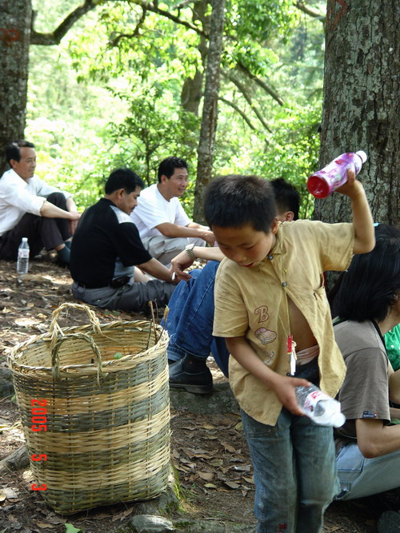

---

## 评论（3）

**[Chinese Tea &raquo; 从江县-岜沙](http://christina.tecinese.com/index.php?p=3634)** · 2005-05-09

[...] �来梳理秀发的，糯米汤的营养把岜沙女子的秀发滋润得乌黑发亮。 [更多内容......](http://www.tecinese.com/index.php?p=408#comments)  
  
  
  
  
  
  
Comments » The URI to TrackBack this entry is: http [...]

**montecarlo** · 2005-05-10

去年去岜沙背了一些文具过去,有些自驾游的一箱箱的抬进去,很多人都自发地关心那里的教育

**oakland** · 2005-05-10

糯米汤和鸡蛋清的类似作用还可以在客家土楼的用土中见到。  
  
“一碗猪肉换一碗三合土”。 这句客家谚语的真实性不必深究，但土楼外墙用土的配方却实在繁复、考究。首先，它的主要建筑材料必须是没有杂质的细净红土，再按一定的比例掺以细河沙、水田底层的淤泥和年代久远的老墙泥。充分搅拌均匀后，加水用锄头反复翻整发酵。这道工序对土楼的建造至关重要，混合泥发酵的充分与否将直接影响土楼建成后的使用寿命。土楼的外墙泥如发酵不到位，就会使墙体在温度和湿度变化时产生开裂现象，威胁到土楼内住户的安全。   
  
　　这样按比例配合而成的泥土被称之为三合土，但这还不是最终的建筑用土，还必须在里面加入上好的红塘、打散起泡的鸡蛋清、不见米粒的糯米汤。这样讲究的配方，“一碗土换一碗猪肉“倒也实不为过。夯建土墙时，还要在泥里加入一些木片、竹片或是大块的山石以加固墙体。这样夯成的土楼外墙将不惧水浸，坚如磐石。在没有钢筋水泥的年代，聪慧的客家人就是用这种看起来近乎原始的建筑方式，建成了神秘而庞大的土楼，成就了建筑史上的奇迹。

