# 榕江—五榕山、车江侗寨

> 榕江是进入侗乡的第一站。这个县名的由来和都柳江边成排的榕树有关。经过几百年的风风雨雨，如今的榕江县城还有40余株百年上下的榕树。这些榕树根叶茂盛，既装饰了风景，又保护了土堤，成为侗乡人生活的一部分。在当地的文化传统中，树木和山林都具有天然神性，黔东南的苗、侗人民素来就有敬树植树的传统。 榕江是贵州省唯一一个地跨月亮山、雷公山的县份，也是国家重点扶贫县。位于贵州东南部，都柳江中上游，幅圆面积3315.8平方公里，辖20个乡镇（其中民族乡6个），总人口32万余人，其中以侗、苗、水、瑶为主的少数民族人口占84.4%。2002年全县国内生产总值完成5.6亿元，财政收入2950万元，财政支出12560万元，农民人均纯收入1310元。榕江旧称古州，为江南八百州之一，历史文化悠久，享有“风情浓郁、璞玉浑金、无迹不古、山水独秀”的美称。由于有得天独厚的水上交通，省内外商贾纷至云集，古州商贸繁华，昔有“小南京”之美誉。

[**进入“榕江”相册...**](http://www.imagestation.com/album/pictures.html?id=2127095841)

这次旅行只是定了大致的路线，到了目的地临时再决定去什么具体的地方。听说到西江千户苗寨的路况不好，因为交通不便的原因，很多苗族家庭就聚集到西江居住，郎德虽只有一百多户人家，没有西江千户那么多，但仍可以充分展现苗家风俗风情。征求当地人的意见看过郎德上寨便不准备去西江而直接前往榕江。

朗德上寨出来在路边招手拦去[榕江](http://www.gz-travel.net/zhuanban/rongjiang/)县城的长途汽车，上车后各付35元车费，车程大约4小时，大多是盘山公路，我们在汽车上随着公路被甩来甩去，这是一段令人作呕的行程，车上大多数人都在呕吐，车主准备了几十张黑色的塑料袋挂在车门口，需要的人就抽一张，可是这些用过的塑料袋却被随意扔在山野路边......奇怪的是我们这些背包客大多完好的或睁大眼睛看风景或靠着背包打盹，也许是兴奋过度了吧！路上可以看见村民从山上引下来的山泉水，为了方便路人饮用有的池边还会放着瓷碗。由此可见当地人的朴实与善良。路上常常载上招手拦车的山民，有个送孩子去雷山县的母亲身着白色斜襟绿色盘扣上衣，下面为丰富色彩的刺绣围裙及黑色绑腿，耳朵上戴着一副夸张的旋转式样的白银耳环，我被深深的吸引住了。问车主哪里可以买到这些东西，他们笑着说应该在县城能买到。但是后来的旅程中一直没有遇到那么好看的衣服和饰品。  
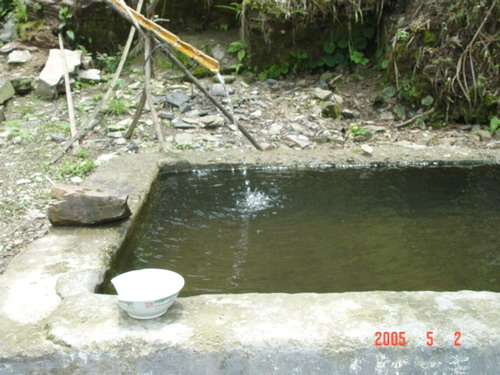

到榕江后遇见许多背包客，和整个县城的气氛有些不协调。县城的形象干瘪而萧条，灰尘极大，街道路上穿梭着银灰色夏利出租车与这个县城也有些脱节。不出城出租车一律2元。几番询问后住进“民政宾馆”，据说已经承包给私人经营，一晚住宿费80元，和招待所的条件差不多。在榕江买了两只梨一只苹果，和凯里一样让人失望的口感。花2元钱在一间网吧上了会儿网，之后在隔壁的大排挡里和妹妹各吃了个米线砂锅，味道一般。第二天为了了却吃酸汤鱼的心愿，在榕江县内找了家小餐馆，18元一斤的鲤鱼，店家说我们要的那条大约一斤七八两中。酸的感觉没吃出来，倒是有泰国冬阴功汤的味道，里面的香草也与冬阴功汤没什么两样。在榕江最窝囊的是我居然把在郎德买的一副刺绣和一只银手镯遗忘在民政宾馆里了，待我们游完五榕山和车江侗寨折回头去询问，宾馆里的服务员一脸无辜地说房间里什么都没有发现，我的对这个回答的判断只有一个，NND~~

**五榕山**：乘出租车前往2元，离县城非常近。步行过一座宛若长虹的钢混入行桥，桥之东端是山的入口处，5角钱门票进山门，大约走十几步远便是一座六角形的“迎客亭”，走过一弯翠竹、鲜花夹道的地段，便到了“瞻园”，这是五榕山的中心部位，3株参天古榕覆盖的这片平坦地面，约莫数十亩宽广。中间靠山的是“五榕庙”，仿古建筑。和上海的表妹各请了一柱香烧，庙前石阶左右两边各两个香炉，将手中的香按照当地规矩从左至右每个香炉里各插三支。如若没有充足的时间，美若仙境的风景也只能是匆匆一瞥了。  
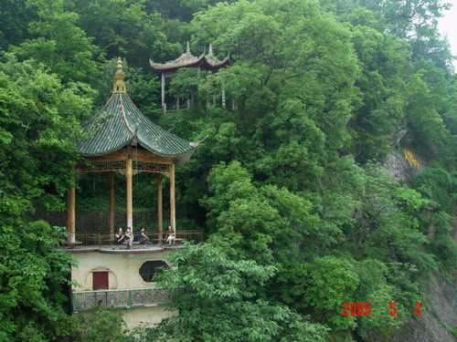   
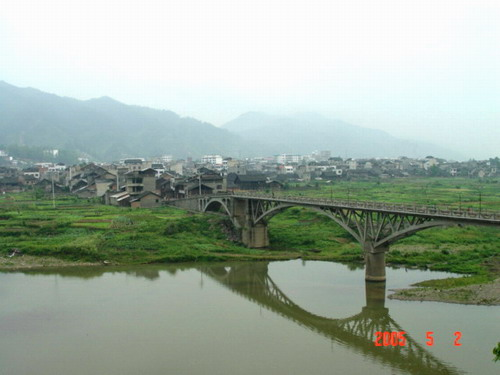

**车江侗寨**：榕江古州镇的对岸，便是举世闻名的车江大坝，大坝上一片密集的瓦檐和木楼，就是号称为“天下第一侗寨”的车江侗寨，又称三宝千户侗寨，位于县城北郊，共2433户、12503人，其中侗族人口占94%，一条清亮亮的河傍寨流过，那便是榕江了。从县城乘出租车过去8元，为了返回方便下车时要了司机的电话。遇上几个出租车司机，一问都是四川过来的。他们家乡的出租车每月缴费比较高，已经很难赚更多的钱，于是到榕江来做出租车生意，一辆车大约7、8万便可证照齐全的上路了。他们认为这个投资就好象股票，等着涨上来的那天。

车江侗寨中保留着完好的侗族生活场景，家家务农，户户纺纱，寨头村中有最古老的侗族祖先”萨堂”庙。“尊贵”的客人进寨，好客的车寨人会为你行“拦路酒”礼。着白色侗家服饰的少女，手捧酒盏，轻启朱唇，唱起了敬酒歌，香醇的米酒就着甜糯的歌声滑入了你的五脏六腑，令人沉醉。一个朋友对侗乡曾有四字概括：侗乡如歌，真是诚哉斯言。

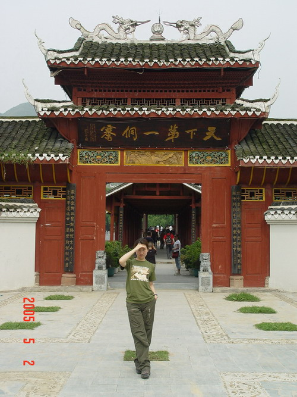   
表妹在车江侗寨前。侗族源于古百越族系，秦汉时由百越西瓯中的一支自长江支流沅水向西南迁徙于今贵州、湖南、广西三省区毗邻地区，分布在贵州的黎平，从江、榕江、天柱、锦屏、三穗、镇远、剑河、玉屏一带。 侗族有自己的语言，属汉藏语系壮侗族侗水语支。侗族无文字，通用汉文，1949年后创立了拉丁字母拼音的侗文。现在还是多以汉语为交际工具。

**鼓楼**：当你看见鼓楼的时候，便可知到了侗乡。侗寨鼓楼，外形象个多面体的宝塔。一般高20多米，11层至顶，全靠16根杉木柱支撑。楼心宽阔平整，约10平方米见方，中间用石条砌有大火塘，四周有木栏杆，设有长条木凳，供歇息使用。楼的尖顶处，筑有宝葫芦或千年鹤，象征寨子吉祥平安。楼檐角突出翘起，给人以玲珑雅致，如飞似跃之感。

鼓楼是侗寨团结吉祥的象征，兴旺的标志，齐心的表现。因此，有侗寨即有鼓楼，或以房族修建，或几个姓氏合建。每个侗寨至少有一座鼓楼，有的侗寨多达四五座。过去鼓楼都悬挂牛皮长鼓一面，平时村寨里如有重大事项，即登楼击鼓，召众商议。有的地方发生火灾、匪盗，也击鼓呼救，这样，一寨传一寨，信息很快传到深山远寨，鼓声所及，人们闻声而来。

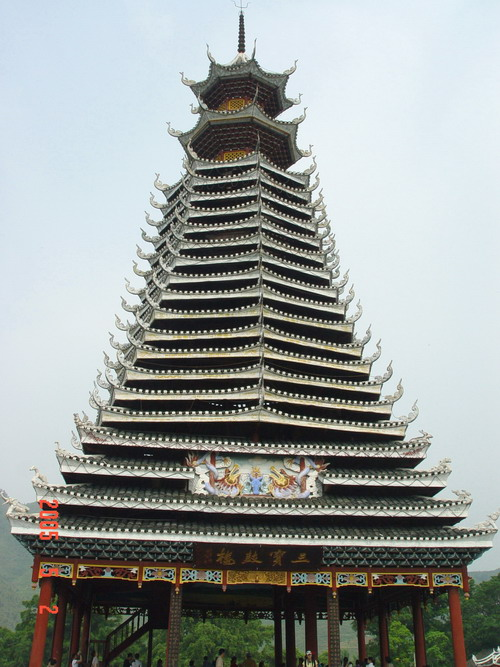   
侗寨鼓楼

**萨玛**：侗语中的“萨玛”是大祖母的意思。相传早在母系氏族社会阶段，侗族有一位英勇善战的女首领，在御敌入侵的战斗中，屡建奇功，深受人们的敬仰和崇拜，然而在一次兵力悬殊的战斗中壮烈牺牲了，侗族后人尊称她为“萨玛”，将她奉为神灵。为了纪念萨玛，在每年的春耕之前（农历正月或二月）或秋收之后（农历九月或十月）的农闲时间里，择吉日而祭。人们在寨子中间的坪子垒起土堆，即萨坛，作为供奉和祭祀的场所，后来萨坛改成小木屋，到了清代光绪年间，各村寨的萨坛才改建成砖砌“然萨玛”即萨玛祠，屋里设一把半开的黑伞，黑伞下垒有一堆石头，象征侗家人在萨玛的英灵保佑下幸福安康、齐心团结。萨玛祠前一般都栽有柏树或杉树和一种常绿植物，以示萨玛英灵万古长存。祭祀活动全部是已婚的妇女参加，祭师是整个活动中唯一的男性。祭祀的祭品也相当讲究，必须用母鸡、公鸭、黑猪，但不能用刀具结束其生命，猪由几个壮汉将其按下水池溺死，鸡也是如此方法，鸭子则是用绳索套住颈部将其勒死。

前来祭萨的妇女每人喝一口“祖母茶”，心里祈祷侗族的大祖母也保佑我。随后是迎萨出门，点燃三响火炮，吹响芒筒，二十位举着黑底白色龙、凤凰的旗帜的妇女在前面引路，颇有当年大祖母出征的气势，长长的队伍跟着“萨玛”踩路，绕寨一周。最后到达耶坪（侗族唱歌的开阔地），“萨玛”被全是盛装打扮的妇女和年轻的侗族姑娘层层圈在中央，大家手拉手唱起了赞颂萨玛的歌曲“多耶”，她们用歌声来祈求萨玛的英灵赋予人们以力量，战胜自然灾害，赢得五谷丰登、人畜兴旺、村寨安乐。歌声回荡在天空。这样的活动要持续一星期，在这一周里妇女们平日操劳的家务都让给了家里的男人。

这个侗族妇女的节日，也可以说是侗族的母亲节。它带着悠久的远古母系社会遗风走来，正如萨玛祠门上写的：“圣德绵长延万世、母仪庄重祀千秋”。

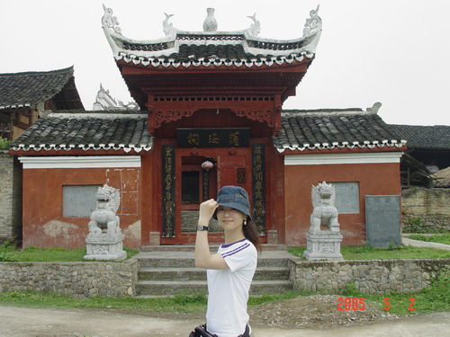   
萨玛祠

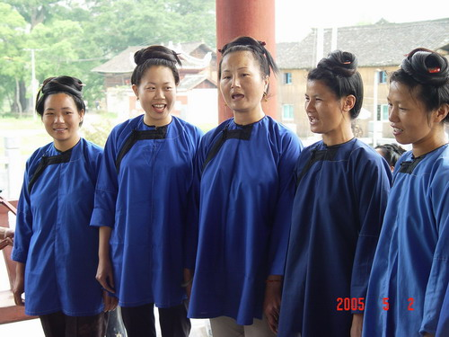   
鼓楼前唱歌的侗族妇女

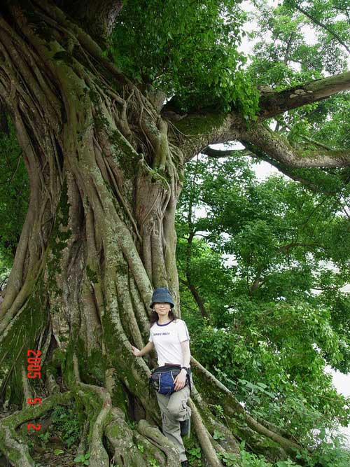   
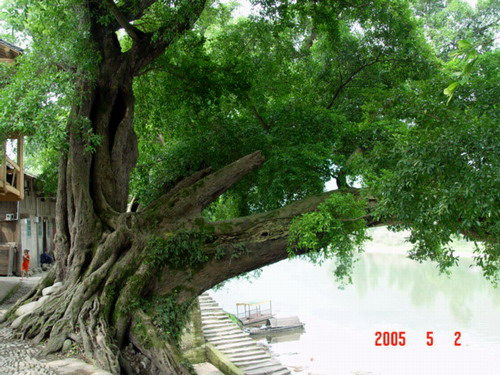   
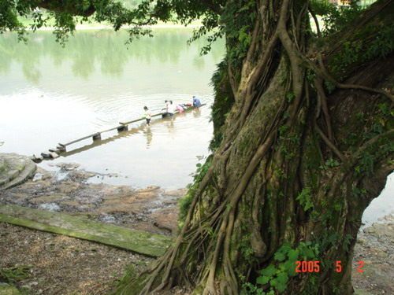   
侗寨里的古榕树。榕江因 榕树多而得名。境内的榕树，百年乃至千年以上树龄的多达一千余株。这些古榕树盘根错节，千姿百态，昂霄竦汉，郁郁葱葱，堆碧涌翠，古老苍劲，奇异传神。古榕最密集的地段，当数车江乡英塘寨到章鲁寨一侧的河岸，无数古榕组成了罕见的阵容庞大的古榕群。这就是闻名遐迩的古榕风景名胜区。古榕成群成阵，相依相伴，保护河堤，远观仿佛是一片绿色的海洋。2000年，榕江古榕风景名胜区经贵州省人民政府批准，列为省级风景名胜区。榕树的奇特造型和无比强大的生命力造就了榕树的”十大奇景”：”古榕包碑”、”古榕吞庙”、”生死恋”（苦楝树与古榕合体）、”至爱悲剧”（古榕抱死古枫）、”苗女开裙”（根如裙播）、”九龙入海”（古根盘结如龙）、”榕根瀑”、”榕根墙”、”姊妹榕”（又称”珠郎娘美）、”夫妻榕”等。

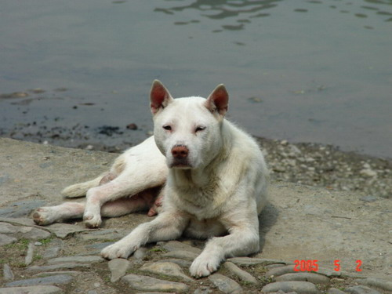   
苗族侗族寨子里多是这种白色短毛狗，妹妹最怕狗，认为那里的狗长得象猪。

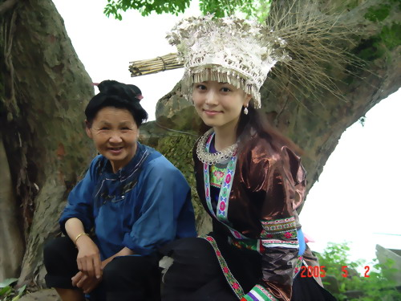   
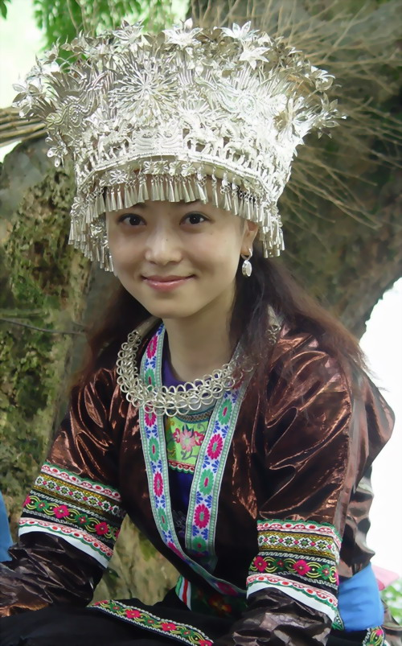   
租一套民族服装5元。旁边有个侗族阿婆坐在树下休息，正好一起合影。阿婆慈祥的很，拍照后立刻跑回家拿来一张面饼送给表妹吃，哇...南京的阿婆要是也这么仁慈就好了。

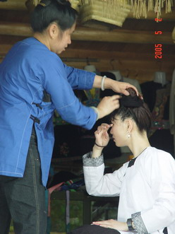 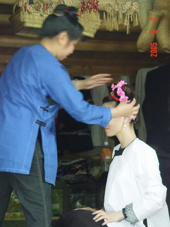   
谁家女子在梳妆？  
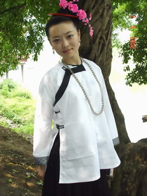 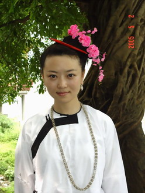   
侗族服饰。侗族的服饰男女有别，男装和汉装无异，妇女也因地区不同而各有异。农村里，妇女穿青色百褶裙；打绑腿，有的地方穿长裤，束围腰，系飘带。足穿云钩鞋。冬青穿右衽无领衣，夏秋改着开襟衣，衬胸襟。头盘髻，包青布大包头，喜银器。

首饰的种类，有项链、耳环、吊环、银簪、银梳、银项圈、银手镯、银帽、银花等。这些首饰，一般都是用白银铸造的，只有小耳环，用黄金或黄铜铸造。在众多的首饰当中，最大最重的要算银项圈和银帽。大的银项圈，从颈脖挂到腰部，有八、九斤重。银帽，有的有十斤重。最小最轻的算是耳环，重量只有几钱。如果就式样而言，一种首饰往往因人地不同而千差万别。就拿耳环来说吧。有的形如一个花环；有的形如一串串香菇；有的象弯曲的竹根；有的象缠树的山藤；有的象跃水的鲤鱼。少女戴的耳环小巧玲珑，富有童趣；姑娘戴的耳环艳丽多姿，闪耀着青春的光华；中年女妇戴的耳环朴素大方，潜藏着欢乐；老奶奶戴的耳环细小而有价值，寄托着希望。别的首饰，也往往根据年龄的不同而有区别，一般是青年女子戴的首饰最多最好。

侗家妇女的首饰，是一代传给一代的。通常是外婆传给母亲，母亲传给女儿，女儿又传给后辈。女孩多的母亲，首饰不够分，才重新铸造。在过去，女子没有权利与兄弟一起享受父亲留下的房屋、田地、山林、耕牛这些财产，得到的只有身上戴的首饰和自己纺织出来的一些布匹。出嫁时，一般没有更多的陪嫁物。比较穷的人家，女儿出嫁时，父母也得想尽办法，置办几件首饰。因此，在侗家，没戴一件首饰的女子，是少有的。母新生下女孩，在月子里就给她的耳垂上穿孔，并用丝线结环戴。女孩长到七、八岁，就开始戴上银环。解放前，富家女儿出嫁，戴的首饰常有几十斤重，迎亲路上，要人扶持才能行走。首饰找谁铸造？侗家有自己的能工巧匠。银帽(侗语谓之“花美”)的铸造，技术难度是很大的，往往一顶银帽，就有几十种鸟、兽、虫、鱼、花、草的图案，千姿百态，栩栩如生。铸匠凭着一架炉子、一把锤子、一把钳子，就巧夺天工地铸造出来，令人佩服。

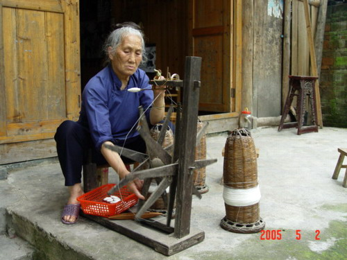   
坐在家门口纺线的阿婆

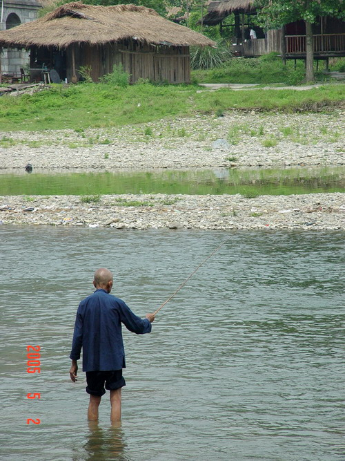   
站在河水中钓鱼的老人，我们一直称他为“可爱的老头”。

   
河边洗东西的侗族妇女。

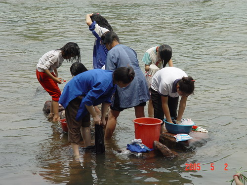   
洗头发洗衣服使用的也是河水，可见保护环境是多么重要的大事。

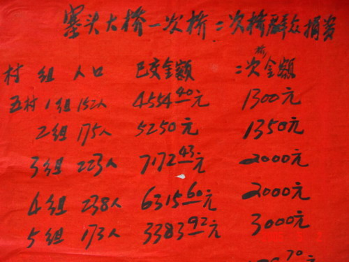   
张贴在村子里的捐款海报

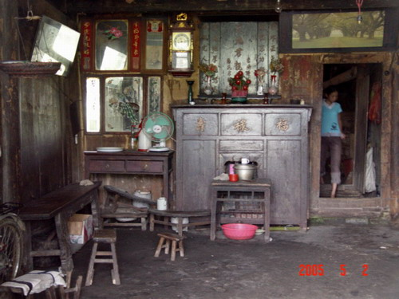   
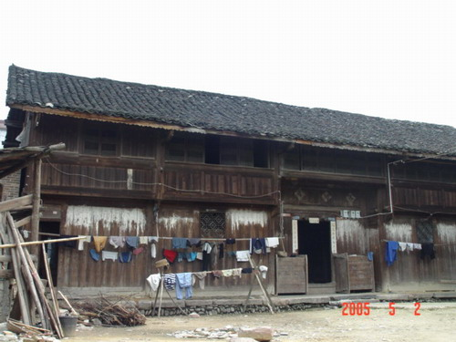   
侗族房屋。侗族喜爱使用木结构建筑物，不论是房子、戏台、仓库，还是桥梁或鼓楼，皆为木质结构，都采用杉木，以木榫、木栓穿合，不用铁钉，结实牢固，扣合无隙。

---

## 评论（9）

**oakland** · 2005-05-09

亭子和牌楼都比较汉化啊。掩映在绿林中的亭子旁边还有个摩崖的“佛”字，实在是修身养性的好去处。侗族没有创造自己的文字，牌楼的对联和横匾都是汉字。

**nick** · 2005-05-09

怎么感觉象以前西南剿匪影视作品里的压寨夫人啊!呵呵呵

**yaohui** · 2005-05-09

待有时间好好看看，穿侗族服饰的你很有味道 哦！

**[ashley](http://dunletgo.blog-city.com)** · 2005-05-09

跟阿婆合影的那张,仿佛是18岁的笑容诶,好漂亮

**[KanJing](http://blog.csdn.net/kanjing)** · 2005-05-09

好玩，好看！  
第一件衣服好看，白色那件有点不合调

**montecarlo** · 2005-05-10

Christina的少数民族look好PP.  
我上次去黔东南见的侗衣多为黑色,还没见过白色的呢.  
侗家女子因长年染布,手指都是黑黑的

**Christina** · 2005-05-10

侗族服装分季节的,可能我穿的这套是天热的时候的衣服，我当时选的白色，也有其他颜色，诸如蓝色、黑色...

**oakland** · 2005-05-10

手绘的苗族姑娘，手捧山上引下的泉水。  
http://www.youthyear.com/cg/yy-cg41.htm  
即使满地落叶，只要有水，生命就有继续生长的能量....

**心随风舞** · 2005-12-11

跟我们02年走得线路一摸一样，连那个穿白衣的侗族女子都没有变，还有那棵大榕树。：)hehe

