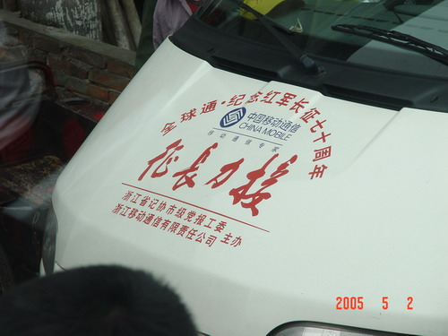
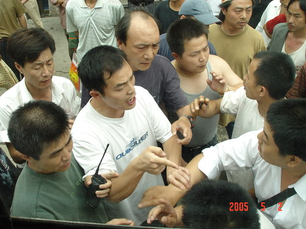
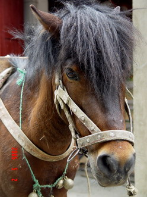
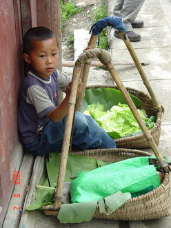
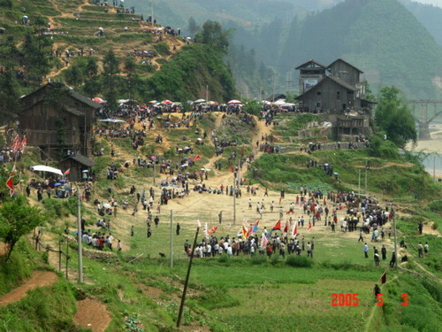
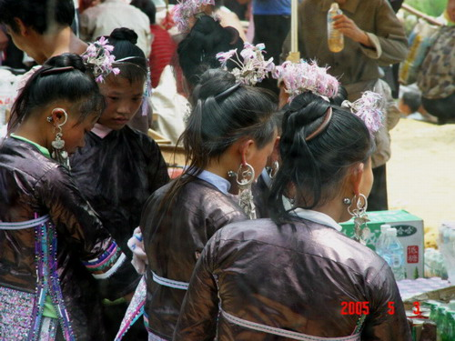
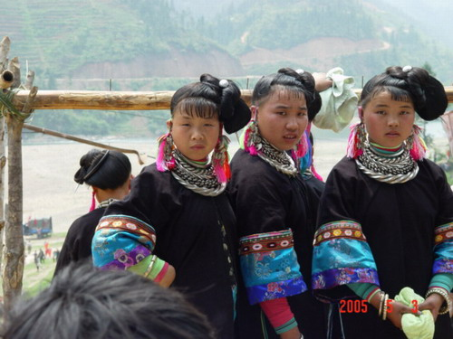
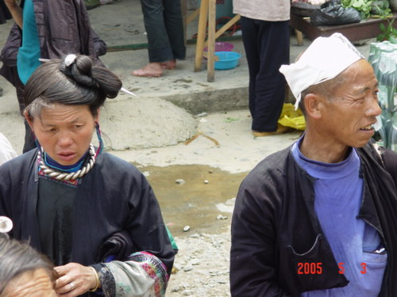
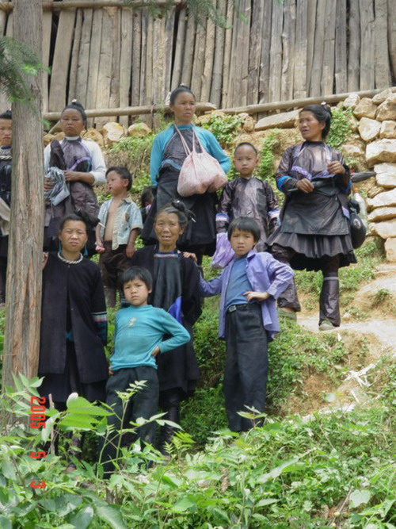
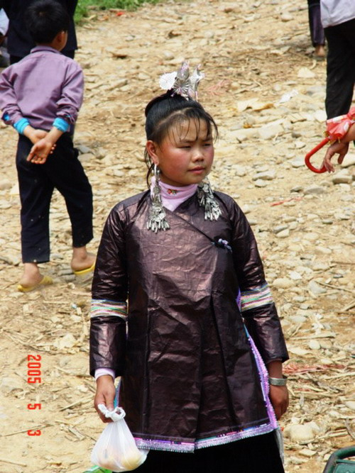

# 插曲两则

插曲一：郎德至榕江的途中遇见一个镇子赶集，路上都是人、车和驮货的马。迎面来了一队汽车，上面写着“全球通-纪念红军长征70周年大型联合采访活动”，我们乘坐的长途汽车没有让对面最前面的大车，僵持一阵之后长途汽车右边的小长安移开把路让出来，长途汽车往边上打了个方向大车过去了。可是大车后面的依维科不高兴了下来就指责长途汽车上的司机，指责这个司机太坏，似乎还有动手的意思。后来经人劝架大家也散了，长途车走了一小截被警察拦下来，司机和陪驾被叫到派出所去了。我们一车人被晾了好长时间，呵呵~~不过看到了水族，还拍了一张马儿一张儿童的照片。

因为没有主动让路给他们走，难道还要把他们关起来不成？瞅瞅这些所谓文明世界里的文明人，品德姿态又高尚多少？气度也可想而知了。当年解放军夜里到村寨里为了不打搅村民夜宿屋檐下，如今“纪念红军长征70周年大型联合采访活动”应该是一次意义非凡的旅程，只是这态度是不是还应该更谦和低调些呢？

   
   
 

插曲二：榕江至从江车费每人16元，经过从江的停洞时，恰逢当地人举行“斗牛节”。当地不说“斗牛”而是说“牛打架”。斗牛场设在321国道下的河边上。路边设的摊，几乎都与牛有关，如卖的都是牛肉、牛皮、牛蹄什么的。每头牛都在赛场边“安营扎寨”，用树枝围上一块小空间，就聊作“赛前休息室”。有的还在一旁插上一块大木牌，牌上写着该牛的番号，如“高脚王”、“万人迷”等；有的还写上该牛的“丰功伟绩”。营寨边都插满了三角色旗，有的村民在吹奏乐器，有的摇旗呐喊，一时间芦笙阵阵，旌旗猎猎。

停洞镇的集市日是逢农历每4日与9日，此时为拍摄少数民族最佳时机。更佳的还是这里的人对照相很感兴趣，尤其是那些视赶集如过节而精心穿戴的少女们，她们很乐意跟你照相。 停洞和下面我们去的岜沙同属几十种苗族之一的“黑苗”。

苗族服饰反映了苗族历史悠久、居住分散风俗多样的特点，苗族支系与支系、县与县，易于寨与寨之间在服饰上都有严格区别。其服装的主要色调亦不尽一致，所谓“白苗”、“黑苗”、“花苗”、“汉苗”等就是依据所着服色或服式而来的自称或他称，也有根据妇女的裙样，称为“长裙苗”和“短裙苗”的。 其实，同一种称呼之严，不同地域的妇女服饰也各各不同。同是“白苗”，麻栗坡一带的人，上着圆领开襟窄袖青布衣，袖肘以三道黑布镶衬，内着白色衣，领围胸襟露出白衣，额部以白巾交叉而缠，白巾上又缠黑巾，黑白分明；而镇雄、威信一带的“白苗”，穿青黑色斜襟长衣，下着绉褶花裙，凡领边、袖口、围腰都以五色丝线镶绣，以宽约五寸，长达丈余的青黑布缠头，突出的白色在于裹白布绑腿。  
[更多内容......](http://www.pep.com.cn/200406/ca522099.htm)  
   
   
   
   
   

---

## 评论（1）

**[woods](http://www.20six.co.uk/vanlam)** · 2005-05-09

我还是喜欢你写字、摄影的感觉！

