# 芭蕾舞剧《大红灯笼高高挂》

> 原先christina\_ss@hotmail.com的帐户停用，换了新帐号，需要的朋友添加一下!
> hqoo@hotmail.com

芭蕾舞剧《大红灯笼高高挂》5月14日、15日在南京人民大会堂演出，能在南京看到喜欢的舞蹈演出是件令人幸福的事儿。可惜南京这类文化活动太少太少......平时经常有人说我瘦，与舞蹈演员相比我已经算胖的了。很喜欢舞蹈演员腿部肌肉的线条，他们每天练功促进血液循环，大多气质优雅肤色健康。后台的帅哥美女不是街头我们常见的那种类型，所以那么多不同寻常的帅哥美女同时出现也蔚为壮观。

由张艺谋导演、陈其纲作曲、王新鹏编舞、中央芭蕾舞团制作并演出的芭蕾舞剧《大红灯笼高高挂》，在保留传统芭蕾元素的同时，将中国国粹艺术”京剧”与现代芭蕾进行了完美的结合，并在艺术手段方面有着大胆地创意和创新，是一部极具观赏性并有着深厚中国历史文化背景的舞剧。

*文字来源：[http://www.enet.com.cn/](http://www.enet.com.cn/life/ent/yc/200410/20041019353792_1.shtml)   
图片：是我在场内拍摄的*  
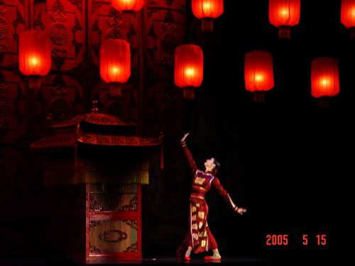   
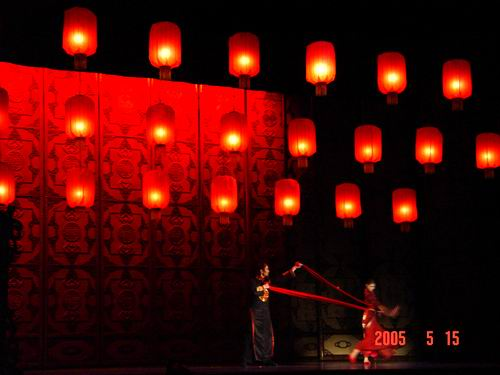   
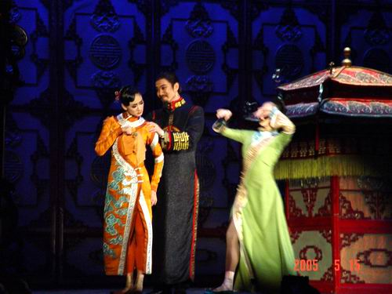

●故事情节

这肯定是人们最关注的内容之一。正像张艺谋事先提示的那样，他把电影《大红灯笼高高挂》的情节进行了大刀阔斧的改编，极大地简化了人物关系，只保留了故事中老太爷、三位姨太太，增加了三姨太的情人——戏班年轻小生。故事就是围绕着三姨太与小生之间对爱情、自由的追求展开的。与张艺谋擅长电影故事有关，这个芭蕾故事也特别强调曲折、复杂和逻辑性，三幕演出中每一幕都包含相当曲折的情节。比如：青梅竹马、被迫出嫁、洞房花烛夜、堂会偷情、麻将偷情、二姨太告密、二姨太点灯、棒打鸳鸯，而每一个情节的具体表现手法也可以看到张艺谋描写故事的丰富想象力。

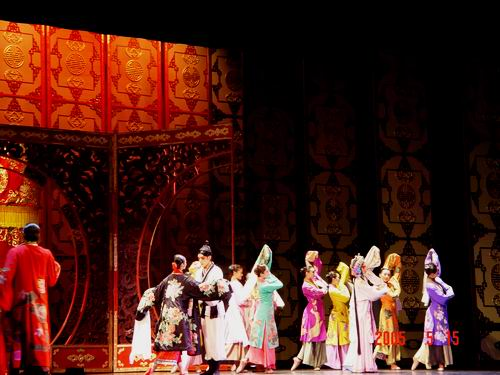   
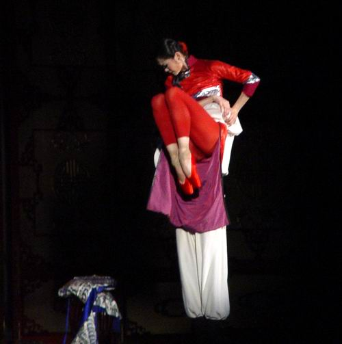   
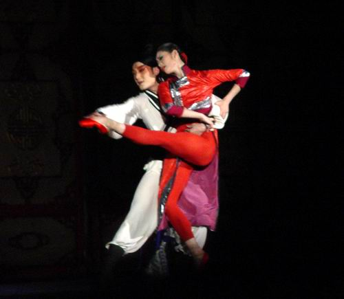   
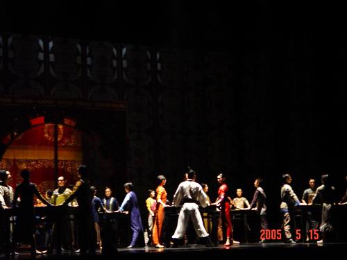   
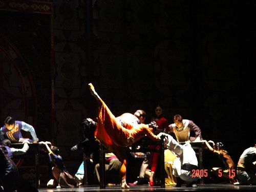   
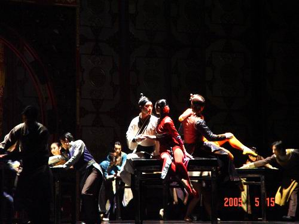   
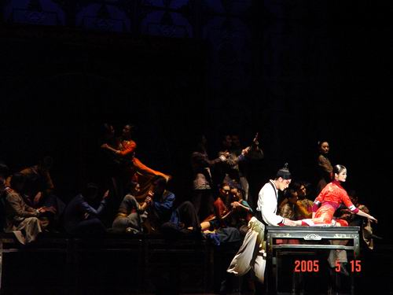

●音乐特色

这是一个极富中国民族音乐特色又充满现代气息的芭蕾音乐。作曲家陈其钢大量运用了中国的京剧、民歌、民间曲调、民间打击乐，运用现代音乐的表现手法，有旋律优美的双人舞音乐、有突出气氛的唢呐和笙独奏、有模仿洗麻将的效果声、有家丁乱棍的效果声、有二胡与大提琴的对答、还有京戏青衣幽怨绵长的吊嗓。看似素材杂乱，但却运用自如，从一种形式进入到另一种形式自然流畅，不留斧凿。

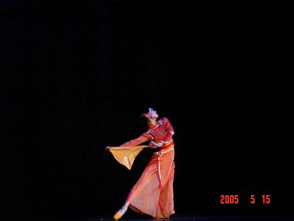   
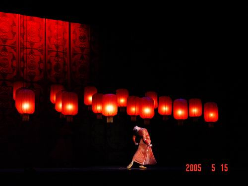   
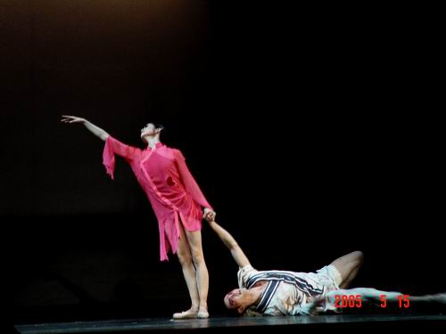

●舞蹈设计

这个版本的舞蹈特别强调故事性和情节性，但也很注重装饰性，甚至借鉴了中国皮影戏的表现手法。在第三幕中还有大段的双人现代舞，但民族舞在其中占了相当大的比重。其中：独舞、双人舞、三人舞、四人舞、点灯群舞、轿夫群舞、麻将群舞和水袖集体舞都非常有特色，并有着芭蕾舞剧的舞蹈结构。序幕的双人舞是由身着学生装的女主角与身穿戏装的武生表演的，与其说是双人舞，不如说是以武生作活动道具的女子独舞，优美而缠绵。而这个舞剧中还第一次使用了四个真正的京剧演员。

●舞美服装

这台舞剧的舞台美术可谓满堂生彩。中国的旗袍第一次被搬上芭蕾舞台，不仅没有影响演员的舞蹈，旗袍的样式、色彩都给人印象深刻。开幕时的４４只大红灯笼富于强烈的装饰性；多层落地可活动的隔扇门也蕴涵着多层的意义；戏中戏的月洞门，既象征着舞台，也象征着床笫。最强烈的视觉冲击来自于第一幕结束段的第一次见血，张艺谋用一整块可铺满舞台的红绸缎翻滚铺盖在老太爷和三姨太身上，把一个初夜的情节渲染到了极致；而最后的棒打鸳鸯又使用了整面的白墙，并由白变成血红色，都有着独特的戏剧效果。

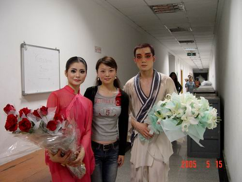   
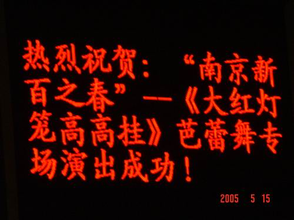

---

## 评论（8）

**[Chinese Tea &raquo; 芭蕾舞剧《大红灯笼高高挂》](http://christina.tecinese.com/index.php?p=3641)** · 2005-05-16

[...] 舞剧。 文字来源：http://www.enet.com.cn/ 图片：是我在场内拍摄的 [更多内容......](http://www.tecinese.com/index.php?p=411#comments)  
  
  
  
  
  
  
Comments » The URI to TrackBack this entry is: http [...]

**don** · 2005-05-17

我一直想问，是什么样的人在，看这些舞蹈？中国的那些阶层在欣赏艺术，在欣赏音乐，在欣赏舞蹈？ 昨晚，羽毛球，中国赢了。 我发现自己还是在家中看的电视直播，几百元的门票，不知道是花不起，还是觉得没有买排骨实在。可能，Show与Sports是一样的，对于我来讲，都很贵。贫民百姓的生活，就是这样的。

**Christina** · 2005-05-17

大多是贫民百姓在看舞剧。大部分票是单位买下来作为福利发给员工的，大家应该了解中国的福利制度，只是现在渐渐改变了。演出成本不算低，那么多演员、舞美音乐等等，几百元票价比起什么个人演唱会应该还是合理的。

**coco** · 2005-05-17

我不讨厌舞台句,可是非常讨厌张艺魔:) 太肤浅庸俗. 我到考虑看张学友的< 雪狼湖>.很久没有看你的页了.你胖了点,有女人味了:)

**churen** · 2005-05-17

高行健的“现代禅剧”也挺有意思，可惜只看过剧本和剧照，没机会现场看。

**astro** · 2005-05-19

一直很喜欢这里，这里的文字和图片...

**Christina** · 2005-05-20

如果能在南京看到袁泉和刘烨主演的孟京辉话剧《琥珀》，是非常开心的事情！

**Liz** · 2005-09-19

請問有沒有二太太 被趕出門的劇照? 她的那件 月白色S排扣的戲服, 好美.

