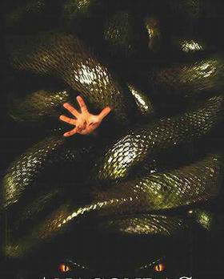

# 无伤

3点55分惊醒，同样的噩梦。  
半梦半醒......到7点起床。

生活在更多时候风过无痕似的忙碌...闲暇...枯燥...平静...但噩梦仍然是噩梦，是一枚植入心脏的芯片，象空气一般毫无感觉却又无时无刻不起着作用。有部片子叫[《**狂蟒之灾**》](http://ent.163.com/ent_2003/editor/movie/film/040823/040823_303109.html)，同样的蟒蛇在我的梦中出现，当它张开血盆大口吐出的是一朵蓝色的喇叭花，又名“千牛花”。这情形似乎有些滑稽，但总是这样，毫无改变。事实上在蓝色的喇叭花下面隐藏着的阴毒足以杀死遇见它的所有人。3点55分之前它缠绕在女友的裸体上贪婪地游动，向我的女友闪烁着动人的眼神，并张开口吐出那朵娇艳而绚丽夺目的花朵，它那本就卑劣龌龊的形象顷刻间在女友的瞳孔里变成了一个天使，当我的女友正要迎上去亲吻那朵蓝色的花时......梦醒了......意识却仍然在拉扯劝阻女友，在美丽的花朵面前女人除了失去正确的判断力，还会失去什么?

---

## 评论（1）

**hyx178** · 2005-05-29

something lost

