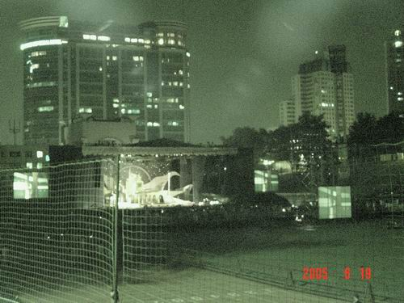
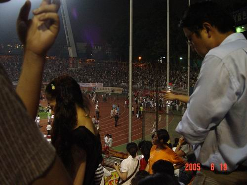

# 露天体育馆的《雪狼湖》

昨天晚上去看张学友的[《雪狼湖》](http://www.snowwolflake.com.cn/)，以为是在五台山室内体育馆，没想到居然舞台是在露天的体育馆。几万人的体育馆基本上都坐满了，不可忽视的名人号召力，380元的票只能看见很小的人影在舞台上移动，看得不仔细会丢失了目标。脖子和眼睛那个累啊！

这种音乐剧在剧院里演出应该更合适，会有好的视觉和听觉效果，在露天体育馆演出一场可得几场剧院演出的收入，肥了主办方苦了掏钱消费的观众，实在是不负责任的做法！好端端的艺术作品，观众本可以享受的过程，结果被“利益”二字弄得有些可笑滑稽了！不过张学友和陈松伶的演唱功底和表演还是蛮出色的，汤灿的演唱倒显得没什么特点。

总之，鄙视把音乐剧搞到体育场演出的人！！！

*相机夜景模式拍摄到的舞台及周围环境，远处的高楼是“古南都饭店”*  

*半场休息时间，对面看台上黑压压的观众，让人误以为是在观看足球比赛  
*

---

## 评论（5）

**[只说](http://www.donews.net/sayon1y/archive/2005/06/20/437908.aspx)** · 2005-06-21

**芙`蓉`姐姐问题**

**citycorner** · 2005-06-21

西安马上也要演了，好象也是在体育场

**[thyamy](http://www.blogcn.com/User6/thyamy/index.html)** · 2005-06-22

体育场就不要去看！！不能便宜了主办方！！！

**xm** · 2005-06-25

Life is similar to Rape.  
if you cannot fight back, close your eyes and enjoy it.

**Sherry** · 2005-06-29

嘿嘿，我看的是580的票，离舞台最近的一个区，嘻嘻

