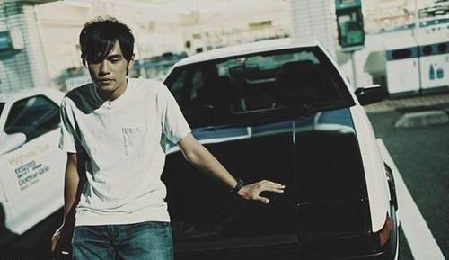

# 飘移de青春

下了雨的夜清爽而深远，车轮滑过路面带动积水的声音显得尤为拖沓，附近高楼大厦顶部的灯光急速的一闪一闪......很久没有对夜晚如此凝视和关注，梅雨季节的夜晚...我有珍惜的感觉。

今天的杨梅好吃。个儿大，色深，肉实，味甜，来自浙江慈溪，这让白天蕴满伤感的工作越来越不值一谈。这是一份不需要梦想和热情的工作，我，什么时候能不为职业感伤？今天我拥有了一个属于自己的狭小空间，这个空间将展延出其它生活计划，为此我等待了一个半月。年龄越来越大时，接触到粗砺晦暗的层面就越多，在还没有掉到虚假苍白市井的基础层面之前，虚弱有余的安全感让我无法辜负梅雨季节的生活，有谁能够真正做到彻底懈怠？

其实很想谈论一下上周日在工人影院看的电影《头文字D》，很想谈论一下小眼睛的周杰伦，对于形象的倾向...我...一直喜欢小眼睛单眼皮的男人...电影、音乐、旅游、汽车和BLOG让人前所未有的不想与人接近...今天为Te Cinese在[信息产业部ICP/IP地址信息备案管理系统](http://www.miibeian.gov.cn)做了备案，希望30号后网站还能继续在这个世界上存在。

   

没看电影前在央视2套“第一时间”节目中听到《头文字D》主题曲[《飘移》](http://mp3.baidu.com/u?n=2&u=http://upload.podcast.com.cn/temp1/Bw7wEPcNZP7fBPlhAu0F~AgIlwosAhn~KzI$.mp3)，里面那几句歌词很精彩：

> 我用第一人称在飘移青春
> 输跟赢的分寸计算的很准
> 我踏上风火轮在飘移青春
> 故事中的我们(在演自己的人生)

一直打算去看这部耗资1200万美圆的剧作，周日的电影院里观看这部电影的观众大多是少男少女，票价25元RMB。藤原拓海，很普通的高中生，传说中的飙车手藤原文太的儿子。因为每天凌晨都被家中那个臭老头逼着开车送豆腐的缘故，所以整天一副萎靡不振的脸孔，常被同学武内树嘲笑不知所谓，不懂赛车知识，没有男人志向。蓬乱的发，茫然的眼神，谁会想到这样一个没有什么特色的少年正是秋名最快、技术最梦幻的赛车手。男孩驾驶着AE86风驰电掣中的悠然神情，更增加了拓海的酷气质。拓海和茂木夏树的恋情因为周杰伦酸涩痴情的表演把千篇一律的初恋表现得愈加饱满。整部电影因为周杰伦的参演，余文乐、陈冠希和钟镇涛的光彩都被掩盖了，余文乐和陈冠希只是讲了几句台词摆了几个pose而已，俨然成了小配角。杜汶泽和黄秋生的表演还有看看之处，余文乐曾经评价杜汶泽说：“其实幽默的人、能逗大家开心的人才是真正成熟的人。”

漫画版《头文字D》是著名漫画家重野秀一在日本讲谈社出版的一部赛车题材的漫画，以3600万册惊人销量狂扫日本后，迅速风靡亚洲。在《头文字D》漫画中，作者重野秀一采用一惯传统的写实派风格，以其创新的赛车题材、跌宕起伏的剧情以及对赛车详尽专业的阐述吸引了诸多车迷。这部《头文字D》的电影上市后，是否会为这个夏天带来一些赛车的气氛？

---

## 评论（13）

**vekiegy** · 2005-06-28

我们这里也下雨了，为什么我写不出自己的心情，不一样的生活不一样的世界

**mendynew** · 2005-06-28

杨梅里面有小虫子，还是少吃为好

**ch** · 2005-06-29

Each man is the architect of his own fate.

**sxq** · 2005-06-29

什么是狭小空间？还等一个半月？是买车了吗？

**Christina** · 2005-06-29

是呀,昨天提到车了~~

**jiajialing** · 2005-06-29

强烈要求贴pp。。。:)

**sxq** · 2005-06-29

啥品牌的车？看你的网页品味不会太差吧？有点小资情调哎！

**Sherry** · 2005-06-29

周杰伦是不得了，fans从13岁到30岁

**ANJIE** · 2005-06-29

经常光顾你的博客，呵呵，我就是浙江慈溪的。杨梅开始落市了，杨梅不变质是没有小虫子的，它有个特点，无论怎么吃也不会吃坏肚子。明年来慈溪山上吃杨梅哦

**[王小宝](http://www.donews.net/linsio/archive/2005/06/29/448629.aspx)** · 2005-06-30

**最近7天的网摘**  
2005-6-29blog;文化Te Cinese # blog;音乐房房空间 # 里面的音乐很有特点 eshu;软硬天师新浪小说连载抓取程序 # 您只需填入小说首页地址，程序会自动完成页面分析与内容抓取。例：欲抓取小说《孙�...

**[Nio](http://www.infor96.com/~nio/)** · 2005-07-01

唉～还是喜欢漫画中的拓海

**anmu** · 2005-07-21

我也一直喜歡小眼睛單眼皮的男生, hoho

**[横戈](http://hengge.blogbus.com)** · 2005-09-16

“小眼睛单眼皮的男人”......  
  
原来世界如此美好~~~~~

