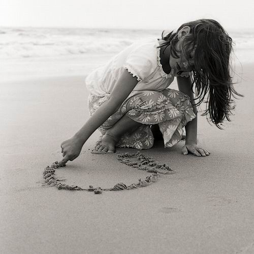

# heart

---

## 评论（7）

**dophingking** · 2005-07-27

急匆匆的来了，又急匆匆地走；  
甩一甩头发，  
我，  
只在情感的荒漠中  
留下  
一个  
“心”字。。。

**airylea** · 2005-07-27

脱不开，一个“纯”

**[andy](http://spaces.msn.com/members/elfix/)** · 2005-07-28

也许有一天我们不再年幼  
也许有一天我们不再年轻  
我们无时无刻不在老去  
我们无时无刻不在失去  
你说,成长究竟是一种进步还是一种退化?

**Michael** · 2005-07-29

用的着那么煽情吗？不就是在地上画了一个窝头吗？

**[angie](http://angie.tecinese.com)** · 2005-07-29

谁说的?明明是个苹果,没看到带柄吗?:))

**ch** · 2005-07-29

此时无声胜有声。。。。。。

**jenniferuk(少爷)** · 2005-08-04

有空时,将我的链接更新一下,谢谢.http://www.sohoxiaobao.com/chinese/bbs/blog.asp?id=15245

