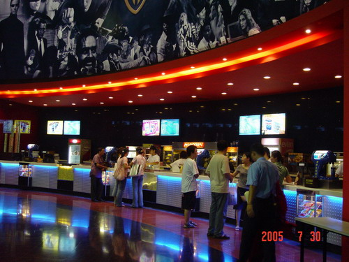
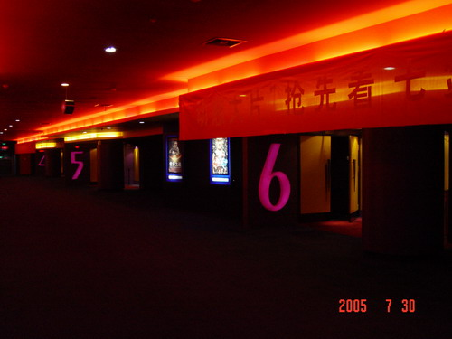
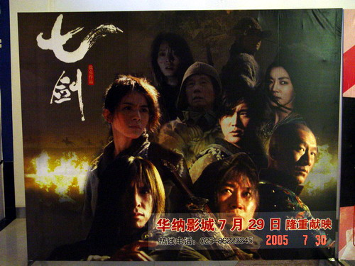
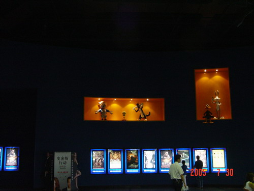

# 周六

   
   
   

---

## 评论（8）

**[Ken](http://spaces.msn.com/members/kenlc/?mkt=zh-cn)** · 2005-07-31

hmm....快乐有价

**[airylea](http://www.airylea.net)** · 2005-08-01

不会是一路“败”下来的吧

**ch** · 2005-08-02

More haste,less speed.

**[Ivan](http://tea.to)** · 2005-08-02

七剑好疯狂，昨天都买不到票。   
  
http://tea.to

**Christina** · 2005-08-02

南京卖到40元一张票,不便宜!

**Michael** · 2005-08-02

好看吗？我还没看过呢...

**Danny** · 2005-08-03

29日零晨去看了七剑首映,感觉还不错,但对白有点搞笑.Christina你最近好吗?

**Ken** · 2005-08-10

主人多日不更新，难得  
呵呵

