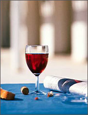
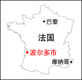

# 葡萄酒

晚上央视新闻频道播出[《**让世界了解你**》](http://www.skyarc.com/wqhg/119G-penglai.htm)的节目，嘉宾是山东[蓬莱](http://www.penglai.gov.cn/)市委书记的刘树琪和法国[**波尔多(Bordeaux**)](http://www.bordeaux.fr/ebx/First)市的市长雅克·瓦拉德，讨论有关葡萄酒和友好城市交流的话题。我们认识的一个法国朋友在波尔多居住多年，姑且对这个城市有些印象。波尔多位于法国西南部，从巴黎乘高速列车出发到达波尔多相当于南京到上海的时间，大约3个小时路程，波尔多是法国第五大城市，是世界葡萄酒之都。波尔多没有大城市那种浮华，它有着独一无二18世纪的建筑遗产和原汁原味的生活艺术。波尔多葡萄酒去年在瑞典、荷兰、芬兰、丹麦、波兰、德国的销量大幅度减少，但与此同时，波尔多葡萄酒在亚洲的越南、中国和泰国的销量则分别增加了77%、44%和22%。波尔多有各个品种和档次的葡萄酒，法国人均每天一瓶葡萄酒，而中国人并不热衷于饮葡萄酒，啤酒的需求量比葡萄酒要大。

 事实上饮葡萄酒对身体有很多益处，1992年科学家在商业葡萄酒中首次发现白藜芦醇，（*白黎芦醇，化学名称为芪三酚，分子式C14H12O3，分子量228.25，产生于葡萄叶表皮和浆果果皮中，是植株对真菌病害感染反应的结果*。）白藜芦醇具有防治冠心病、高血脂症、抗氧化、扫除自由基、抗血栓、抗炎症和抗过敏等作用。另外**对于女性**葡萄酒还有养颜益寿的功效，葡萄酒中含有各种维生素达六七种之多，其中维生素B12能促进红血细胞成熟，有一定的补血作用。葡萄酒的美容效果极佳，坚持早晚用葡萄酒涂抹皮肤，可以使粗糙的皮肤变得光洁而富有弹性。然而国内劣质葡萄酒很多，在河南省西华县有一些葡萄酒厂，他们生产的葡萄酒标着新疆、通化、烟台生产，连牌子、厂名、厂址都是别人的。这些葡萄酒平均每瓶的价格在一块五毛钱左右，最低的每瓶不到一块钱。所以购买葡萄酒时一定要仔细小心。

节目末了刘书记一边抖动着左腿一边对雅克·瓦拉德市长说“......让蓬莱成为中国的波尔多，让波尔多成为法国的蓬莱......”这话连说两遍，简直是胡话连篇！法国的葡萄酒文化是伴随着法国的历史与文明成长和发展起来的。葡萄酒文化已渗透进法国人的宗教、政治、文化、艺术及生活的各个层面，与人民的生活息息相关。作为世界政治、经济与文化大国，法国葡萄酒文化也影响着全世界人的生活方式与文化情趣。我去过蓬莱，对那里没什么好印象，也许几十年后的蓬莱在葡萄酒生产技术及酒的销售与普及上有可能和现在的波尔多相提并论，但城市文化及葡萄酒文化几十年后估计也危险！你就是你，蓬莱就是蓬莱，做好自己最重要！

---

## 评论（4）

**avril** · 2005-08-15

唉，这个刘～怎么跟村长一样，说话还抖腿？

**[annie](http://spaces.msn.com/members/anniechen77/)** · 2005-08-15

很久没来了,看到版主还是一如既往,佩服.  
我的BLOG里加你了,有空会常来.

**anxd** · 2005-08-16

中国的葡萄酒业充斥着铺天盖地的假货。即使是少数几个大厂也明目张胆地作假。那些所谓的年份酒，绝大部分都是假的。要么是兑水的，要么是从国外进口的廉价葡萄汁酿造的。中国造酒业表面上的风光，是建立在自欺欺人和欺骗消费者的基础上的。喜欢葡萄酒的朋友，还是喝进口的吧，不一定很贵的。澳洲和新西兰都有不错的红酒。如果有机会的话，可以试试加拿大的葡萄酒（不仅仅是冰酒哦），风味独特。

**淡蓝色** · 2005-08-16

生日快乐！生活的率性而美丽！

