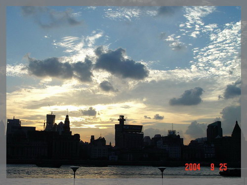

# 落日低悬

我对一位异性印象好可能会是因为比较崇拜他,但是很快这种感觉就会消失的，因为没有一个人是真正的偶像。”*-张静初*

  
*拍摄于上海浦东外滩*

从家出来，撞见对面邻居的奶奶和她的孙子，我一脸茫然地按了电梯，我的母亲伸出脑袋热情的和对方打招呼，在母亲的促动下我也寒暄了几句...改变环境其实和改变自己一样困难，顺其自然实在是无奈之举。想想我们的人生早有天定，除非遭遇人生突变或是具备非凡的勇气。只是这定局的人生，浸泡在弥漫的八卦中，有许多crazy，有许多unimaginable许多的depressed的时候~~

---

## 评论（5）

**EverKiss** · 2005-08-25

我相信，她是那些影子中唯一真实存在的一个。  
......  
我在等她，但很清楚她不会来。所以，我留下了一支玫瑰。  
葡萄总是甜的，无论尝到与否。  
0/10到了明天早晨又会是10/10，A PERFECT MORNING.  
otherwise...

**[Ken](http://spaces.msn.com/members/kenlc/)** · 2005-08-25

人是群居动物，或许正因如此，所以有时候不得不放弃一点自我，对某些东西妥协吧……

**Hanmei** · 2005-08-25

想念南京啊~~

**anxd** · 2005-08-26

人是会改变的，主动或者被动。就好像跟对门的老太太/小孙子打招呼，当你为人母，带着自己的孩子，我想你也会主动拉孩子跟别人打招呼的。A circle of life. 不是吗。

**Kaifry** · 2005-08-28

人与人也是不一样的...

