# 非想非非想

> 人若没有失落感，就能生活得平静。  
> 我有些不安，不能就这么坐着，得去做点什么。

  
下午和姐姐姐夫一起去观看外甥女最后一次军训。在树人国际学校对面的南京政治学院的校园里。大约13个班，呈方块儿列队等候检阅，远远看见调皮的学生在队伍里面夸张着扭动身体摆动双臂，想起别人的小时侯或许也是如此顽皮而可爱的唱着打鸭归来被罚站的情形？依依没了平时的娇嗲扭捏，她的表情不容我们忽视她正在做的那件事情，是多么的神圣和庄严。这些刚刚升入初中的孩子表情平静，神态自如，围观的家长象是一大群FANS，手捧各种数码非数码摄像产品，追随迷彩服们左挪右移，有位年轻的妈妈匍匐着边拍照边情不自禁地说道：“太好了，简直太好了。”不时发出一串刻意压制住的笑声，这是FANS中比较癫狂的一种。
> 生活使许多人迷失方向，在不可知的地方迷失自我。我不厌其烦地想着自己，也想着他。一个善良有辨别是非能力的人，应该是可爱的。无法承诺什么，就以各自喜欢的姿势坐着，时间可以拉长也能够缩短。都市的嘈杂污染及不守交通规则的人群，使人不能从容的找到一片安静的空地，我常常在每个红绿灯的十字路口不知所措，怅然若失。生活中充斥着各种变数，也有许多不如意之处，有时阳光和花朵也不能使人摆脱无动于衷的境地，我有种被刺穿的感觉......快乐独立于现实之外，象一部节奏缓慢的文艺片，女人开始变得象婴儿一样。

  
晚上的紫金大戏院内部预演《妈祖》舞剧。听朋友说这部舞剧1999年编排，先后到香港澳门巡演，这次是停演四年之后复演，9月初受邀到厦门福建演出，如果顺利可能还会去台湾。前线歌舞团当时想找题材编排一部舞剧，想到了妈祖。领舞是从广州请来的阎红霞，和我同年生，刚刚生过孩子。部队文艺团体编排了这样一部宣扬迷信的舞剧，似乎又有些不妥，于是有关舞剧的宣传稍许薄弱了。据说《妈祖》所有的服装是请上海的一个舞台服装设计公司设计的，主设计师手下清一色的男士，一套难民服的费用就是几百元。演出结束后等coffin换了服装一起吃宵夜，金顺烧鸡公。今天过到此可算是完美的结束？

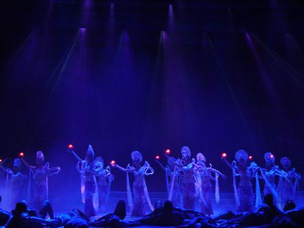   
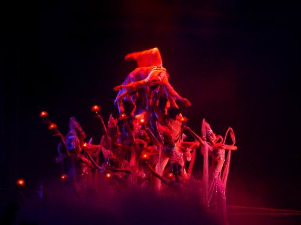   
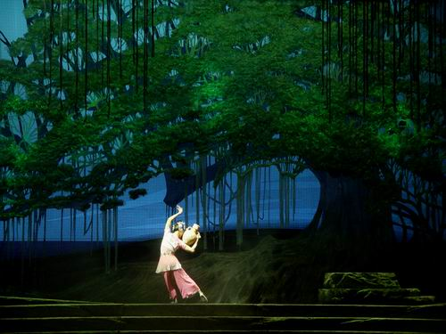   
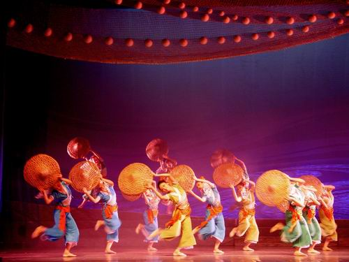   
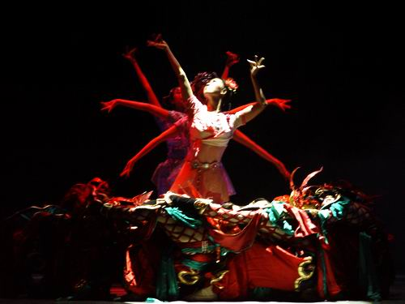   
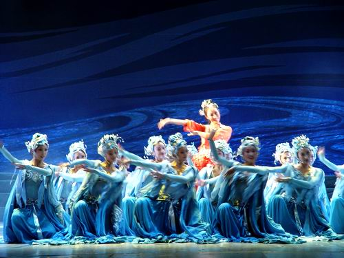   
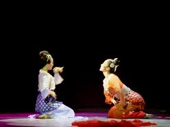 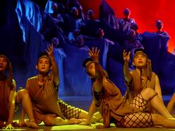   
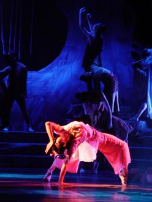 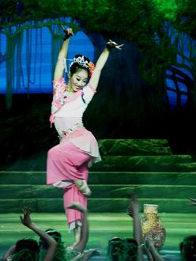   
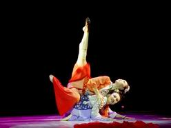 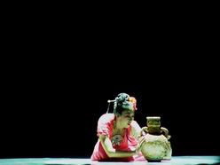   
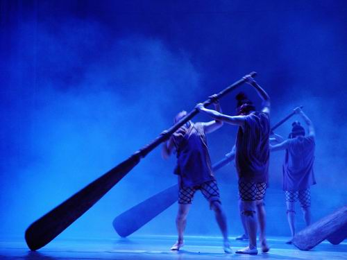   
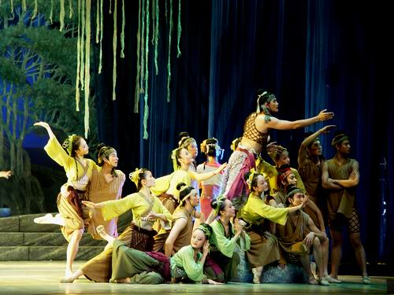

---

## 评论（2）

**EverKiss** · 2005-08-28

迷失自我的过程是甜蜜,结果是幸福,至少在精神上.  
......  
看着自己迷失,失落是一种美.  
或许想得太多.  
...温暖,无奈.

**coffin** · 2005-08-29

照片拍的很漂亮可以做团里的剧照了.呵呵

