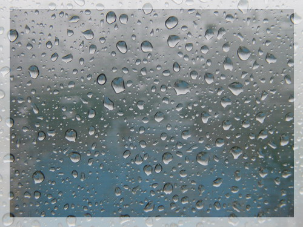

# 遗落的季节

5:40分又醒了。

  
*shot by Christina  
@5:55 Sep-12-2005*

想起《陪我失眠》那首歌，出于好奇想看看早晨的MSN上都有谁在...一如歌词中的便利店...4个人在线，一个还算熟悉，另外三个不知道是谁。有个ID显示着：play it,play “as time goes by”......

天空早已不是夏日那种疯狂的颜色，在青灰的天色中一声倦倦的叹息，随细雨打在窗户上，却成了淡淡的和风。下着雨的窗前，现实世界离我那么远，宁静而自由。不禁低叹：有什么是我们可以把握的？要以怎样的疯狂、怎样的速度才能彼此在这大千世界上并驾齐驱？...徘徊在心之栅栏外，也许应该把心情藏起来，这便是最好的珍惜。

成熟是错误的积累...从另一个角度看也是美丽的刹那！

---

## 评论（3）

**only** · 2005-09-12

拥有,在秋季...

**anxd** · 2005-09-13

下雨天... http://music.13139.com/music/song/new1/475/6.wma

**Kaifry** · 2005-09-14

终于下雨了...

