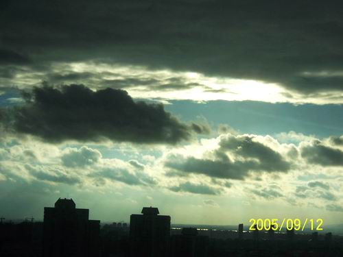
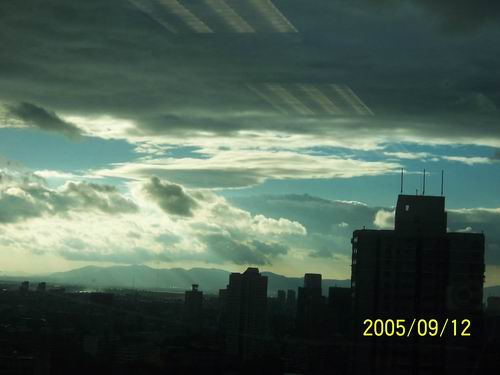

# 南京今天的傍晚

借同事相机拍摄的,不拍太过分了~~  
   
   

---

## 评论（8）

**only** · 2005-09-13

抑郁的调子……

**jiajialing** · 2005-09-13

黑云压城。。。。。。

**[寒媚](http://spaces.msn.com/members/tyhm/)** · 2005-09-13

俺们南京好漂亮哈~~好想念！  
这里整日蓝天白云，我都审美疲劳了~~

**ch** · 2005-09-14

一切都会变化。。。。。。

**Jonathan** · 2005-09-14

quite special and wish i could be there.

**[yanhuasanyue](http://spaces.msn.com/members/yanhuasanyue1980/)** · 2005-09-15

偶然，来到这里，像进了一个神秘花园，让人惊艳！

**[TalkyBird](http://daydream.com.cn)** · 2005-09-15

12号下午的景色好棒！空气透亮极了，尘埃全都被吹跑，能看到非常非常远的地方。从来没有过的感觉。可惜下班时没带相机。  
  
最后一张照片里，云上的4道光柱不知道是从哪儿来的，我下班时看到了两道~~

**[马尔代夫的小偷](http://spaces.msn.com/members/fortblk/)** · 2005-09-15

boh.boh..从别人的推荐中过来，不许此行，le belle foto e il nome 'italiano' forse hai tempo libero benvnuto a me

