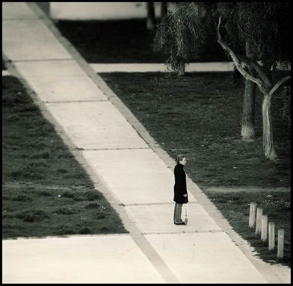

# What women want

> 偏偏是个清闲的早晨，看到Stephen的E-MAIL回复，脑海里涌现偶像Mel Gibson几年前导演的一部电影[《What women want 》](http://ent.sina.com.cn/film/foreign/file/WhatWomenWant.html)，若全世界男人都在思考这个问题，那真是女人的荣幸了。

  

Stephen Ask:  
既然是睿智的美人，想请教：女人到底要什么？  
满足安全感实在，或者被人吹捧享受

这个问题比工作更让人困惑，偏偏最近忙得很，懒得想这样费解的问题，何况想也是白搭。  
做不到“跳出三界外，不在五行中”，如何能想这样的问题？  
是女人，又能徘徊在心之栅栏外想必能帮到我的

Christina Reply:  
女人要的是：自我，爱，安全感，空间，快乐....  
男人要什么？

Stephen Reply:  
有点眼花，把“自我，爱”看成了“自爱”，心想：没错，没错女人都够自爱的。还记得有个女生说她天天逛街，花光钱买衣服，就是因为“女为乐己者容”。“自我”也没错，做个party animal，宁愿晚上睡办公室？

说起来这个问题有点唐突，请见谅。也亏得给出5个答案，让我不好意思。如果我选一个，安全感会放在第一，差不多是信任的意思。这个世界可以没有爱，但是没有信任，一切都是空中楼阁。

男人需要什么，女人一定知道，否则就不是女人。  
所以问题成了男人还需要什么？  
我的答案是：勇敢，无他。  
但是有时候自己的想法不敢跟身边人说，所以要写下来，因为自己也不勇敢。

预祝中秋快乐

---

## 评论（12）

**[横戈](http://hengge.blogbus.com)** · 2005-09-17

看标题我忽然想起来的是黄真真的那两部片子~~~

**anxd** · 2005-09-17

不大认同“这个世界可以没有爱，但是没有信任，一切都空中楼阁”。如果连爱都没有了，要来信任何用！干脆死了算了。当然，这个“爱”是包括了爱自己。  
没有爱就没有信任。爱会产生信任，信任却未必能带来爱。

**xx** · 2005-09-17

男人女人都一样，都想要安全感，也都喜欢被吹捧

**[liangzi](http://lan-yu.blogms.com)** · 2005-09-19

于信任中不一定会产生爱，于爱中却是一定会有信任的！  
此中滋味，唯有自己体味！

**[liangzi](http://lan-yu.blogms.com)** · 2005-09-19

忘了：祝福四面八方、天涯海角的朋友们中秋快乐！天天快乐！

**andy** · 2005-09-19

你的日志终于好了,中秋快乐

**路人甲** · 2005-09-19

女人要的是：自我，爱，安全感，空间，快乐....-------听起来有点自私。

**Jonathan** · 2005-09-19

Have watched the movie before, it's good.

**[花夫子](http://blog.donews.com/siacgem)** · 2005-09-20

希望越大，失望越大。  
当一个人用二十年的时间揭出这个答案时，你会想什么？

**[Marie](http://mariewong.blogone.net)** · 2005-09-21

没有人是天生勇敢的，只要抱有尝试“勇敢”的心和冲动，距离勇敢就只有一步之遥了。

**Sherry** · 2005-09-21

男人需要什么，女人一定知道，否则就不是女人？  
搞清楚别人需要什么比搞清楚自己需要什么还难哎。  
尤其是男人，他们对自己需要什么还未必清楚呢。

**coco** · 2005-09-29

Christina,一直很关注你的日志，写的很棒。  
我认同你的观点。女人需要的是美满。

