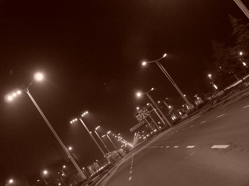
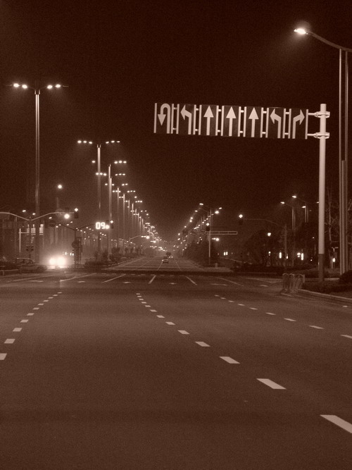

# @无声无息

挂上电话便睡着了，最过分的是母亲没有喊醒我，依稀知道她给我盖上棉毯，我却怎么也睁不开眼睛...23:35分忽然醒来，安静的夜，只听得见自己的呼吸，起身走到书房窗前望昨夜的街景，一片茫然...此时此刻，我有驾驶的冲动......想找寻一个城市的角落，一个深深的角落，把自己藏起来，藏得连自己也找不到。

@1:55返回  
走出那个家门比我想象的艰难......  
光着脚走到门口，原来这门也有咿呀的声响，用了大约5分钟才轻轻推开门，在电梯里穿上鞋。  
有关隐私或许一个看车库的老人比谁都清楚，他知道你何时出门何时返回，今天穿了什么衣服带着什么表情...一切的细节都逃不出他的眼睛。从他眼前走过总好过母亲的唠叨。河西的那条路上没什么车，打开双跳灯便堂而皇之的站在路中间拍摄片子，仅为寻找我要的那份感觉。感觉这东西有时还真玄，无声无息的，让人烦躁！

   
   
   
   
   
夜晚比白昼更需要方向感...

[more pix here…...](http://spaces.msn.com/members/tecinese/PersonalSpace.aspx?_c11_PhotoAlbum_spaHandler=TWljcm9zb2Z0LlNwYWNlcy5XZWIuUGFydHMuUGhvdG9BbGJ1bS5GdWxsTW9kZUNvbnRyb2xsZXI%24&_c11_PhotoAlbum_spaFolderID=cns!1ponMgbhosmM4yHUnztdPhPQ!452&_c=PhotoAlbum)

---

## 评论（11）

**Jonathan** · 2005-09-23

The brandnew view of your blog is refreshing.

**only** · 2005-09-23

one

**xx** · 2005-09-23

感觉这车就像是你的家，你的孩子，常常在那里寻找慰藉。

**Mick** · 2005-09-24

新的BLOG有一点冷的感觉...

**anxd** · 2005-09-24

夜的心。Tell me that is human nature...

**[只说](http://sayonly.com)** · 2005-09-24

改版了哦。

**[Nio](http://www.infor96.com/~nio)** · 2005-09-24

怎么在右边倒数第二个竟然是左拐的方向标志，怪异……

**Kaifry** · 2005-09-24

以前的风格还是不错的，还有没有theme?

**ANJIE** · 2005-09-24

晚上看起来这么冷清，有点吓嘘嘘，小心哦：）

**[greenroot](http://spaces.msn.com/members/dreamofgreenroot/)** · 2005-09-25

很舒服，冷！所以两种感觉掺合在一起就是饮凉茶的感觉，自然这很好！

**ch** · 2005-09-27

身不由己。。。。。。

