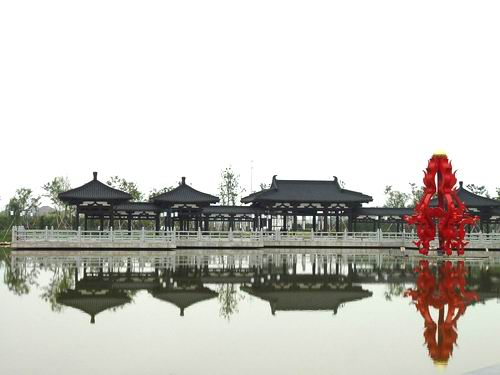
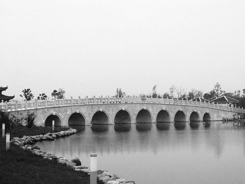
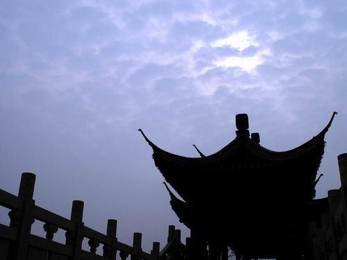
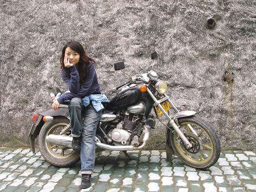

# 宜兴自驾行

岁月会让皮肤起皱，失去对生活的热情会让灵魂起皱。

   
   
   
   

---

## 评论（9）

**[LOMO@chengdu](http://www.i170.com/user/silicone)** · 2005-11-02

very good blog site, can we make a friends link??

**[wallace](http://spaces.msn.com/members/living-and-giving/)** · 2005-11-02

10年前，我有一辆一样的摩托。

**[airylea](http://www.airylea.net)** · 2005-11-03

又见病隙随笔 ：）

**Mick** · 2005-11-03

开摩托去的?

**Danny** · 2005-11-03

不知道的还以为你开摩托去的

**denny** · 2005-11-03

照片拍的很不错啊

**Mick** · 2005-11-04

楼主的精典POSE :)

**[Rocky](http://irocky.cn)** · 2005-11-06

惊艳，乍一见以为是杂志封面:P

**[gabyu](http://www.gabyu.com)** · 2005-11-06

your blog (and you) looks very beautiful, good stuff

