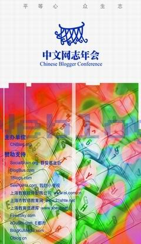
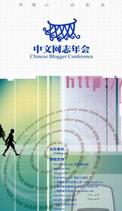

# Chinese Blogger Conference

在[Chinese Blogger Conference](http://blog.cnblog.org/bloggercon/)召开之前，这里介绍一下[blogger·china’s photos](http://www.flickr.com/photos/nihaoblog/page14/)  ，实在是佩服做这个工作的人，能把那么多写BLOG的人照片收集起来，精神精力都是无与伦比的...认识一些未见其人先睹其态的面孔，有些可爱有些风雅有些......先熟悉一下他们的照片，如能在会场相遇，会是怎样的开始？我关注的BLOG有限，最近因为工作和其他事情忙碌，更无暇经常去看更新。我对网聚有莫名的烦感，但对这次大会却有些许期待。从2002年4月开始写BLOG至今，也许就是热情支持着的。

此次收到大会邀请有些意外，先前听说大多与会者都有某某公司机构的头衔，人数不能超过199人（法规上：200人属非法集会）。

 

确认参会的受邀特色Blogger：  
广州 [http://www.postshow.net](http://www.postshow.net/)   
广州 [http://in.comengo.net](http://in.comengo.net/)  
北京 [http://blog.wespoke.com](http://blog.wespoke.com/)  
北京 [http://www.chedong.com](http://www.chedong.com/)  
北京 [http://www.topku.com](http://www.topku.com/)  
深圳 [http://www.zuola.com/weblog](http://www.zuola.com/weblog/)  
北京 [http://doubleaf.com](http://doubleaf.com/)  
北京 [http://herock.net](http://herock.com/)  
香港 [http://www.azuremedia.net/tech/chi](http://www.azuremedia.net/tech/chi/)  
重庆 <http://woooh.com/>  
台北 [http://blog.schee.info](http://blog.schee.info/)  
台北 [http://heterotopias.org](http://heterotopias.org/)  
香港 [http://sidekick.mocasting.com](http://sidekick.mocasting.com/)  
香港 [http://blog.hoiking.org](http://blog.hoiking.org/)  
北京 [http://www.1kg.cn](http://www.1kg.cn/)  
上海 [http://www.wangjianshuo.com](http://www.wangjianshuo.com/)  
福州 <http://www.icebin.net/>  
柳州 [http://www.kenlee.cn](http://www.kenlee.cn/)  
南京 <http://christina.tecinese.com/>  
上海 <http://slashdotcn.org/>

会议地址：上海巨鹿路915号巨鹿大厦二楼  
   

cnbloggercon-badge-samples  

[cnbloggercon-badge-participant- mini](http://www.flickr.com/photos/yining/56312659/)

年会日程安排表

11月5日，第一天 上午  
8：00—9：00 签到  
9：10-9：20 开幕词  
9：20-10：20 第一场讲演，isaac  
10：20-10：30 休息  
10：30-11：30 第一场对话与讨论：rebecca主持，全球化与blogger

第一天 中午  
12：00-13：40 午餐（会）

第一天 下午  
14：00-15：00 第二场讲演，XiuLi，主题：blog与教育  
15：00-15：10 休息  
15：10-16：10 第二场对话与讨论：hopesome主持，podcasting主题  
16：10-17：10 第三场讲演，Wenxin，主题：weblog技术

第一天 晚上  
夜游黄浦江（自愿参与方式）

11月6日，第二天 上午  
9：00-10：00 第四场讲演，Horse讲演，主题：Web2.0  
10：00-10：10 休息  
10：10-11：10 第五场讲演，吕欣欣，主题：rss  
11：10-11：40 特色blogger推介

12：00-13：40 午餐会  
14：00-15：00 第六场讲演，SayOnly，主题：blog与媒体  
15：00-15：10 休息  
15：10-16：10 第三场对话与讨论：Jack主持，tags/folksonomy主题  
16：10-16：30 闭幕词

---

## 评论（2）

**anxd** · 2005-11-08

“法规上：200人属非法集会”此话怎讲？

**anxd** · 2005-11-08

从照片上看，那个楼倒是个适合“非法集会”的好去处哩。

