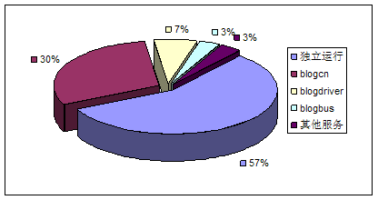

# 博客大奖赛

因为忙碌而无暇写BLOG，因为忙碌而欠下许多想做而未做的事情。整个上午有许多琐碎繁杂的工作，心里想着，行为上懒惰着，想推到下午再积极的开始。在[**Sunset House**](http://sunsethouse.apro-g.com/archives/001028.html#comments) 上看到一篇有关博客大赛的文章，这才知道又有什么人组织了评比，顿觉无趣。这里转载一下，以示对这个世界我还有些许的关心。

上个月开始就陆续有不同背景、几个版本的博客大奖赛粉墨登场。最先看到的是BOKEE的[“第二届”博客大赛](http://dasai.bokee.com/newscontent.php?id=21)，不知道哪位仁兄把俺推荐上去，示众了[整整一个月](http://dasai.bokee.com/one.php?id=59)却只有区区两票，而第一名已经有[五千多票](http://dasai.bokee.com/tppm.php?type=22)鸟，所以就不号召大家给俺投票了——咱即使乘坐神舟六号都追不上啊。不过当俺看到[中国茶](http://www.tecinese.com/)10票，[KESO](http://www.donews.net/keso)同学8票，车东同学2票，顿时明白了方博这次搞的比赛原来是闹着玩的，要不然为啥FRJJ的“官方博客”也才只有2票捏？

另外热心搞博客大奖赛的还有新浪和搜狐，相比于前者小气地只允许自己的用户参与比赛，搜狐这一次表现得要更加性感，所以[首届全球中文博客大奖赛](http://it.sohu.com/s2005/blogdajiang.shtml)起手就高出[首届中国博客大赛](http://tech.sina.com.cn/focus/blog_05/index.shtml)半个顶天力地的头——下嘴唇在地上，上嘴唇在天上……

回想起[[2003年度十佳Blog评选]](http://blog.cnblog.org/archives/2004/02/eioeiaeaeeeenbl.html)，当时唱主角的还是独立BLOG，[OWEN](http://blog.timetide.net/archives/2004/02/14/20040214020313.php)同学按排名前30的数据统计Blog分布情况依次为：独立运行（57%），Blogcn，Blogdriver，Blogbus，其他服务。现在，在草根之上，盛开了好多好多提供BLOG服务的WEB 2.0之花啊。

老实说，俺搞不清楚博客大奖赛到底比的是什么，总不能比大小（BSP的，哈哈）吧？虽然日落酒馆已通过海选并进入到PK阶段，但没有心爱的[王老板](http://wanderlust.blogchina.com/)、漂亮的[中国茶](http://www.tecinese.com/)、温柔的[蜂窝煤](http://fengwomei.51.net/)和知性的[MOKO说话](http://moko.blogone.net/)，这[最佳人气博客](http://it.sohu.com/s2005/9171/s240612414.shtml)到底还是让人心生遗憾。
