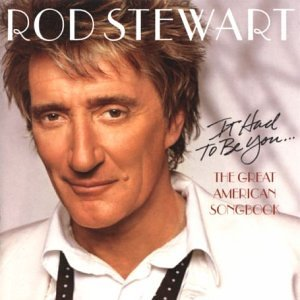

# For The First Time

艺人名称： 洛史都华 – ROD STEWART  
中文专辑名称：爱在今夜 ﹣16首超级情歌精选  
英文专辑名称：IF WE FALL IN LOVE TONIGHT

 因着嗓音沙哑且性感而树立个人风格的英籍巨星Rod Stewart，早在身为“Jeff Beck Group”成员时期，即已享有歌声非凡的赞誉。自六○年代中期起，经过“Five Dimensions”、“Hoochie Coochie”、“Shotgun Express”、“Jeff Beck Group”、“Small Faces”(后更名为“Faces”)等乐团的琢磨历练之后，Rod终于在七○年代可以独当一面，展开一生灿斐然的歌唱生涯。

洛·史都华（Rod Stewart）于1945年1月10日出生于伦敦，本名 Roderick David Stewart。豆沙般的嗓音，桀骜不驯的舞台形象，源源不断的创作灵感构成了摇滚巨星Rod Stewart。他被许多人称为摇滚公鸡.你有可能并不熟悉这个名字,但是你一定听过他演唱的这些歌曲:Sailing,Have I told you lately,For The First Time等等(更多见摇滚公鸡史都华穿透人心之作...)

Rod Stewart是个优异的歌者，不时也扮演作曲的感情故事，可以是柔情无限的抒情乐章，可以是大胆狂放的摇滚旋律，可以是温润清雅的民谣小品，也可以是带有一抹黑人音乐姿采的慢版佳构，于是，在这张萃选出他历年来16首抒情作品的精选辑里，所有属于Rod Stewart特有的知性、温柔、深情与感动，于此汨汨而泻，成为一种值得记录与珍藏的回忆：

76年全美冠军经典Tonight s The Night的挑情撩人；  
深获本地歌迷喜爱的感伤作I Don t Want To Talk About It；  
93年英/美Top 5 Unplugged作品Have I Told You Lately的录音室混音版；  
77年英Top 3、美国Top 4的爱情宣言You re In My Heart；  
77年重释Cat Stevens之作First Cut Is The Deepest，蝉联英国四周冠军；  
曾于 76年登上英国榜季军的Sailing，已成英国皇家海军的非官方军歌；  
90年翻唱Tom Waits的Downtown Train，承载着无尽的哀愁驶向美国榜Top 3；  
另一首演绎自Tom Waits作品的Tom Traubert s Blues唱尽人事沧桑；  
94年与Bryan Adams、Sting破天荒携手为电影“豪情三剑客”高歌颂扬爱情，攀登美国榜榜首；

另外，Rod选择两首名作予以重唱，即Dan Hill 77年Top 3抒情名曲Sometimes When We Touch与Leo Sayer 77年冠军情诗When I Need You，而两首开幕曲If We Fall In Love Tonight和For The First Time则是全新创作。这般多情的Rod Stewart，听来可是非常的抒情。

[For The First Time.mp3](http://blog.chaoke.com.cn/uploadfile/20051013203939695.mp3)

Are those your eyes  
Is that your smile  
I’ve been looking at you forever  
yet I never saw you before  
Are these your hands holding mine  
Now I wonder how I could have been so blind  
And for the first time I am looking in your eyes  
For the first time I’m seeing who you are  
I can’t believe how much I see   
when you’re looking back at me  
now I understand what love is, love is   
for the first time

Can this be real  
Can this be true  
Am I the person I was this morning   
and are you the same you   
It’s all so strange  
How can it be  
All along this love was right in front of me  
And for the first time I am looking in your eyes  
For the first time I’m seeing who you are  
I can’t believe how much I see   
when you’re looking back at me  
now I understand what love is, love is   
for the first time

Such a long time ago I had given up   
on finding this emotion ever again  
But you’re here with me now  
Yes I found you somehow   
and I’ve never been so sure   
And for the first time I am looking in your eyes   
For the first time I’m seeing who you are  
Can’t believe how much I see  
when you’re looking back at me  
Now I understand what love is, love is   
for the first time  
For the first time

---

## 评论（6）

**[dophingking](http://spaces.msn.com/members/eeiivv/)** · 2005-11-16

这首歌不错  
。。。

**Kaifry** · 2005-11-16

终于能够访问了...

**maji** · 2005-11-16

你好.我是时尚先生的编辑.正在做一个关于web2.0的封面专集.想要采访你.Keso介绍我找你的.不过他也没你的联系方式.请联系我.急,感谢.

**ANJIE** · 2005-11-16

一直很喜欢，现在年轻人可能不知道这些摇滚巨星，但洛德那沙哑的歌喉将一直会在记忆中

**[rainbow](http://silicone.i170.cn)** · 2005-11-16

我咋听出了点JAZZ的味道来.

**Michael** · 2005-11-18

I really love this song! Very soft! Enjoy the melody! reminds me of some old things...

