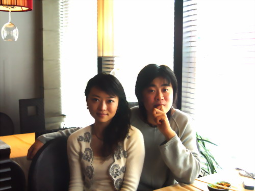
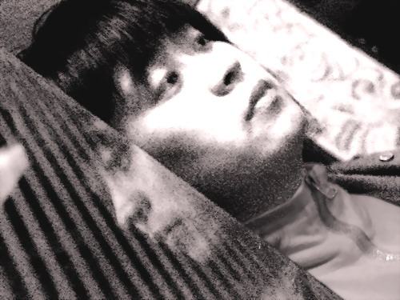
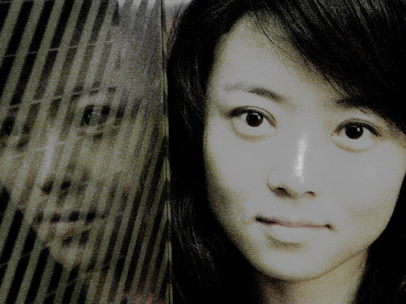

# 11年记忆的影：虎子

接到虎子的电话，时间一下子跳到11年前，一个纤瘦摸样的少年浮现在我的脑海中。  
时间仿佛出现断裂，记忆变得不真实起来。好象没有经过这11年，好象还是昨日...我们青春年少的笑与惑。

在进香河附近绕了两个圈才找到他住的那家酒店，电话里的声音依稀还带着过去所熟悉的口音，当他戴着宽大的墨镜从酒店大厅里走出来时，我一眼就认出来是他、是虎子，体型比过去宽厚，1.84M的身高，皱眉的习惯一点没变，即使笑起来有时也会皱着眉。他的新发型、瑜珈式的衣裤、宽了的身体等等一切形象把少年的他包裹其中，多么熟悉的人啊！

对过去记忆深刻的片段，是我经常忘记拿宿舍钥匙，他会从气窗爬上去，探下大半个身体伸手从里面把门打开，每每帮忙乐此不疲。他会在周末带好吃的椰蓉面包给我，记忆中的他总是很活跃地在我面前说笑，微皱着他的眉。那时，我戴着一顶黑色的棒球帽，他说好看说第一次见到有人这么打扮，问我那顶帽子是否还在？他还记得我脸上的雀斑，记得那时的我喜欢问“为什么？然后呢？”......谈起三个让他记忆犹新的场景......

我们如此自然的交谈，仿佛没有11年的距离，从少年到成年人，谈话的节奏和感受如此熟悉，有亲人的温暖。他告诉我他写的第一首歌就是写我的，11年过去仍然能清楚地记得歌词内容：“闭上眼睛静静的怀疑过去...没有错误，没有没有遗憾...”据说后来他爱的女孩儿性格和我差不多，外表文静内心狂野，性格独立同时又很粘。当年他给我的印象是：对我很好，总是帮我做这做那的，觉得这个人怎么轻易就对别人那么好呢？他说你知道吗每次那么做之前我都要斗争十几遍，才会伸手帮你拿行李什么的，对你的感受就象[《密西西里的美丽传说》](http://www.loverspace.com/lianwu/721.html)里13岁男孩对玛莲娜的那种经历，13岁的他骑着单车，在小镇的各个角落穿梭，如影随形地跟踪，窥视她的生活，那个被荷尔蒙掩没的少年。恍悟自己的不经意却成了他人记忆中的深刻。令人感动的不是别的，是那个年纪。那个时刻被感动同时也感动别人的年纪。那个时候的甜蜜和烦恼，都是在今后一生最珍贵的收藏。

虎子现在签约德国一家电视公司，每月基本上都要去欧洲参加音乐演出等活动。在北京一家马术俱乐部里买了套480平米的别墅，养了四条狗：可卡、吉娃娃、德国牧羊犬和苏格兰牧羊犬。有个照顾他们的保姆，成立了7、8个人的音乐制作室，工作地点就在那套别墅里。出了四张专辑，我手上有他送的其中两张，期待下周他能带给我另外两张。在我寻找合成乐的阶段虎子的音乐正好满足了我，他制作的氛围音乐很符合我的需求。用餐时才知道他不吃荤只吃素，因为他加入了新基督教，这种教与宗教不同，仅以聚会形式存在，中国俗语“酒肉穿肠过，佛祖心中留”大致能描述其新基督教的概念一二。

我们为今天见到的彼此感到欣慰，因为我们都确定对方的状态是积极的，我们都在努力的生活。

   
**少年的虎子**

[虎子简介](http://www.modernsky.com/bands/huzi/huzi_index.htm)：

1978年出生的我6岁开始学习舞蹈，13岁参军，在部队文工团当了一名舞蹈演员。如果我不是一个AB型血的双鱼座人，或许我可以做一个很好的舞蹈演员，或者我会从事一辈子和舞蹈相关的工作，可是我这种人的性格当中充满了矛盾，在部队期间一次偶然的机会听到了Cocteau Twins摇滚乐的，于是开始每天十几个小时地苦练吉他，为了逃避舞蹈排练，甚至用开水将自己的脚烫伤......

专辑简介：[《口痴》](http://www1.cei.gov.cn/serve/index/showdoc.asp?Color=Ten&blockcode=wnyybd&filename=200409271926)的方向不是东行的美洲底特律派系，恰恰相反，是背道而驰的西方欧陆。借助于德国的“杂音”派的思想，解决Minimal音乐在中国的生存。简单的说来，就是《口痴》从核心上还是延续着[《叛客》](http://www.xk99.com/singer.htm?singer_id=2491)去繁求简的艺术概念，力求在IDM的空间中使外观朴素的Minimal(简约)概念在国内生根。一种痴心不改、义无返顾的举动。在关注国际电子音乐舞台发展的潮流时，虎子还诉求于整体趋势中的根源路线，直白的说就是“落叶归根”，借助于非洲的Dub音乐深化主题。这种手段几乎是和站在国际电子乐界潮流浪尖上的Pole与其同僚的做法是如此惊人的巧合。当然，我们可以更自豪的说，这并非某种意义上的巧合。而是，我们真的看到了国内真的有个“把脉”精准的“郎中”。[（试听点击）](http://www.520music.com/MusicList/520music.com_3894.htm)

**一、11年后的[**虎子**](http://www.modernsky.com/bands/huzi/huzi_index.htm)**  

**二、与虎子在1912泰国餐厅**  
他在我身后再不是11年前弱不经风的少年。

**三、与虎子在“悠仙美地”茶餐厅**  
很喜欢合影里我们的表情，为这张片子编辑出这种恍惚的曲线、失真的色彩，两个人的神态使我产生一种酸楚感，没有过程就那么长大了，如两个相依为命成长起来的姐弟，不可触碰的年华沉淀在虚恍的光影中。

---

## 评论（9）

**topku** · 2005-11-16

很游离恍惚的感觉，跟我目前回广州的心情是一样的

**anxd** · 2005-11-17

想起了马尔科斯的《百年孤独》开篇句“我已经老了”...

**[Kaifry](http://www.tecinese.com/?p=571)** · 2005-11-17

小伙子年轻有为...

**dz** · 2005-11-18

呵，好看，有以前的照片更好。。

**citycorner** · 2005-11-21

时间总是过的这么快,不经意间,我们的青春就流走了

**Sherry** · 2005-11-23

这小哥挺酷，没听你说起过他么。

**[郑六](http://www.tecinese.com/?p)** · 2005-11-23

呵呵，不错

**[corlin](http://cybercorlin.net/corlin)** · 2005-11-29

不错，和新老朋友保持联系，常常打打电话聚聚会，很惬意。）

**kaiser** · 2005-12-27

很好的照片,全部拿出来好么????????  
  
期待中

